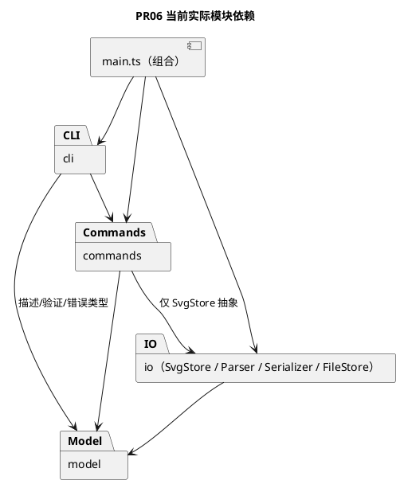
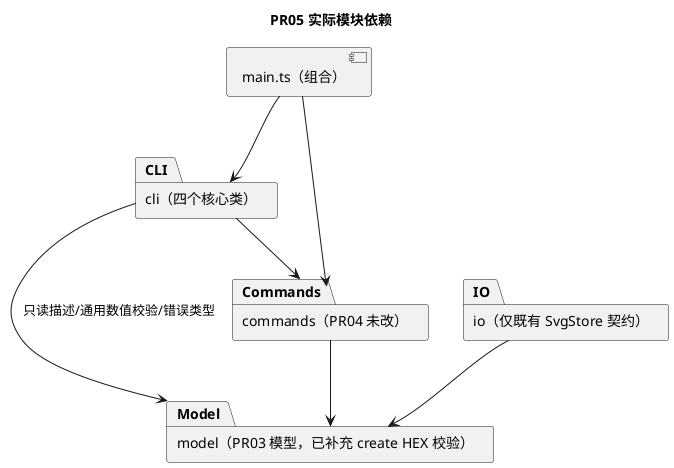
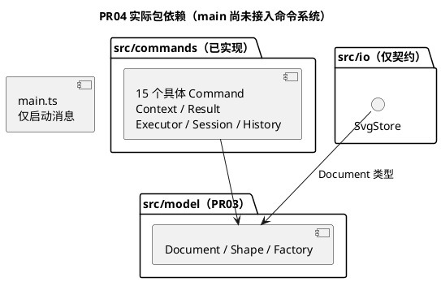
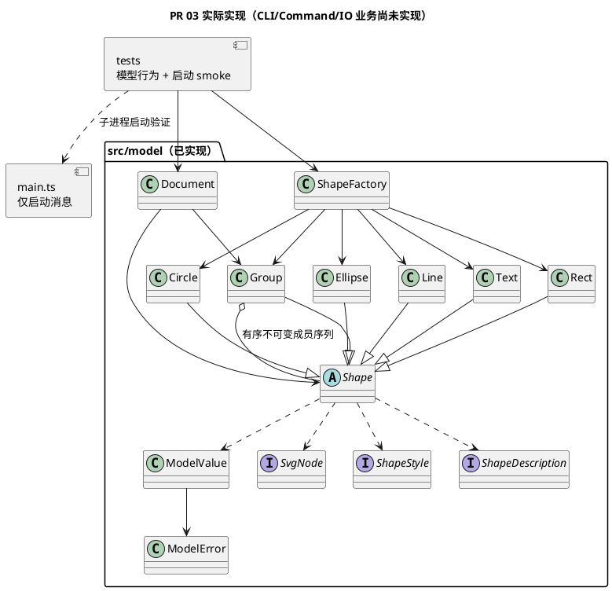
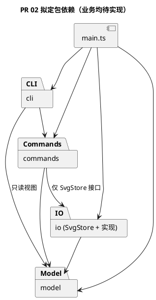
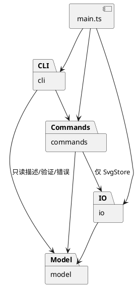

# Lab1 Phase 1 — 架构设计与开发过程报告

> 本文件是课程要求的交付文档，实际仓库路径必须为 **`doc/README.md`**。`doc/requirements/phase_cli_1.md` 仅保存原始需求。本文由开发过程中的 Codex 增量维护，最终内容需由学生审查确认。

## 1. 架构方案

### PR07 当前状态（2026-10-31）

基线为 `97de984`（PR06 合并），当前分支 `test/QA-001-phase1-acceptance`，PR 待创建、commit 待创建。本轮无架构变化、无生产代码修改；当前模块概览统一整理在 §1.1～§1.5，下面 PR01～PR06 小节保留当时记录和人工结论。完整需求及证据见 [PR07 需求矩阵](../tests/doc/PR7_acceptance.md)，本轮 QA 结果见 §4.13。原始任务书、D1～D6 和已填个人反思没有改写。

### PR 06 SVG 文件持久化（2026-10-31，待人工验收）

当前在 `feat/IO-001-svg-persistence` 接入真实 Read/Save，模型、命令和 CLI 的完整生命周期已由实际文件测试验证。实际类、流程、接口适配和限制见 [architecture.md §16](architecture.md#16-pr-06-svg-持久化与完整集成2026-10-31)。PR03～PR05 及 D1–D6 原记录与人工结论保留；此处自动验证不代替浏览器与最终人工签收。

| 文件/组件 | 当前职责及变化 |
|---|---|
| `src/io/SvgStore.ts` | 方法签名保持原样，仅将未来契约注释更新为实际边界；Command 仅依赖此抽象 |
| `SvgParser.ts` | 使用锁定版本的 XML DOM 库解析结构，检查支持子集，规范化数值/默认值、预留/自动生成 ID，再交 Factory/Document |
| `SvgSerializer.ts` | 统一遍历中立节点、转义文本/属性、保持显式样式和顺序，输出 UTF-8 SVG 字符串 |
| `SvgFileStore.ts` | 有大小上限的分块读取、严格 UTF-8 解码；同目录随机临时文件完整写入/sync/close/rename，失败只清理自有临时文件 |
| `ReadCommand.ts`、`SaveCommand.ts` | 两种 boundary 命令；read 声明文档/路径替换及警告，save 登记延迟写入，不改变 readPath |
| `CommandContext.ts`、`CommandExecutor.ts` | 新增提交前延迟外部效果，内存/结果/历史/写入副本预备完成后才写盘，成功后一次提交 |
| `CommandDispatcher.ts`、`main.ts` | 注入 SvgStore，read/save 使用原名称映射和渲染回调；主入口组合真实 FileStore，Parser/REPL/Renderer 词法与行为未改 |
| `ShapeFactory.ts` | fromSvgNode 增加可选 defaultGeometry=false；仅 Parser 开启缺失几何补 0，复用原类型定义，其他调用保持原严格规则 |



Save 的实际顺序：结果复制 → 候选/提交文档校验与克隆 → 空且 blocked 的新 History → 新 SessionState → 独立写入副本 → 完整 XML → 临时文件写入/sync/close/rename → 单次状态赋值。失败准备/写入保留旧内存与历史；正常提交后没有克隆/回调/IO。Read 同样在完整解析与候选准备成功后提交，警告随成功结果输出。IO 异步期间保持 busy，重叠调用拒绝。D4 路径严格保持最近成功 read，save-as 不更新路径，init 清空路径。

本轮新增依赖 `@xmldom/xmldom@0.9.12`（固定版本、自带类型），安装审计为 0 个已知漏洞；不等于没有解析缺陷。DTD/自定义实体被拒绝，不执行脚本或读取引用资源；未知元素/视觉属性和变换不静默丢弃。新增输入/解码后 XML 字符检查，弥补库对非法字符引用的接受，见 §2.11。支持六类、嵌套、显式样式、文本实体及中文 Unicode、等值 viewBox；不支持完整 SVG/CSS。

用户本轮明确确认：缺失根尺寸分别补 width=800、height=600；提供的尺寸须正且有限，完整数值或 px；几何缺省补 0；viewBox 仅接受 `0 0 width height`，其他映射报错。实现限制为 16 MiB 输入/输出、100000 节点/256 层。D1～D6 不变；详见 architecture.md §16.4～§16.6。

**已知窗口**：文件系统与 Session 无共同事务；rename 成功后若进程中断或异常 commit 失败，磁盘可已更新而内存仍旧。测试主动演示此窗口，不作绝对原子声明。清理失败会报告临时路径；未实现目录 fsync、断电恢复、文件锁、多进程协调或元数据继承。

**【人工核对】[已核验]** 对照 Context/Executor/FileStore 的实际顺序及 §16 图，核验 D4 路径、D5 子集与默认值、警告与失败状态保持，确认上述非原子窗口和限制可接受。结论：已核对，符合要求。

### PR 05 CLI 集成（2026-10-30，待人工验收）

当前在 `feat/CLI-001-interactive-editor` 将 PR03 Model 与 PR04 Commands 接入真实终端入口；没有重写模型、执行器或历史。实际组件、接口、词法规则与图见 [architecture.md §15](architecture.md#15-pr-05-cli-实际架构2026-10-30)。Read/Save 仅输出尚未实现，真实 SVG IO 留待 PR06。

| 实际文件 | 职责 |
|---|---|
| `src/cli/CliRepl.ts` | 注入同一执行器；readline 异步逐行 await；提示符、EOF、逐行错误恢复与流关闭 |
| `src/cli/CommandParser.ts` | 无业务状态的词法拆分，冻结 value/quoted tokens，处理空白、引号、注释和非法控制字符 |
| `src/cli/CommandDispatcher.ts` | 唯一命令名映射，构造 15 种现有 Command，路由 Undo/Redo，绑定格式回调，提供 19 种命令的帮助 |
| `src/cli/CliRenderer.ts` | 排版结构化结果、显式样式、tree/show/help、警告与错误；不查改文档或历史 |
| `src/main.ts`、`package.json` | 单 Session/Executor 的组合入口；新增 `npm run cli`（先构建再启动），保留 start/dev/build/typecheck/test |



设计取舍：Dispatcher 同时绑定命令构造与类型安全的渲染回调，Renderer 不再按 operation 名称选择实现；图形类型仍仅由 Factory 分派。普通编辑经 Executor.execute；Undo/Redo 经原历史入口，REPL 不直接执行 Command.execute。候选、正式文档、历史隔离及单执行器约定保持 PR04 不变；创建/属性的专属校验复用模型而不复制类型映射。只新增四个类及必要的 token/action 接口，无第三方 CLI 框架。

对原方案的细化及纠偏：注释严格采用任务书与原草案的独立整行规则；AI 生成提示词引入的行尾注释要求经人工审核已删除，命令中的 `#` 一律作为普通参数保留，颜色不被截断。双引号不支持转义、必须包裹完整参数；quoted 保留以区别文本 `"in"`。Init 单宽度沿用已有构造器的默认高度 600，Canvas 仍只接受 0/2 个参数。不新增退出命令，以 EOF 结束。模块、接口及 D1–D6 无变化；纠偏案例见 §2.2，具体规则见 architecture.md §15.2。

2026-10-31 补充：用户进一步发现 create 的单个非法 # 颜色可被接受。现由 ShapeFactory.create 的既有可选样式分支校验：颜色去除两端空白后若以 # 开头，必须是 3/4/6/8 位 HEX（仅 0–9/a–f/A–F），否则拒绝且不改变文档/历史。普通颜色名和非颜色位置的 # 保留。仅修改模型工厂这一校验点，模块职责和接口不变；这是本轮人工补充约束，不冒充任务书原文。

**【人工核对】[已核验]** 请对照四个 CLI 类和 main 核验实际图、单会话逐行 await、两处名称分派与词法规则；确认没有实现真实 IO。结论：已在终端手动验证新建、合法命令和非法命令、undo/redo、改变画布尺寸等操作，没有问题。

### PR 04 Command 与快照历史（2026-10-30，已人工验收）

当前在 `feat/CMD-001-command-execution` 完成命令层，复用 PR03 模型，已确认 D1–D6 保持不变。整体架构目标图和历史记录继续保留；本轮实际组件及取舍见 [architecture.md §14](architecture.md#14-pr-04-command-与完整快照历史实现2026-10-30)。

PR04 新增 49 项测试的逐项说明见 [PR4_test.md](../tests/doc/PR4_test.md)。本次测试说明补充无架构变化。

根 README 进度同步：本轮无架构变化，仅将项目入口的 PR04 验收状态、功能进度及目录职责与本报告对齐。

| 实际文件 | 职责 |
|---|---|
| `src/commands/Command.ts` | 泛型异步协议，name、effect、requiresDocument 元数据；具体行为多态执行 |
| `CommandContext.ts`、`CommandResult.ts` | 命令局部草稿/替换意图；结构化成功数据及警告的复制、冻结；错误用 ModelError 抛出，无终端输出 |
| `EditorSession.ts` | 私有当前文档/读入路径/历史状态；一次绑定 Executor；公开文档访问返回独立副本 |
| `CommandExecutor.ts` | 隔离候选、执行、校验、结果准备、快照准备、单次状态提交；统一 execute/undo/redo 的并发与错误处理 |
| `CommandHistory.ts` | 不可变两栈与 blocked；独立完整 before/after 快照；记录身份名称、准备撤销重做及边界清空 |
| `CreateCommand.ts`、`DeleteCommand.ts`、`MoveCommand.ts`、`ScaleCommand.ts`、`SetCommand.ts` | 图形创建及几何/属性编辑，调用 Factory/Document/Shape 的公开方法 |
| `GroupCommand.ts`、`UngroupCommand.ts`、`AddToCommand.ts`、`FrontCommand.ts`、`BackCommand.ts` | 层级与顺序命令，整体一个历史单元，按当前 Document 中的 id 定位 |
| `InitCommand.ts`、`CanvasCommand.ts` | 初始化和画布；Canvas 无参数 query、带尺寸 boundary，失败不产生历史边界 |
| `TreeCommand.ts`、`ShowCommand.ts`、`HelpCommand.ts` | 层级/属性/父位置查询、注入帮助数据；没有完整终端树形排版或 CLI 依赖 |
| `src/io/SvgStore.ts` | 仅未来 read/write 异步接口；没有实现类或 Read/Save 命令，不宣称文件 IO 完成 |



Commands 当前只依赖本模块及模型；未来存储消费仅允许 commands → io/SvgStore 接口，IO 不反向依赖 commands。model 不感知历史、会话或文件。没有新增名称分派点：按名字构造图形仍只有 Factory；未来 CLI 的 Dispatcher 尚未实现。

实际事务流程：对当前文档 clone 候选 → await 多态 execute → 复制结果 → validate 候选 → clone 并 validate 新活文档 → 准备完整 before/after 和新历史 → 构造新状态 → 一次赋值提交。所有克隆、校验、结果/历史准备均在提交前；失败保留文档、路径、两栈和 blocked。Undo/Redo 先准备恢复副本及新历史再提交，Redo 不重执行命令、不反算几何。

init 成功清除读入路径；canvas 修改保留路径，两者均清空并封锁历史。canvas 查询/tree/show/help 不改变历史；下一次成功编辑解除封锁，undo 只能回到边界后的基点。空栈用 nothing to undo/redo，blocked 优先使用任务书的 undo not allowed after io command。无文档时 help 也按任务书严格规则报错。Read/Save 历史和路径完整编排留待 IO 阶段。

实现细化登记：原拟定类图中 Executor 关联 History；实际由 Session 的状态对象持有不可变 History，Executor 仍负责调用和协调，一次提交避免两个可变字段出现部分更新。每个 Session 只绑定一个 Executor；重叠 execute/undo/redo 立即报 busy、不排队，调用方必须逐次 await，不同 Session 可并行。查询也使用文档副本，避免自定义查询改动会话。为防止命令保留候选引用，提交文档另行 clone；额外克隆开销接受，未做性能基准或历史限额。

**【人工核对】[已核验]** 请对照 `CommandExecutor.ts`、`EditorSession.ts`、`CommandHistory.ts` 核对原子状态提交及单执行器约定，确认本轮没有提前接入 REPL 或宣称 read/save 完成。结论：确认一致性。

### PR 03 核心模型实现（2026-10-29，待人工验收）

本轮在 `feat/MODEL-001-shape-document` 实现 `src/model/`，未改变 PR 02 的四模块依赖方向或 D1–D6。整体目标图仍保留为拟定；当前实际业务组件如下，仅 model 已落地，main 尚不调用模型。

| 实际文件 | 职责及设计落地 |
|---|---|
| `Shape.ts`、`Rect.ts`、`Circle.ts`、`Ellipse.ts`、`Line.ts`、`Text.ts` | 封装 id/样式和各自几何，模板方法与多态计算 move/scale；属性白名单、clone、describe 和 SVG 节点输出 |
| `Group.ts` | Composite：递归准备几何更新后统一提交；样式留在组自身，子元素显式样式不被覆盖；成员序列冻结 |
| `Document.ts` | 画布、树、idIndex、parentIndex；候选结构校验后提交；D3 最深公共祖先及绘制顺序；删除子树、归属与层级、深拷贝 |
| `ShapeFactory.ts` | 六类唯一类型映射，CLI 参数值构造与中立节点适配共用；未引入注册/插件机制 |
| `SvgNode.ts`、`ShapeStyle.ts`、`ShapeDescription.ts` | 只读传输接口：XML 中立节点、显式样式、展示数据；非图形行为的数据袋替代品 |
| `ModelError.ts`、`ModelValue.ts` | 单行领域错误与重复标量校验，避免五类中重复数字解析；没有通用框架 |



设计细化与取舍：Document 独占结构修改，但 Group 不提供可写 children 或就地结构 mutator；通过 `withChildren` 构造新祖先组、校验候选树后同步提交 roots 与两张索引。代价是结构操作后旧 Group 引用可能过期，调用者必须按 id 重新 find。insert/构造克隆输入以隔离文档所有权；clone 是完整独立快照。具体约定见 [architecture.md §13](architecture.md#13-pr-03-实现对应说明2026-10-29)。这是对模型内部编辑协议的实现细化，无跨层依赖变化。完整 Command Undo/Redo 仍待后续 PR，当前只实现其需要的深拷贝。

几何更新先计算并检查整棵目标子树，再修改字段；避免后代数值溢出导致前面的节点已更新。结构操作先验证全体目标、重复/祖孙关系，之后建立候选并重建索引；失败不修改当前树或索引。只存显式样式，输出不补 fill/stroke 默认值。模型不处理 XML 转义或文件。

本轮会话已由用户确认：画布宽高为有限正数；图形尺寸、半径、stroke-width 非负且允许 0；group 至少一个目标、重复目标报错。D3 继续采用原深度优先绘制顺序收编，而非参数顺序。这些边界是用户补充确认，不冒充任务书原文。


### PR 02 架构草案（2026-10-28）

详细草案见 [architecture.md](architecture.md)（需求、类设计、流程、三张 PlantUML 源图、验收映射和 D1–D6 决策）。以下为新增拟议方案，业务类均 **[待实现]**；保留下文 PR 01 的历史事实和原人工字段，不将当时的“待设计”回写为已完成。

| 拟定目录 | 本轮明确的职责与组件 | 禁止承担的职责 |
|---|---|---|
| `src/cli/` | CliRepl、CommandParser、CommandDispatcher、CliRenderer：逐行输入、词法、构造命令、终端排版 | 写模型字段、文件访问、几何计算和历史算法 |
| `src/commands/` | Command、各具体命令、CommandExecutor、CommandHistory、EditorSession：操作编排、事务、历史、当前文档和读入路径 | 按图形类型分支、直接 fs/readline |
| `src/model/` | Document、Shape、五种叶子、Group、ShapeFactory：多态几何/属性行为、树不变量和唯一 id | 知道终端、历史或磁盘路径 |
| `src/io/` | SvgStore 接口、SvgFileStore、SvgParser、SvgSerializer：文件与 XML，返回已验证候选和警告 | 绕过 Document 直接改私有字段 |
| `src/main.ts` | 组合注入、启动 | 承担业务逻辑 |

**Command（拟定）**：每条操作构建对象，接收者为 Document/Shape。Executor 对编辑创建候选深副本，成功后提交并保存 before/after，复杂操作一个单元；失败不提交、不清空 redo。init/read/save/canvas 修改成功后清空并封锁历史，直到下一次成功编辑；canvas 查询和显示不影响历史。当前仅设计，尚无实现落地位置。

**Composite（拟定）**：Group extends Shape，move/scale 递归委派，叶子自行计算几何。普通组 set 推荐自身 SVG 样式继承；delete 对叶子/组统一由 Document 删除子树。Document 统一树写入、顺序、idIndex 和 parentIndex，拒绝循环、重复 id 和祖孙同时 group；根级 g 禁止解组遵循原文。

**拟定依赖规则及原因**：main → 全部（组合）；cli → commands、model 只读视图（隔离输入与业务）；commands → model、io 的 SvgStore 接口（复用领域行为及可注入存储）；io → model、Node fs（格式与存储适配）；model → 仅 model（保持领域独立）。所有反向依赖禁止；图形不感知历史，IO 不依赖 commands，避免循环。未来逐 PR 检查 imports 和实际写入调用，不以目录存在代替实现审查。




当前实际依赖仍是 `src/main.ts` 无 import，`tests/smoke.test.ts` 只用 Node 标准库；上图不是当前代码组件图。详细草案中接口实现关系与这里的包依赖一致。

**变化点与取舍（拟定）**：新增图形通过 Shape 子类和 Factory，新增命令通过 Command 子类和 Dispatcher；两处名称分派显式标记待重构，后续可替换为注册机制。本轮不实现 ShapeProvider、box 或插件加载。新入口复用 commands/model/io；XML 编解码与文件存储分离便于后续格式变化，暂不做多格式框架。推荐深副本换取原子性与可审查性，接受 O(历史×文档大小) 空间；增量历史为备选，见 D1。

**修订登记**：2026-10-28 / ARCH-001（PR 待创建、commit 待创建），在 PR 01 预留四目录基础上细化职责和依赖，没有改动实际工程或配置。现为“PR 02 架构草案，已完成人工确认”可以作为架构基线。


### PR 01 工程基线（2026-10-27）

本轮无业务架构变化，仅完成工程初始化。已建立 `src/cli/`、`src/commands/`、`src/model/`、`src/io/`（各含 `.gitkeep`）、`src/main.ts` 和 `tests/smoke.test.ts`。模块目录只是初始规划；领域模型和 Command 架构尚未正式设计，最终模块职责、依赖方向及 PlantUML 图待 PR 02 确定。下面的拟定模块和未填写字段继续保留，不代表已经实现。

工程配置：`package.json` 提供 build/start/dev/typecheck/test；`tsconfig.json` 仅编译 `src/` 到 `dist/`，采用 ES2022、CommonJS、Node 模块解析、strict、esModuleInterop、skipLibCheck，并启用 noEmitOnError。`tsconfig.tests.json` 继承配置，将测试单独编译到 `dist/tests/`，避免测试位于源码 rootDir 之外的错误；typecheck 同时检查源码和测试。`package-lock.json` 锁定依赖。

环境选择：使用已安装的 Node.js 24 LTS，工程 engines 限定 24.x；本地开发依赖 TypeScript `~5.9.3` 保持要求的 CommonJS/Node 配置，`@types/node` 使用 24.x 与运行环境匹配。测试使用 Node.js 内置工具，不引入第三方测试框架或业务抽象。

### 1.1 模块划分与职责

| 模块/目录 | 职责 | 对外接口或关键类 | 状态与证据 |
|---|---|---|---|
| `src/cli/` | 逐行输入、词法、命令分发、结果排版 | CliRepl、CommandParser、CommandDispatcher、CliRenderer | 已实现，CLI 单元/集成/真实入口测试 |
| `src/commands/` | 意图编排、候选、快照、提交与历史 | Command、17 个具体命令类、CommandExecutor、CommandContext、CommandHistory、EditorSession | 已实现，Undo/Redo 使用 Executor 独立入口 |
| `src/model/` | 几何、多态、Composite、树与索引 | Shape、五叶子、Group、Document、ShapeFactory | 已实现，几何/树/工厂测试 |
| `src/io/` | XML 子集编解码、文件存储 | SvgStore、SvgParser、SvgSerializer、SvgFileStore | 已实现，实际文件与故障测试 |

**当前组件图 / 包图（省略模块内工具类）：**



**【人工核对】** 模块职责与边界是否符合你的真实设计意图？有没有上帝类、循环依赖或过度抽象？

- 审查结论：根据现有源码和 PR07 静态检查，实际目录与已确认的四模块设计一致。CLI 处理逐行输入、词法、分发和排版；Commands 编排候选文档、快照、历史和提交；Model 负责几何行为、树结构及索引；IO 负责 SVG 编解码与文件存储，main 仅完成组合启动。CommandDispatcher 集中命令名称映射，具体业务仍由 Command 和模型对象完成；CommandExecutor 统一事务流程，但不承担每种图形的几何计算和 XML 处理，未发现明显的职责集中失控。46 个源码文件、40 个类的检查未发现循环依赖、命名冲突或违规模块 import；当前没有引入插件框架、服务容器等与本阶段无关的抽象。以上事实支持模块边界清晰的结论，是否符合本人最终设计意图仍由本人确认。
- 整理日期 / 对应 PR：2026-10-31 / PR07（`test/QA-001-phase1-acceptance`，PR 待创建）；这是核对稿整理日期，不代填个人签收日期。

### 1.2 设计模式选择及落地

- **Command 模式（必需）**：`Command.ts` 定义异步协议和 effect；具体命令只保存意图及 ID，经 `CommandExecutor.execute` 调用。`CommandHistory` 保存完整 before/after，`EditorSession` 一次提交文档、路径和历史；Undo/Redo 克隆快照而非反算或重执行。
- **Composite 语义**：五叶子和 `Group` 继承 `Shape`，统一 move/scale/set；Group 递归准备所有后代变换后统一赋值，避免后代溢出留下部分修改。delete 由 `Document.delete` 统一删除叶子或整树及索引；结构写入集中于 Document。
- **设计权衡**：D1 深副本提高复杂操作恢复可审查性，代价为时间/内存；D2 组样式遵循 SVG 继承；D6 不可变成员序列及重建树避免任意写 children，调用方按 ID 重新查找，避免过期 Group 引用。Save 延迟写入先准备内存，仍保留磁盘/内存非原子窗口。

**【人工核对】** 是否真的通过多态与对象职责实现，而不是换个类名继续使用过程式分派？

- 审查结论：Command 模式已落实为 `Command.execute(context)` 协议、独立具体命令、统一执行器以及作为接收者的 Document/Shape。执行器通过多态调用命令，不按命令名编写业务分支；Undo/Redo 使用独立的完整快照恢复当前文档。Composite 已落实为五种叶子和 Group 共同继承 Shape；各叶子自行实现几何计算，Group 递归准备后代更新，每个后代只变换一次。Group 的公共样式保存在组自身，子元素显式样式保留；删除由 Document 统一处理整棵子树和索引，符合容器与叶子的统一命令语义。名称到实现的分派仍集中在 Dispatcher 和 ShapeFactory；effect 策略、属性白名单和容器结构识别未形成新的按图形标签分派。模型/命令/历史及 PR07 综合测试提供行为证据，因此并非仅增加类名而继续由外围过程函数操作公共数据。

### 1.3 模块依赖方向规则

| 调用方 | 允许依赖 | 禁止依赖 | 理由 | 实际核查证据 |
|---|---|---|---|---|
| main | 四模块 | 无业务操作写在入口 | 只组合和启动 | src/main.ts |
| cli | cli、commands、model 的描述/验证/错误、Node readline/stream | io/fs、直接修改树与历史 | 输入与展示和业务隔离 | AST/import DFS 与四个 CLI 类审阅 |
| commands | commands、model、io/SvgStore | cli、具体 FileStore/fs | 存储契约注入，复用模型行为 | AST/import DFS；Read/Save/Executor 源码 |
| model | model | cli、commands、io、Node IO | 领域逻辑独立 | AST/import DFS |
| io | io、model、XML 库、Node 文件 API | commands、cli、History | 格式和磁盘独立 | AST/import DFS |

**【人工决策】** 结论：架构基线沿用 architecture.md §12 已确认的 D6 与 §9 依赖方向，不新增架构决策。当前汇总表与该基线一致：main 组合四模块，CLI 依赖 Commands 及模型描述/验证/错误类型，Commands 通过 SvgStore 抽象访问 IO，IO 依赖 Model，Model 不反向依赖其他模块。

### 1.4 变化点假设与取舍

| 可能变化点 | 当前设计如何应对 | 代价或明确不预留的理由 | 人工确认 |
|---|---|---|---|
| 新增图形类型（后续插件化） | Shape 子类 + Factory 集中映射 | 暂不留 ShapeProvider 注册框架；两处分派保留为待重构点 | 沿用任务书阶段边界和已确认 D6：当前只实现六类；本表汇总待本人核验 |
| 新增命令或输入入口 | Command 子类、Dispatcher；其他入口复用 Executor | CLI 语法与执行事务隔离，不提前实现 GUI | 沿用已确认的 Command/四模块设计；PR05 已核对逐行 await 与两处分派，本表汇总待本人核验 |
| 文件格式/读写策略 | SvgStore 契约，Parser/Serializer 与 FileStore 分离 | 可单测格式并注入故障，不增加多格式框架 | 沿用 D5/D6 及已填写的 PR06 结论：支持约定 SVG 子集、保留存储边界和非原子窗口 |
| 大文档与长历史 | 独立 History，日后可改增量快照 | 本阶段接受完整克隆成本，无性能达标承诺 | 沿用 D1 已确认的完整快照取舍；资源边界测试不等于性能验收，本表汇总待本人核验 |

### 1.5 架构决策与修订记录

以下补充记录依据本地 Git 提交对象、合并提交及各版本中的架构/报告内容整理。时间统一为 Git CommitDate（UTC+08:00，本批提交与 AuthorDate 相同），代表改动形成提交的时间，不等于最初讨论或测试执行时间。分支名由保留的本地分支引用和 PR 合并消息交叉核对；初始提交所在分支无法仅凭提交对象确定。已确认的 D1～D6 不在此重新决策。

| 日期 / PR | 原方案 | 调整后方案 | 触发问题与理由 | 影响范围 | 人工状态 |
|---|---|---|---|---|---|
| 2026-10-27 23:21:02 +08:00 / PR01 / `chore/INIT-001-project-setup` / `8374cb9` | 仓库仅有 README 和忽略规则 | 建立 TypeScript/Node 工程、四模块预留目录、独立测试编译配置与启动入口 | 先提供可构建、可验证的工程基线，不提前实现业务 | package/tsconfig、src/main.ts、四个 .gitkeep、smoke、课程报告 | 原 PR01 人工记录保留；本行是 Git 事实汇总 |
| 2026-10-29 17:28:18 +08:00 / PR02 / `docs/ARCH-001-design` / `c488e2f` | 只有目录预留，模块与状态归属尚未落实 | 明确四模块、Command/Composite、两处分派、D1～D6；帮助数据由 Dispatcher 构造命令时注入 | 统一失败原子性、历史与树结构规则，避免 HelpCommand 反向依赖 CLI | doc/architecture.md、课程报告及架构图片，无业务代码 | 引用 §12 已填写的 D1～D6 与原 PR02 核对结论，不新增批准 |
| 2026-10-30 10:27:42 +08:00 / PR03 / `feat/MODEL-001-shape-document` / `13c7f2a` | 设计要求 Document 独占树写入，具体协议待实现 | Group 成员序列冻结，通过 withChildren 重建祖先；几何更新先准备后赋值，Document 管理树/索引 | 防止绕过模型修改结构，保证后代溢出及非法结构操作无部分修改；结构操作后按 ID 重定位 | src/model、模型测试、架构 §13、PR3_test.md | 沿用原 PR03 对 D1/D2/D3/D6 实现细化的已填结论 |
| 2026-10-30 22:41:55 +08:00 / PR04 / `feat/CMD-001-command-execution` / `88bfd35` | 拟定 Executor 协调文档与历史，持有关系尚待落地 | Session 持有文档/路径/不可变 History 状态；Executor 准备完成后一次提交，effect 区分三类操作并拒绝重叠调用 | 避免文档与两栈分别修改造成部分提交，保持候选/正式文档/历史隔离 | src/commands、SvgStore 契约、命令/历史/原子性测试、架构 §14 | 沿用原 PR04 人工核对，未改变 D1/D6 |
| 2026-10-31 00:47:29 +08:00 / PR05 / `feat/CLI-001-interactive-editor` / `98d2c06` | 模型与命令 API 已有，尚无真实 REPL；初版提示词扩大了注释语法 | 接入四个 CLI 类；Dispatcher 绑定格式回调，REPL 逐行 await；纠正为仅整行注释，Factory 校验 create 的 HEX 颜色 | 防止新增名称分派，纠正行尾注释扩展及颜色语义漏检 | src/cli、main、ShapeFactory 可选颜色分支、CLI/工厂测试、架构 §15 | 沿用原 PR05 核对和用户注释/HEX 决定，不推广为任务书新增原文 |
| 2026-10-31 03:41:35 +08:00 / PR06 / `feat/IO-001-svg-persistence` / `6810158` | CLI 的 read/save 尚未实现；直接在 execute 写盘会早于后续内存准备 | 接入 Parser/Serializer/FileStore 和 Read/Save；Context 登记延迟写入，Executor 准备内存后写盘再提交 | 保证已知准备失败不提前写盘，保持 D4 路径及 D5 子集；明确磁盘/Session 非原子窗口 | src/io、Read/Save、Context/Executor、Factory 导入缺省、依赖/锁文件及文件集成测试 | 引用原 PR06 人工结论及用户缺省值确认，保留已知窗口 |
| 2026-10-31 / PR07 待创建 | 增量阶段说明之外仍留 PR01 的待实现模板 | 汇总当前模块、模式、依赖及变化点 | 防止现行摘要与已完成实现矛盾；历史记录不覆盖 | 本报告 §1.1～§1.5、§3.2；架构 §17 | [已核验] |

PR01～PR06 的 main 合并记录依次为 `05d26ba`（2026-10-27 23:33:15）、`5be3aae`（2026-10-29 19:11:01）、`afd4dfb`（2026-10-30 10:29:33）、`e1f5786`（2026-10-30 22:44:17）、`d070143`（2026-10-31 00:56:09）、`97de984`（2026-10-31 03:43:35），均为 +08:00。当前 PR07 分支为 `test/QA-001-phase1-acceptance`，仍指向基线 `97de984`，本轮改动未提交；不得将该合并提交误记为 PR07 的完成提交。

## 2. 过程记录

> 只记录真实且有代表性的讨论、建议、验证、反例与纠正；不要为凑字数编造“AI 曾建议”。每次会话不必强行制造设计分歧，但应记下实际改动和证据。

### 2.1 开发会话日志（按时间追加，不覆盖历史）

原开发会话记录保留，随后追加按 Git 提交顺序核实的里程碑。新增行使用真实提交时间和分支；“AI 建议/问题”仅引用仓库已有过程记录，不从提交标题推测未记载的对话。验证结果来自相应提交保存的报告，不宣称本轮重新执行过历史版本。

| 日期 / 分支 / PR | 本次目标 | 实际修改与证据（文件、提交、测试） | AI 建议及采用情况 | 问题与纠正 | 未决事项 / 人工复核 |
|---|---|---|---|---|---|
| 2026-10-27 / `chore/INIT-001-project-setup` / INIT-001（PR 待创建） | TypeScript 工程初始化 | 新增 `package.json`、`package-lock.json`、`tsconfig.json`、`tsconfig.tests.json`、`src/main.ts`、四个模块目录的 `.gitkeep`、`tests/smoke.test.ts`；增量更新根 `README.md` 和本报告。原有未提交的 README 内容、`AGENTS.md`、任务书和报告框架保留，并作为本阶段基线纳入提交；commit 待创建，实际 hash 见会话最终汇报 | 采用独立测试编译配置和 Node 内置测试；本轮未发生代表性业务设计纠错 | 上轮环境检查未找到 Node/npm，本轮已可用；`npm --version` 遇到 npm.ps1 执行策略限制，改用 `npm.cmd`，未修改系统策略；沙箱创建分支失败，获准提升权限后成功；依赖安装请求返回 EACCES，终止重试并获准访问 registry 后安装成功 | 自动验证均通过；人工验收、个人反思待填写；业务能力待后续 PR |
| 2026-10-27 21:07:35 +08:00 / 初始分支不可由提交单独确定 / `1838655` | 创建仓库初始版本 | Initial commit，仅 README.md 与 .gitignore 两文件 | Git 未保存本次 AI 会话证据，不推测 | 未建立 TypeScript 工程和测试 | 仅记录提交事实，不宣称已有业务实现 |
| 2026-10-27 23:21:02 +08:00 / `chore/INIT-001-project-setup` / PR01 | 完成环境基线提交 | `8374cb9`：14文件，配置、四目录、入口、smoke及报告；对应提交报告记录 build/typecheck/test 通过，1项测试 | 已有会话记录采用 Node 内置测试和独立测试编译配置 | 执行策略及权限处理沿用上方原日志，不额外补写经历 | 23:33:15 合并为 `05d26ba`；补足上方会话中当时待创建的提交事实 |
| 2026-10-29 17:28:18 +08:00 / `docs/ARCH-001-design` / PR02 | 完成架构设计与人工决策提交 | `c488e2f`：architecture.md、课程报告及4张图片，共6文件；报告记录工程检查与1项smoke通过 | 采用四模块、Command/Composite、完整快照及已确认 D1～D6 | §2.2 案例001记录帮助信息注入，避免 commands→cli 潜在反向依赖 | 19:11:01 合并为 `5be3aae`；该提交没有业务实现 |
| 2026-10-30 10:27:42 +08:00 / `feat/MODEL-001-shape-document` / PR03 | 完成核心图形及文档模型 | `13c7f2a`：23文件，新增model及模型测试、PR3_test；报告记录40项、类型检查/构建通过 | 采用冻结成员序列、按ID定位、几何两阶段更新和D3 | 提交说明明确旧Group引用可能过期，未记录新的个人分歧 | 10:29:33 合并为 `afd4dfb`；CLI/命令/真实IO仍留待后续 |
| 2026-10-30 22:41:55 +08:00 / `feat/CMD-001-command-execution` / PR04 | 完成命令执行和快照历史 | `88bfd35`：31文件，Command/Context/Result/Executor/Session/History、15具体命令与SvgStore接口；报告记录89项全量、49专项通过 | Session原子状态、不可变History、候选隔离、拒绝重叠 | §4.6记录测试异构数组TS2345，补类型标注后通过 | 22:44:17 合并为 `e1f5786`；未接入CLI和真实IO |
| 2026-10-31 00:47:29 +08:00 / `feat/CLI-001-interactive-editor` / PR05 | 完成交互CLI及模型/命令集成 | `98d2c06`：17文件，四个CLI类、入口/脚本、Factory颜色与测试；最终155项、CLI58项、工厂19项记录通过 | Dispatcher绑定格式回调、逐行await、只保留整行注释 | §2.2案例002及§4.9～§4.11记录词法纠偏、HEX补漏和测试TS7006修正 | 00:56:09 合并为 `d070143`；真实Read/Save留待PR06 |
| 2026-10-31 03:41:35 +08:00 / `feat/IO-001-svg-persistence` / PR06 | 完成真实SVG持久化及完整CLI | `6810158`：26文件，IO三类、Read/Save、延迟写入及测试；含demo.svg/read.svg；报告记录242项通过 | 使用XML DOM解析、独立存储契约、准备后写盘；缺省尺寸规则已获用户确认 | §2.11/§4.12记录DOM类型修正、测试计数纠正及非法XML字符防护 | 03:43:35 合并为 `97de984`；磁盘/内存窗口及SVG子集限制保留 |
| 2026-10-31 / `test/QA-001-phase1-acceptance` / PR07待创建，未提交 | 完成质量验收及交付文档整理 | 基线`97de984`；新增7项综合测试及可复现examples，矩阵49项；本会话实际全量249项通过的记录见§4.13 | 先建矩阵，补真实缺口，不增加业务能力；本轮按Git证据补汇总 | 新测试D3顺序预期、示例计数和PowerShell复现命令纠正见§2.12；非生产缺陷修复 | 无PR07提交时间/hash；示例视觉检查及本轮核对稿仍需本人处理，未执行Git写入操作 |

以下保留 PR01 当时的会话步骤描述；后续已经发生的提交和合并以本节新增 Git 汇总行为准，不将原文的“待创建”理解为现在仍未提交。

本轮实际步骤：读取约束、原始任务书和已有文档 → 检查 Git 状态及原有 README diff → 创建功能分支 → 添加工程配置、入口与 smoke test → 安装依赖 → 增量更新 README → 执行验证 → 更新本报告 → 检查 diff 与暂存内容 → 验收通过后创建一次本地提交。不创建远程 PR、不推送、不创建 final tag。

### 2.2 有代表性的 AI 协作案例

**案例编号：[001-PR2中潜在循环依赖问题]**

- 工程背景/遇到的问题：AI写的架构文件中“命令覆盖与状态归属”的模块中可能有循环依赖的潜在问题。
- AI 原建议（如有，保留可追溯摘要）：architecture.md文件中的1.2节中说
```
| help / HelpCommand | CommandDispatcher 提供语法描述 | 全部语法；不改变历史 |
```
- 我发现的问题与判断理由：HelpCommand 需要显示所有命令的使用说明，但这些说明由 CommandDispatcher 提供，那么 HelpCommand 应该怎样拿到这些数据呢？

CommandDispatcher 位于 cli 模块，负责识别命令、提供命令语法说明。HelpCommand 位于 commands 模块，负责执行 help 命令。依赖规则规定 cli → commands，不允许 commands → cli。

如果直接
```
import { CommandDispatcher } from "../cli/CommandDispatcher";
```
就有可能形成CLI 要 import HelpCommand，HelpCommand 又要 import CommandDispatcher的情况，构成循环依赖。

- 如何验证与修正（文件、测试、结果）：明确规定Dispatcher 创建 HelpCommand 时直接把数据给它，这样HelpCommand 只知道自己收到了一段帮助文字，完全不知道文字由谁提供。


**案例编号：[002-PR5中AI提示词扩展注释需求的纠偏]**

- 工程背景/遇到的问题：PR05 为 SVG 编辑器实现 CLI 词法解析。任务书规定以 `#` 开头的输入行为注释，同时合法命令示例使用 `#4a90d9` 等 RGB 颜色参数，需要区分独立注释行与命令中的普通字符。
- AI 原建议（如有，保留可追溯摘要）：AI 生成的 PR05 需求提示词额外要求支持行尾注释，并给出以下示例，要求忽略引号外的注释：
```text
set t1 text "A # B" # comment
```
初版实现据此将行内独立的 `#` 及之后内容截断，虽然保留了 `#4a90d9`，仍然扩展了任务书没有要求的语法。
- 我发现的问题与判断理由：人工对照原任务书发现，原文只要求 `#` 开头的行为注释，没有要求行尾注释。为避免与颜色代码及普通文本中的 `#` 混淆，用户明确决定注释必须另起一行单独列出，并删除 AI 提示词中的行尾注释要求。生成的开发提示词需要回到任务书逐项审核，不能自动升级为权威需求。

2026-10-31 继续人工测试时，用户发现首次修正仍有遗漏：create 的一个可选颜色参数即使是 `#12`、`#zi` 或 `#中文`，参数数量也合法，而原工厂只验证字符串类型，因此仍会创建成功。取消注释截断和检查参数数量并不等于校验了颜色内容，必须根据参数语义验证；用户据此要求拒绝不符合 HEX 的 # 颜色。该限制只用于颜色参数，不能误伤 ID 或文本中的 #。
- 如何验证与修正（文件、测试、结果）：删除 `src/cli/CommandParser.ts` 中行内 `#` 截断分支，保留独立整行注释判断。修改 `tests/cli-parser.test.ts`，验证命令中的 `#` 和其后 token 不会丢失；修改分发与集成测试，验证追加 `# comment` 导致参数过多时会报错且文档/历史不变，同时颜色、引号内文本和字面 `#` 仍正常使用。同步根 README、architecture.md §15.2 和本报告。实际运行 `npm.cmd test` 为 145 项通过、0 失败，`npm.cmd run typecheck` 通过；新增专项运行与检查结果见 §4.10。此次修正依据用户明确审核意见，不代填个人反思或最终验收结论。

本次补漏在 `src/model/ShapeFactory.ts` 的 create 可选样式分支集中验证 3/4/6/8 位 HEX，不在 CLI 新增图形类型分派。`tests/factory.test.ts` 覆盖四种带颜色图形的合法/非法 HEX、命名颜色和缺省样式；CLI 分发/集成测试覆盖引号与空白、失败后文档和索引/路径/Redo/blocked 保持，以及合法颜色、文本 # 和后续命令正常执行。全量 155 项、CLI 专项 58 项、工厂专项 19 项通过，类型检查通过，详见 §4.11。本次发现合并在案例 002，保留首次纠偏事实与运行记录。

### 2.3 PR 02 会话记录（2026-10-28）

- 分支：`docs/ARCH-001-design`；PR 待创建；commit 待创建，本轮按用户要求不暂存、不提交、不推送、不创建 PR/tag。
- Git 证据：初始分支 `chore/INIT-001-project-setup` 工作区干净；`git log main -3 --oneline` 显示 `05d26ba Merge pull request #1` 包含 `8374cb9`；祖先检查成功。`git fetch origin` 首次因 `.git/FETCH_HEAD` 写权限失败，经自动审批提升权限后成功；fetch 后 `git rev-list --left-right --count main...origin/main` 为 `0 0`。从 main 创建目标分支，未修改 remote 配置或已有历史。
- 阅读 AGENTS、根 README、完整任务书、原报告、package/两份 tsconfig、现有源码和测试，确认业务未实现。新增 `doc/architecture.md`，增量更新本报告，未改源码、测试、配置、锁文件或原始任务书。
- AI 建议：保留四目录，分离解析/分发/执行和 XML/文件职责；采用 Command + 候选副本，模型多态 clone 及 before/after 历史，替代仅靠逆操作。考虑逆操作/局部快照可节省内存，但浮点回算和复合结构恢复增加验证成本，建议作为备选交人工决策，未宣称用户已接受。
- 实际发现：任务书根级 g 解组限制与常见编辑器习惯不同；跨父 group 的组位置/顺序、普通 g 样式 set、save-as 路径生命周期与外部 transform 范围未完全明确，草案列 D2–D5 供用户确认，没有补写为老师强制规则。
- 检查与纠正：首次 PowerShell 读取中文显示乱码，显式 UTF-8 重读；首次批量读取输出过长，分文件补读，避免凭截断内容设计。未发生用户与 AI 的代表性设计争论，不编造人工反馈。工程检查和设计检查结果见 §3.3、§4.4。
- **【人工填写】[已填写]** 请在 §2.2 或此处记录本人实际判断、是否采纳推荐及真实分歧和收获；个人反思：本轮主要围绕 SVG 编辑器的整体架构设计展开。起初，我对任务书要求的软件功能及模块之间的关系理解不够清晰。通过梳理完整的命令执行流程，逐渐明确了 CLI、Commands、Model 和 IO 四个模块的职责：CLI 负责输入解析与命令分发，Commands 负责操作执行和历史管理，Model 负责图形行为与结构约束，IO 负责 SVG 文件读写。采用这种划分，可以避免将输入处理、业务逻辑和状态管理集中在同一模块中，也有利于后续功能扩展。

在设计模式方面，我进一步理解了 Command 模式将操作封装为对象的意义。相比由 CLI 直接修改图形，通过统一执行器管理命令，可以集中处理 Undo/Redo、失败原子性和执行流程，同时减少具体命令与用户交互方式之间的耦合。对于 Composite 模式，我认可通过统一的 Shape 接口处理单个图形与 Group 容器，使移动、缩放等操作能够利用多态完成。

在 D1 撤销重做方案的选择上，我重点比较了逆向操作、完整快照、局部状态记录和结构共享。虽然完整快照存在额外的内存与复制开销，但考虑到本阶段图形规模有限，且 group、delete、ungroup 等操作涉及复杂的父子关系和顺序恢复，最终决定采用完整快照，优先保证实现正确性和可测试性。

对于 D2～D6，我认可普通 Group 遵循 SVG 样式继承、跨父分组采用最深公共祖先规则、保存路径遵循任务书描述，以及保留四模块架构等方案。同时认识到，部分具体行为并非任务书明确规定，而是需要由开发者作出的设计选择。对于外部 SVG 的 transform 等兼容性问题，应明确当前支持范围并保留后续验证事项，不能直接将 AI 的建议视为课程要求。

### 2.4 PR 03 会话记录（2026-10-29）

- 分支 `feat/MODEL-001-shape-document`；PR 待创建；commit 待创建，本轮不暂存、提交、推送、合并或创建 PR。
- 前置证据：fetch 成功，原 PR02 远程分支已不存在，不能再用该远程分支名判断合并；改查已知提交 `c488e2f` 的祖先关系，退出码 0。`main` 和 `origin/main` 均为 `5be3aae`（Merge pull request #2），差异计数 `0 0`，初始工作区干净；从 main 创建指定分支。
- 阅读规范、根 README、报告、任务书、架构及当前配置/源码/测试；沿用 TypeScript、Node 内置测试。向用户说明尺寸/group 边界并收到“采用以上规则”，随后落实有限正画布、非负几何尺寸/笔宽、至少一个 group 目标和重复目标拒绝。
- 实际新增 `src/model/` 下 14 个 TS 文件、`tests/shapes.test.ts`、`tests/document.test.ts`、`tests/factory.test.ts`；移除 model/.gitkeep；package.json 只扩大原测试发现范围，避免 npm test 漏跑新测试；更新根 README、architecture.md §13 与本报告。
- AI 设计取舍：采用冻结 children 和重建祖先组，替代导出可写结构能力；保留领域对象的几何行为与私有状态，Document 统一校验后提交树/索引。采用两阶段几何更新确保直接调用 Group.move/scale 也具备数值失败原子性。代价与引用生命周期如实记录在架构说明，未新增历史执行器或 IO。
- 检查与修正：源码审阅时限制 Shape 构造器样式参数只能走公共样式分支，避免未知参数触发尚未初始化的叶子字段；将 D3 公共祖先变量显式保留 null（根）语义。首轮 39 项测试通过后，补查中立 SVG 节点循环输入，添加访问路径检测及回归测试，最终 40 项通过。没有实际测试失败，不虚构失败/人工争论。
- 本轮没有修改 D1–D6 人工结论，也没有代填个人反思；后续 IO 负责 XML 解析、缺 id 分配、几何缺省值规范化和文件回读。模型中立节点往返不等于 SVG 文件读写已实现。

**【人工填写】[已填写]** 请记录本人对“冻结成员序列、按 id 重新定位”和“两阶段几何更新”取舍的真实判断，以及亲自运行模型测试后的观察；如没有分歧如实填写。个人反思：对于 Group 成员序列冻结与按 ID 重新定位，我理解到，Document 不直接暴露可写的 children，可以避免外部代码绕过 Document 修改图形的父子关系和顺序。结构操作通过重建相关 Group 并统一提交，可以更好地维护树结构与索引的一致性。虽然这意味着旧对象引用可能失效，但图形 ID 保持不变，因此后续 Command 可以保存 ID，并在执行时通过 Document 重新查找目标。我接受这一设计取舍。
对于 两阶段几何更新，我认为其主要价值在于保证失败原子性：先计算并校验所有受影响图形的新几何值，只有全部合法后才统一更新，避免在嵌套 Group 移动或缩放过程中出现部分图形已修改、部分图形因数值溢出而失败的情况。虽然增加了一定的实现复杂度，但有利于保证模型状态可靠，因此接受该方案。

### 2.5 PR 04 会话记录（2026-10-30）

- 分支 `feat/CMD-001-command-execution`。初始工作区干净，PR03 为 `13c7f2a`。fetch 获取 `origin/main=afd4dfb`（Merge pull request #3），祖先检查确认含 PR03。通过本地 fetch 的无强制快进 refspec 将 main 同步至 origin/main，再创建指定分支；未执行 merge、暂存、提交、push 或创建 PR。
- 阅读 AGENTS、根 README、课程报告、任务书、架构、全部模型和既有测试、package/tsconfig。复核 PR03 只有公开 find/insert/树操作/clone/validate 等方法，不直接写模型私有字段或索引，不改模型实现。
- 本轮新增 commands 下 21 个 TS 文件（20 类和 1 个命令协议文件）、io/SvgStore 接口、三份命令专项测试；删除 commands/.gitkeep；更新三份入口/课程/架构文档。没有更换工具、依赖或测试配置。
- AI 建议并实施：用不可变 History + Session 单一状态引用协调提交；Context 只持候选，不给具体命令 Session；公开会话检查返回副本，提交文档再 clone，以隔离命令保留的草稿。并发选择单 Session/单 Executor/重叠拒绝，未引入队列框架。read/save 选择仅保留契约，不做假读写或存储替身实现。
- 实际问题与纠正：首次 `npm.cmd test` 源码构建成功，但测试编译因异构查询数组的泛型结果推断报 TS2345。将测试集合显式标注 `Command[]`，保留单独执行时的具体结果类型；修正后全量 89 项通过。错误不是业务测试断言失败，不编造人工争论或额外失败过程。
- 验证再以专项命令单独运行新增 49 项，全部通过；完成源文件 AST 类名/依赖/循环检查，37 个源 TS 文件无跨层违规。具体证据见 §4.6。

**【人工填写】[已填写]** 请记录本人如何理解“候选、提交文档和历史快照相互隔离”“单次会话状态提交”，是否接受拒绝重叠调用的接口约定，以及亲自运行测试后的观察；仅按真实经历填写。个人反思：对于候选文档、正式文档与历史快照的隔离，我认为其主要目的是避免命令执行失败或外部引用修改导致正式状态被意外改变。执行器先在候选 Document 上执行并校验，再分别准备提交文档和历史快照，只有全部成功后才提交。虽然多次深拷贝会增加内存和计算开销，但与此前选择的 D1 完整快照方案一致，能够降低复杂编辑操作的状态恢复难度。

对于单次会话状态提交，我认可由 EditorSession 统一持有 Document、readPath 和 CommandHistory，并由 CommandExecutor 负责协调提交。这样可以避免文档已更新、历史却未成功记录的问题，保证一次命令的状态变化作为整体生效。

在并发处理方面，我接受单 Session、单 Executor、拒绝重叠调用的约定。考虑到本阶段是单用户顺序操作的 CLI 编辑器，没有必要引入额外的并发队列。后续 CLI 应逐条 await 命令执行结果。

根据 Codex 提供的测试报告，PR04 新增的 49 项专项测试覆盖了命令执行、Undo/Redo、历史边界、失败原子性及并发控制。后续仍需结合实际 CLI 和 SVG 文件读写进行完整集成验证。本轮认可上述实现取舍，未发现需要调整 D1～D6 的问题。

### 2.6 PR04 测试说明补充（2026-10-30）

在 `feat/CMD-001-command-execution` 按用户要求仿照 PR3_test.md 新增 `tests/doc/PR4_test.md`，逐项对应实际的 24 项命令、10 项历史和 15 项原子性测试，注明参数化展开、验证边界和运行方式。仅新增测试说明并更新本报告，未改源码、测试断言或配置；PR 待创建、commit 待创建。路径统一使用相对链接，本轮未发生代表性纠错。

### 2.7 根 README 进度同步（2026-10-30）

在 `feat/CMD-001-command-execution` 根据本报告已填写的 PR04 人工验收结论，更新根 `README.md` 的当前状态、功能进度、目录职责及 PR04 规划行，并链接架构与测试说明。仅修改根 README 和本报告，保留已有代码及人工结论；PR 待创建、commit 待创建。本轮未发生代表性纠错。

### 2.8 PR 05 CLI 开发记录（2026-10-30）

- 分支 `feat/CLI-001-interactive-editor`；PR 待创建、commit 待创建。本轮开始工作区干净，main 与已获取的 origin/main 均为 `e1f5786`（Merge pull request #4），差异 `0 0`；`88bfd35` 是 main 祖先，PR04 已在本地主线合并。git fetch origin 因 GitHub 443 连接失败，未能刷新远程最新状态；不声称实时远端验证成功。从现有已同步引用的 main 创建指定分支，未暂存、提交、推送、合并或创建 PR/tag。
- 阅读实际规范、任务书、README/架构/报告、配置、模型、命令、SvgStore 与测试后，新增四个 CLI 类和四份 CLI 测试；修改 main、package.json、smoke.test.ts，删除 cli/.gitkeep；同步根 README、architecture.md §15 和本报告。没有改动 PR03/PR04 业务源码、锁文件、tsconfig、任务书或 AGENTS。
- AI 方案：用 Dispatcher 的单一固定映射构造动作闭包，将命令与格式回调配对；REPL 只顺序 await 动作，Renderer 不按名字分派。复用 Factory/ModelValue 的严格数字规则和模型白名单，不在 CLI 增加图形类型知识。一次启动仅创建一个 Session/Executor，read/save 直接报告当前未实现，无假保存。
- 初版按 AI 生成的 PR05 提示词加入行尾注释，采用独立 # 标记以保留颜色。随后用户人工对照任务书发现这是额外扩展，明确要求取消；现已恢复仅独立整行注释，详见 §2.2 案例 002、§2.9 及 §4.10。保留此次初版选择与纠正的事实，不将旧规则继续视为当前需求；D1–D6 未改变。
- 首次 typecheck/npm test 在新增测试的异步 mock 参数处报 TS7006；生产源码编译成功，但测试未运行。补上泛型 `Command<T>` 参数标注后 143 项通过；随后补充输入流错误测试和帮助六种创建语法，最终 144 项通过。未跳过旧测试；smoke 保留启动/退出/空 stderr 断言，并适配新提示符及显式 EOF 输入。
- 实际 npm 启动脚本管道验证覆盖嵌套图形、颜色、move/undo/redo/tree/show/help、未实现 save、非法目标后继续编辑，退出码 0。第一次通过 PowerShell 管道传临时 JS 源码使中文源码变为问号；改用 ASCII 源码中的 Unicode 转义生成 UTF-8 输入后，npm start 的中文和特殊字符往返验证通过，未修改系统编码配置。该问题属于验证脚本转发，不宣称为 CLI 中文逻辑缺陷。

**【人工填写】[已填写]** 请记录本人对词法规则、单映射绑定渲染回调、逐行 await 和实际终端反馈的理解；如有真实分歧再记录，不虚构经历。个人反思：本轮主要理解了 CLI 如何将用户输入转换为具体命令，并与已有 Commands 和 Model 模块衔接。

对于 CLI 的职责划分，我认可将输入循环、词法解析、命令分发和结果渲染拆分为四个类。Parser 只负责拆分参数，Dispatcher 负责构造命令和绑定格式化回调，REPL 负责顺序执行，Renderer 只负责结果展示。这种设计避免了输入解析、业务执行和输出格式相互耦合。

对于 Dispatcher 同时绑定命令构造和渲染回调的设计，我认为能够让 Renderer 不必再次根据命令名称选择处理逻辑，避免出现额外的名称分派。图形类型仍由 ShapeFactory 统一处理，符合此前确认的架构方案。

对于逐行 await，我理解其意义不仅是保证终端输出顺序，还在于遵守 PR04 单会话执行器拒绝重叠调用的约定，避免多个命令同时修改会话状态。

本轮一个重要的人工纠偏是注释规则。初版 AI 提示词加入了行尾注释处理，但我对照任务书后发现这是额外扩展，因此要求恢复为仅识别独立整行注释。这个过程使我认识到，AI 生成的方案即使在技术上合理，也不一定符合具体需求，仍需由开发者进行核对。

### 2.9 PR05 注释规则人工纠偏（2026-10-30）

在 `feat/CLI-001-interactive-editor` 根据用户明确审核意见，删除 AI 提示词扩展的行尾注释行为。保留已有未提交的 PR05 工作，仅修改 Parser、三份 CLI 测试、根 README、架构规则与本报告；未修改原任务书、模型或命令系统。案例按 §2.2 原有格式追加，保留案例 001 和全部已有人工字段。PR 待创建、commit 待创建；本轮未执行暂存、提交、推送或合并。

### 2.10 PR05 create HEX 颜色补漏（2026-10-31）

在 `feat/CLI-001-interactive-editor` 根据用户人工测试发现的 `#12/#zi/#中文` 漏洞，补充 ShapeFactory.create 对可选 fill/stroke 的 HEX 校验；此前仅验证字符串，合法参数数量不能排除非法颜色。本轮修改 ShapeFactory.ts、factory/cli-dispatcher/cli-integration 三份测试及三份文档；保留现有未提交工作、原任务书与已填人工结论。验收关注 3/4/6/8 位 HEX、大小写、引号/空白与失败原子性；未新增抽象或第三处分派，未扩展 set、XML 导入或通用 CSS 校验。用户明确提出修正规则，本轮未发生自动测试失败；PR 待创建、commit 待创建，未暂存/提交/推送/合并。

### 2.11 PR06 IO 与完整 CLI 集成记录（2026-10-31）

- 分支 `feat/IO-001-svg-persistence`；PR 待创建、commit 待创建。初始工作区干净，PR05 提交为 `98d2c06`。本轮 fetch origin 成功，获取 `origin/main=d070143`（Merge pull request #5），祖先检查退出码 0，确认 PR05 已合并。非当前 main 通过非强制 fetch refspec 快进至同一提交，差异计数 `0 0`，再从 main 创建指定分支；未 merge、暂存、commit、push 或创建 PR/tag。
- 阅读规范、原需求、架构/报告、主入口与已有模型/命令/CLI/测试契约。新增 5 个业务类（IO 三类、Read/Save 两类）与 4 份专项测试及 io-fixtures.ts，移除 IO 的 .gitkeep；修改 Context/Executor、Factory、Dispatcher/main、SvgStore 注释、package/锁文件与两份旧 CLI 测试，更新三份文档。既有 Command 接口、History、Session、CLI 词法类和 tsconfig 未改。
- XML 方案先检查 saxes 和 xmldom 官方资料及源码，选择后者的 DOM API/自带类型；实际 `npm.cmd view @xmldom/xmldom version` 为 0.9.12，固定版本安装，审计 5 个包、0 个已知漏洞。没有将正则替代 XML 结构解析；声明/标量/字符守卫仅补充库行为，源码依据与边界见 architecture.md §16.5。
- 发现原 Executor 会在 Command.execute 返回后继续执行可能失败的克隆/历史准备，若 Save 直接在 execute 写盘，磁盘可提前变化。采用 Context 登记一个延迟效果，Executor 预备全部内存与独立写入副本，再 await write 后只提交状态引用。没有引入另一套历史、文件事务框架或第三处名称分派；强制外部效果只用于 boundary。
- 对任务书未明确的 SVG 根尺寸/单位/几何缺省/映射，向用户提出规则并收到“根尺寸缺失时使用 800×600，其余采用上述规则”。据此缺失 width/height 分别补 800/600，保留并严格校验已提供值；几何补 0，支持数值/px，viewBox 只允许等值映射。该回复是本轮决策依据，不倒写为任务书原文。
- 首次源码 typecheck 在 DOM localName 可为空的类型处报 TS2322，使用 tagName 回退后通过。新增测试首轮共 234 项，233 pass/1 fail，原因是新增完整生命周期用例把 7 个图形误计为 8；核对 scene、五个叶子及 pair 共 7 个后修正该新断言。后续补充 XML 字符、大小上限、IO 准备失败与最终默认值验证，最终 242 项通过；没有删除或跳过旧测试。
- 边界探测发现所选库会接受 `&#0;`、非法代理字符等 XML 字符；在 Parser 对原文和解码后文本/属性加 XML 1.0 字符守卫，Serializer 同步拒绝非法字符。库对合法 U+FFFD 的编码提示作精确例外，FileStore 的 UTF-8 字节解码依然 fatal。新增回归验证该修正，未把安装审计当作正确性证明。
- 旧测试中“Read/Save 尚未实现”的断言随功能落地适配为注入确定失败的 Store，精确断言错误路径和读/写类型，保留原文档/历史不变断言；新真实文件测试均使用独立临时目录并核验清理路径，未操作用户文件。实际 npm CLI 管道完成 save/read/中文/继续编辑/Undo/Redo/默认 save/失败读取后继续，退出码 0；未启动浏览器，不编造显示实测。

**【人工填写】[已填写]** 请记录本人对 XML 子集、缺省值规则、两阶段保存与非原子窗口的理解，以及亲自打开 SVG 和复现测试的观察。只填写真实经历；个人反思：本轮主要关注 SVG 文件持久化、模型与文件格式的转换，以及文件写入与会话状态提交的一致性。

对于 XML 解析，我认可将支持范围限制在任务书要求的六种图形及基本样式，而不是直接支持完整 SVG 标准。对于 transform、未知视觉属性和无法正确表达的 viewBox，明确报错比静默忽略更合理，因为后者可能导致重新读取的图形与原文件显示结果不一致。

对于缺省值规则，本轮确认缺失的画布宽、高分别采用 800 和 600，缺失几何属性补 0，viewBox 仅接受与画布尺寸一致的原点映射。我认为这些规则既便于与现有 Model 对接，也使文件读取行为更加明确、可测试。但这些属于本轮人工确定的实现规则，不应写成任务书原有的强制要求。

对于保存机制，我认可通过 CommandContext 登记延迟写入操作，由 CommandExecutor 先完成候选文档、历史快照、结果和新会话状态的准备，再执行文件写入，成功后提交 Session。这比直接在 SaveCommand.execute 中写盘更合理，能够避免内存准备失败时磁盘已经提前改变。

同时，我理解文件系统与内存 Session 不共享事务。即使采用临时文件、sync 和 rename，仍然可能在文件替换成功后、Session 提交前发生进程中断，导致磁盘与内存状态暂时不一致。考虑到本项目是单用户 CLI 编辑器，我接受这一已明确记录的限制，不额外引入复杂的文件事务和恢复框架。


### 2.12 PR07 全功能验收记录（2026-10-31）

工作区启动时干净，PR06 为 `6810158`。首次 fetch 因 `.git/FETCH_HEAD` 写权限失败；获工具提升权限后 fetch 成功，取得 `origin/main=97de984`，确认其包含 PR06，main 起初落后 2 提交；非强制 fetch refspec 快进 main 后从其创建 `test/QA-001-phase1-acceptance`。没有 merge、暂存、commit、push、创建 PR/tag。

先审阅任务书、全部源码/测试及文档，建立 `tests/doc/PR7_acceptance.md` 的逐项矩阵，再运行基线 242 项。发现真实覆盖缺口：Undo/Redo 恢复 validate 故障、100000 节点/256 层精确阈值、跨模块连续结构操作落盘检查；新增 `tests/phase1-acceptance.test.ts`，复用临时目录助手，不修改业务源码和原测试。

本轮未发现已复现的生产缺陷，也未发生新的架构分歧。新增测试首轮 248 项中 247 通过、1 失败：AI 将 back 后再 group 的预期顺序写为 `[b,both]`，实际按 D3 最早分支落点应为 `[both,b]`；核对前置操作与 D3 后仅修正新断言。示例检查脚本首次把 10 个节点误计为 11，核对实际 create 后修正脚本预期；这两次是验收代码/脚本错误，不记为生产修复。随后新增第 7 项示例可复现测试，最终结果见 §4.13。

新增 `examples/phase1.cli`、真实入口生成的 `phase1.svg` 和说明，实际完成回读→move→undo→redo→save 并检查坐标及继承样式。Node 原生覆盖率无需依赖；报告区分编译产物覆盖与功能验收。文档纠正根 README 过时进度及课程报告的 PR01 待实现模板，原始任务书、人工字段/个人反思和历史正文保留。

文档命令实测又发现 PowerShell 将 `node -e '..."..."...'` 的内部引号移除，导致 SyntaxError；将示例说明改为单引号 here-string 经 stdin 交 Node 执行，避免原生命令参数转义问题。这是本轮真实发现的复现文档问题，修正后实际运行成功；不改系统执行策略或 CLI 词法规则。


### 2.14 Git 提交事实回填与质量评价（2026-10-31）

按用户要求，只修改本报告：以 git log/branch/show 核实初始提交、PR01～PR06的真实提交/合并日期、保留分支、文件范围及随版本提交的验证记录，补充 §1.5、§2.1 和 §4.1。原开发日期和历史会话保留，新增提交时间明确采用+08:00，避免把PR02/PR03等较早的开发验证日期改写成提交日期。未fetch、不检出历史版本、不推断无法由Git证明的测试运行时刻或未记录的AI对话。

用户明确取消 §4.3“是否认可本阶段功能完整性与质量依据”这一问题的人工填写要求；已将该项改为AI依据证据给出的评价，说明认可的依据、适用范围及未验证项目。其他个人观察、改进意见与已填写签收日期均保留。本轮无架构变化、无代码纠错、无功能扩展；文档检查见 §4.15。

### 2.15 PR07 最终提交与收尾授权（2026-10-31）

用户明确确认本次为最后一次提交，并授权 Codex 提交 PR07、创建并合并 PR、在最终提交创建及推送 `final` 标签。本轮无架构变化、无生产代码修改；保留现有个人核对、反思及未实测范围，不将发布授权改写为新示例已经过浏览器验证。

本轮重新 fetch origin 成功，当前分支 `test/QA-001-phase1-acceptance` 与 origin/main 同基线 `97de984`。远程未查询到 final 标签，GitHub 官方 API 未发现该分支已有 PR，现有凭据具有仓库 push/合并权限；环境没有 gh，采用 GitHub API 创建/合并 PR，不新增项目依赖或保存访问令牌。提交范围为根 README、本报告、architecture.md、PR7_acceptance.md、phase1-acceptance.test.ts 及 examples 下三个文件，共8文件。

提交前重新执行 npm.cmd test（249通过、0失败/跳过，含构建）及 npm.cmd run typecheck，均退出码0，git diff --check通过。计划按已获授权执行精确暂存→提交→推送当前分支→创建PR→检查合并条件并使用merge commit合并→将本地main快进至合并提交→在该提交创建并推送附注final标签→核对远程main/标签及干净工作区；不强推、改写历史或删除分支。此段写于提交前，不预填尚未发生的PR编号、提交hash或标签成功状态；真实结果以GitHub/Git记录和本次最终回复为准，避免为记录自身hash再增加一个交付提交。课程截止时间仍以任务书/课程通知为准，不仅凭提交日期宣称满足截止要求。

## 3. 一致性自查

### PR07 一致性复核（2026-10-31）

本轮 Git 资料回填仅修订过程与验证摘要，不改变源码、依赖图或 D1～D6；§4.3 指定评价项由人工字段改为AI评价是用户本轮明确要求，不意味着其余人工待办已获签收。

本轮无架构变化。TypeScript AST/import DFS：46 源文件、40 类，一类一文件且命名匹配，本地 import 可解析，无循环或违反四模块规则的 import；名称映射仍仅 Dispatcher/Factory。对照 architecture.md §16 的 Read/Save、Context/Executor/Session 调用顺序与 §9 依赖方向一致。src、配置、锁文件、任务书及规范保持基线内容；测试和示例不引入新业务层。旧阶段图保留其历史标识，当前图见 §1.1 和 architecture.md §16。

**【人工核对】[已核验]** 结论（依据现有证据整理）：矩阵 F10～F12 与 Document 的结构行为一致。group 允许跨父容器，按操作前深度优先绘制顺序收编，父节点为最深公共祖先，新组位于最早选中分支之前；ungroup 仅允许非根级 Group，并以原序提升子节点；addto 将节点追加到目标组末尾，拒绝自包含或形成环。这些规则同时有模型测试、命令快照测试与 PR07 真实入口文件检查点验证。

H01～H08 明确标为人工确认规则或实现边界，未冒充任务书原文：完整快照、Group 样式继承、D3 落点、D4 路径、D5 支持子集、缺省尺寸/几何及单位、create HEX 校验、并发与资源限制均沿用已有决定。PR07 未修改生产源码或 D1～D6；架构 §16 的保存顺序与实际 Executor/Context/FileStore 调用一致，§17 记录了本轮复核及剩余限制。249项自动测试和静态检查支持实现一致性；浏览器视觉验收、个人架构评价与最终签收仍单列，不由此推定完成。

### PR06 一致性检查（2026-10-31）

| 项目 | 自动结果 | 依据与限制 |
|---|---|---|
| 四模块职责与依赖 | 通过（TypeScript AST + DFS） | 46 源 TS 文件、40 类，无环；commands 对 IO 只引用 SvgStore，IO 无 commands/cli 依赖；XML 库只在 IO，fs 只在 FileStore |
| 一类一文件 | 通过 | 5 个新增类与文件名一致，接口/临时中立值不替代领域行为；未新增通用框架 |
| 两处名称分派 | 通过（源码） | 原 Dispatcher Map 接入 read/save，原 Factory 定义用于读取；Parser 数字属性集合是标量规范化，不是图形类型映射，Serializer 统一遍历 |
| PR04 状态协议 | 已登记并验证 | Command/Session/History 接口不变；Context/Executor 延迟效果是在原提交路径前追加，旧 155 项继续运行 |
| PR03/PR05 适配 | 已登记并验证 | Factory 新参数默认 false；Dispatcher 注入存储，旧未实现断言替换为更精确的失败存储断言；Parser/REPL/Renderer、HEX 规则不变 |
| D1～D6 | 通过（实现/测试核对，人工待核验） | 完整快照、样式继承、D3 顺序、D4 路径、D5 拒绝未知视觉内容、D6 树写入都沿用；读写不直接改索引/History |
| 保护路径 | 通过（diff） | AGENTS、任务书、两份 tsconfig、Command.ts/CommandHistory.ts/EditorSession.ts、CLI 词法/REPL/Renderer 无改动 |

**【人工核对】[已核验]** 对照本节与 architecture.md §16 核验新增 IO 和延迟写入顺序，尤其是“全部内存准备在写盘前”和“磁盘/内存仍非绝对原子”两点。结论：对照 PR06 的实现说明及 architecture.md §16，重点核对了 IO 模块职责和 Read/Save 的执行流程。

SvgParser 负责 XML 解析及支持子集验证，SvgSerializer 负责 Document 到 SVG 文本的转换，SvgFileStore 负责实际磁盘读写。Commands 仅通过 SvgStore 抽象使用 IO，不直接依赖具体文件操作类。

保存时，CommandExecutor 先准备候选文档、结果、历史和 SessionState，再执行延迟写盘，成功后提交会话状态。读取时，在完整解析及候选状态准备成功后替换正式文档并建立历史边界。

D4 路径规则保持不变：最近一次成功 read 的路径用于无参 save，显式 save-as 不更新 readPath，init 清除路径。

D5 仅支持约定的 SVG 子集，对无法正确表示的视觉属性明确拒绝，不静默丢弃。

认可 PR06 当前 IO 与 Commands 的集成方案。接受已记录的 SVG 子集限制及磁盘与内存之间的非原子窗口。根据现有源码和测试报告，未发现需要调整 D1～D6 的问题。

2026-10-31 补漏自查：相较 10-30 的“模型未修改”，现仅修改 `src/model/ShapeFactory.ts` 中 create 可选样式校验；利用既有定义定位颜色，不增加 CLI 类型分支，依赖方向和 D1–D6 不变。旧一致性表是当时记录，本次变更与新测试证据见 §2.10/§4.11。

PR05 注释纠偏自查：仅去除前导空白后以 # 开头的独立整行被忽略；命令中的 # 是普通参数，与任务书和 architecture.md §1.2/§15.2 一致。无模块、依赖方向、公共接口或 D1–D6 变化；非法多余参数继续由原分发/工厂校验并保持失败原子性。

### PR 05 一致性检查（2026-10-30）

| 项目 | 结果 | 依据与限制 |
|---|---|---|
| 模块边界 | 通过（源码） | CLI 只经 CommandExecutor 执行，不访问 Session 活文档、不维护历史、不读写文件；model/commands/io 无 diff |
| 类与依赖 | 通过（TypeScript AST + DFS） | 41 个源 TS 文件、35 个类，类名与文件名一致、无循环；四个 CLI 类仅依赖本目录、commands、model 及 Node readline/stream |
| 两处名称分派 | 通过（静态检查/源码审阅） | Dispatcher 集中 19 种名称的构造/历史/格式路由，ShapeFactory 未改；CLI 没有 switch、图形类型分支或 Command instanceof 链 |
| 与 PR02/PR04 的关系 | 已登记 | 四类职责与方向保持；注释已按人工意见恢复任务书规则，修订记录在 architecture.md §15.2，Session/Executor/History 公共接口与状态协议未修改 |
| 范围与配置 | 通过（diff） | 只修改 CLI、入口、启动脚本、测试与三份文档；无新依赖，Read/Save 留待 PR06；旧 smoke 改为新入口的 EOF 验证 |

**【人工核对】[已核验]** 抽查 Dispatcher 的 Map/命令构造与格式闭包、REPL await 及 Renderer 的只读结果使用，核对本报告 §1 与 architecture.md §15。结论：合 PR05 实际实现说明与 architecture.md §15，对 CLI 四个核心类的职责和调用关系进行了核对。

CliRepl 负责交互循环，CommandParser 负责词法拆分，CommandDispatcher 负责命令构造和执行路由，CliRenderer 负责结果展示。程序入口只创建一组 EditorSession 和 CommandExecutor，并由 REPL 逐条 await 执行，符合 PR04 的会话执行约定。

命令名称分派集中在 Dispatcher，图形类型名称分派仍由 ShapeFactory 负责。CLI 没有重新实现图形业务、撤销重做或真实文件读写。

此外，重点检查了 Dispatcher 的命令构造与格式回调绑定、REPL 的顺序 await 和 Renderer 对结构化结果的使用。​
认可 Dispatcher 使用集中映射构造命令，并为对应结果绑定格式化回调的方案。Renderer 只负责排版，不再次根据命令名称分派业务逻辑，也不访问或修改 Document 和 History。​
词法处理方面，确认采用独立整行注释规则；双引号用于包裹完整参数，不提供转义语法；通过 quoted 标记保留引号信息，以避免文本参数与关键字发生歧义。


根 README 同步自查：入口说明区分已实现的模型/命令 API、尚未接入的 CLI 和仅有接口的 IO；PR04 人工验收状态引用本报告，不将验收解释为已提交或已合并。无模块或依赖变化。

PR04 测试说明补充自查：对照三份测试源码核对 49 项顺序与行为，四次克隆阶段按当前 Executor 的执行顺序解释；明确中立数据/命令 API 测试不等于文件 IO/CLI 验收。新增文件为用户指定的 `tests/doc/PR4_test.md`，课程交付主文档仍为本报告。

### PR 04 一致性检查（2026-10-30）

| 项目 | 结果 | 依据与限制 |
|---|---|---|
| 模块职责和范围 | 通过（源代码审查） | 15 个具体命令、5 个支撑类；SvgStore 只有接口，main/cli/model 与原模型测试未改动 |
| 一类一文件 | 通过（TypeScript AST） | commands 下 21 文件、20 类，各类名与文件名一致；没有机械增加每个类的接口 |
| 源码依赖与环 | 通过（TypeScript AST + DFS） | 37 个 src TS 文件均按本地路径引用，无环；commands 仅依赖本模块/model，io 接口只引用 Document；model 未增加对 Commands/IO/CLI 的依赖 |
| 分派和输入输出 | 通过（静态扫描及审阅） | Executor 根据 effect 选择事务策略，不按命令名 switch；具体行为多态；没有终端/文件系统调用，没有新增类型名分派 |
| PR02/PR03 适配 | 通过（源码/测试） | ID 定位、冻结 Group 协议及 D3 均复用模型；D1 完整快照落地，D4 init 清路径和普通编辑保留路径已验证，实际 save 生命周期待实现 |
| 历史原记录与新图 | 已登记 | 新实际图在 §1/architecture.md §14；旧目标图和人工字段保留，Session 持有 History 的细化如实说明 |

**【人工核对】[已核验]** 请核对新实际图与代码调用关系、effect 的三类职责以及失败前后文档/两栈/blocked 保持；自动检查不代替个人认可。结论：在调用关系上，CommandExecutor 通过 EditorSession 获取和提交会话状态，EditorSession 统一持有 Document、readPath 和 CommandHistory，Executor 负责执行命令及准备历史转移。该实现与 §14 实际架构图一致，没有引入反向依赖或循环依赖。关于effect的三类职责：edit 负责编辑文档并记录历史；boundary 负责建立历史边界，清空 Undo/Redo 并设置 blocked；query 只返回查询结果，不修改正式文档或历史。CanvasCommand 能够根据参数区分查询与修改，符合任务书要求。最后失败前后文档/两栈/blocked保持，CommandExecutor 在候选文档上完成操作、校验、复制和历史准备，成功后由 Session 一次性提交。根据已有专项测试，命令失败时 Document、Undo 栈、Redo 栈及 blocked 状态保持不变，避免发生部分提交。

### PR 03 一致性检查（2026-10-29）

| 检查项 | 结果 | 证据及限制 |
|---|---|---|
| 实际目录与范围 | 通过（自动检查） | 14 个 model TS 文件（11 类、3 接口）；3 份新增模型测试；移除 model/.gitkeep；未修改其他业务层或 main |
| 一类一文件 | 通过（TypeScript AST 检查） | 每个类名与文件名一致，单文件最多一类；接口文件单独命名 |
| 允许依赖及无循环 | 通过（TypeScript AST + DFS 检查） | 全部模型 import 为本目录路径且目标存在；含类型依赖在内没有环；没有 cli/commands/io/fs 依赖 |
| 多态与两处分派 | 通过（源代码检查） | 模型无 switch；几何各叶子独立实现；Factory 私有 Map 是唯一类型名映射；instanceof Group 只用于结构容器 |
| 既有配置与源码范围 | 通过 | src/cli、commands、io、main、两份 tsconfig、锁文件、AGENTS、任务书无 diff；package.json 仅将单项测试入口改为测试通配符 |
| PR 02 设计细化 | 已登记 | architecture.md §13 记录冻结成员序列、候选提交、引用生命周期与 Factory 适配范围；已确认 D1–D6 未改写 |

**【人工核对】[已核验]** 请复核 Group 结构封装、D3、模型依赖与实际图；自动结果不等同人工认可。结论：结合 PR02 已确认的架构方案及 PR03 的实现和测试报告，对模型层的一致性进行了复核。认可Group 结构封装通过冻结成员序列、重建相关 Group 并由 Document 统一提交结构变化的设计。该方式能够限制外部代码直接修改父子关系，维护图形树与索引的一致性。接受结构变更后旧对象引用可能失效、调用者需按 ID 重新定位的约定。确认D3 跨父分组采用最深公共祖先作为新组父节点，按照原文档深度优先绘制顺序收编选中图形，并依据已确认规则确定新组位置。理解该操作不保证所有未选图形的视觉叠放关系保持不变，且 `ungroup` 不等同于撤销 `group`。关于模块依赖与架构一致性，根据现有静态检查报告，模型层不存在对 CLI、Commands、IO 或 Node 文件系统的依赖，未发现循环依赖。Shape 子类负责各自的几何行为，Document 负责结构管理，ShapeFactory 集中处理图形类型分派，整体符合 PR02 确定的架构方向。
基于目前的实现说明、测试报告和静态检查结果，未发现 PR03 模型层与 PR02 已确认架构之间的明显冲突，认可当前实现方案。实际功能的正确性以已有自动化测试为初步依据，后续仍需通过 Command、CLI 与 IO 层的集成测试进一步验证。

### 3.1 模块划分与方案一致性

| 计划模块 | 实际文件/目录 | 是否一致 | 差异与修订记录 | 人工确认 |
|---|---|---|---|---|
| PR 01 初始目录与文档 | `src/main.ts`、四个预留模块目录、`tests/smoke.test.ts`、`doc/README.md`、`doc/requirements/phase_cli_1.md` | 通过（自动检查） | 与本轮规划一致；未创建 `docs/`；业务模块仍未实现。原有 `AGENTS.md`、需求文件未改写 | 【人工核对】[已核验] |
| 工程与依赖配置 | `package.json`、`package-lock.json`、`tsconfig.json`、`tsconfig.tests.json`、`.gitignore` | 通过（自动检查） | `npm.cmd ls --depth=0` 显示 typescript 5.9.3、@types/node 24.19.2；现有忽略规则已覆盖所需产物，无需修改 `.gitignore` | 【人工核对】[已核验] |

路径检查：`rg -n 'docs/' AGENTS.md README.md doc` 只命中 README 中 PR 02 的分支名 `docs/ARCH-001-design`，其含义是 Git 分支命名，不是课程文档路径，故保留。

### 3.2 依赖方向一致性

| 规则 | 检查方式与范围 | 检查结果 | 违规证据/修复提交 | 人工确认 |
|---|---|---|---|---|
| 四模块单向依赖 | PR07 TypeScript AST 解析全部 src import，DFS 查环，人工源文本核对两个映射 | 通过（静态检查） | 46 源文件/40 类，无违规 import、无环，未修改生产代码 | [已核验] |

历史 PR01 只有启动输出、业务依赖暂不适用；当前 main 已组合四模块，以上 PR07 全量源码检查替代旧模板的现行状态。PR01～PR06 的原阶段自查及人工结论继续保留，不倒写为当时已实现。

**【人工核对】[已核验]** 结论：依赖汇总与当前源码及 PR07 检查结果相符。具体核对位置包括 `src/main.ts` 对 REPL/Session/Executor/FileStore 的组合，`CliRepl.run` 对每个动作逐次 await，`CommandDispatcher` 对具体 Command 的构造及格式回调，`ReadCommand`/`SaveCommand` 对 `io/SvgStore` 的依赖，`SvgParser` 对 ShapeFactory/Document 的调用，以及 `SvgSerializer` 对 Document 中立节点的遍历。Model 不 import CLI、Commands、IO 或文件系统，IO 不 import Commands/CLI，CLI 不直接 import IO/fs。Executor 通过 Session 控制器准备和一次提交新状态，History 负责快照转移而不依赖终端或文件存储。未发现反向依赖或循环；Session 持有 History、Save 延迟写入等已登记的实现细化不构成对原架构方向的推翻。UML 仍仅静态核对，未宣称已渲染。

### 3.3 PR 02 一致性自查（2026-10-28）

| 检查范围 | 结果 | 依据及限制 |
|---|---|---|
| 实际目录与改动范围 | 通过 | `rg --files --hidden` 显示四目录 .gitkeep、main 和 smoke；仅新增 architecture.md 和修改本报告。没有建立课程 `docs/` 目录，分支的 docs/ 前缀不代表文件目录 |
| 需求与命令责任覆盖 | 通过（设计检查） | architecture.md §1.2 覆盖四类文档命令、十个编辑命令、三类显示和 undo/redo；§11 按原文段落映射后续测试。不能视为功能测试通过 |
| 图文内部一致性 | 通过（源文本审阅） | 三张图对应四目录、Document/Shape、Command/Executor/History 和候选提交；组件/包图均为 commands → io 接口、io → model，无 io → commands；移动流程与快照恢复相符 |
| 业务代码依赖与封装 | 未检查（尚无实现） | 当前 main 无业务依赖；未来类图中的模型封装、树协议和 import 必须在实现后逐项验证 |
| 工程与配置未误改 | 通过 | `git diff -- src tests package.json package-lock.json tsconfig.json tsconfig.tests.json README.md AGENTS.md doc/requirements/phase_cli_1.md` 无输出 |


## 4. 质量保证手段

### 4.1 验证记录

原始环境验证行保留。新增“提交锚点”行使用真实 CommitDate 关联版本/分支，结果取自 `git show <hash>:doc/README.md` 和提交说明；Git 只能证明记录已随该版本提交，不能独立证明测试运行时间或代替CI日志。例如 PR02/PR03 的报告验证日期分别为2026-10-28/29，但提交日期分别为2026-10-29/30，二者不混写。本轮没有检出或重新运行历史版本。

| 日期 / PR | 验证命令或测试场景 | 实际结果 | 证据（输出摘要 / 文件位置） | 已知限制 |
|---|---|---|---|---|
| 2026-10-27 / INIT-001 | `git --version`、`node --version`、`npm.cmd --version`、`node -p "process.release.lts"` | 通过 | Git 2.54.0.windows.1；Node v24.22.1；npm 11.19.1；LTS 代号 Krypton | `npm --version` 被 PowerShell 策略阻止，使用 npm.cmd 解决 |
| 2026-10-27 / INIT-001 | `npm.cmd install --save-dev typescript@~5.9.3 @types/node@24 --cache .npm --fetch-retries=0` | 通过 | added 3 packages，audited 4 packages，0 vulnerabilities；`npm.cmd ls --depth=0` 无缺失依赖 | 先前沙箱安装尝试因 EACCES 未完成，获准访问后成功；未安装全局依赖 |
| 2026-10-27 / INIT-001 | `npm.cmd run build` | 通过，退出码 0 | 生成 `dist/main.js` | 仅最小入口 |
| 2026-10-27 / INIT-001 | `npm.cmd run typecheck` | 通过，退出码 0 | 源码及测试均无类型错误 | 尚无业务类型 |
| 2026-10-27 / INIT-001 | `npm.cmd test` | 通过，退出码 0 | Node 内置测试执行 1 项，pass 1 / fail 0；检查子进程无启动错误、退出码 0、stderr 为空和正确启动消息 | 仅启动 smoke test；业务测试尚未实现 |
| 2026-10-27 / INIT-001 | `npm.cmd start`、`npm.cmd run dev` | 均通过，退出码 0 | 均输出 `SVG Editor CLI started!` | 没有 REPL 或 SVG 编辑功能 |
| 2026-10-27 / INIT-001 | `git check-ignore -v node_modules/ dist/ .npm/ .env setup.log setup.tsbuildinfo` | 通过 | 命中现有 `.gitignore` 规则 | 源码、配置、锁文件、文档的暂存检查在提交前执行 |
| 2026-10-27 / INIT-001 | `git diff --cached --stat`、`git diff --cached --name-only`、`git status --short` | 通过 | 暂存 14 个工程与文档文件，包含原有规范和任务书；没有依赖、构建产物、日志或环境文件 | 尚未创建提交，hash 由最终汇报提供 |
| 2026-10-27 / INIT-001 | `git diff --cached --check` | 存在原始文件格式提示 | 仅提示 `doc/requirements/phase_cli_1.md:522: new blank line at EOF` | 该文件原有末尾空行保留，未为消除提示改写任务书；本轮新增工程文件无此问题 |
| 提交锚点2026-10-27 23:21:02 +08:00 / PR01 / `chore/INIT-001-project-setup` | 对应版本记录的 build、typecheck、npm test | 已提交报告记录1项通过，build/typecheck通过 | `8374cb9:doc/README.md` §4.1；合并`05d26ba` | 只有启动smoke，无业务；本轮未重跑该版本 |
| 提交锚点2026-10-29 17:28:18 +08:00 / PR02 / `docs/ARCH-001-design` | 对应报告§4.4的build/typecheck/test及设计审查 | 记录1项smoke通过，设计覆盖/依赖静态核对完成 | `c488e2f:doc/README.md`；合并`5be3aae` | 原验证记录日期2026-10-28；图片已提交不等于本轮运行UML渲染 |
| 提交锚点2026-10-30 10:27:42 +08:00 / PR03 / `feat/MODEL-001-shape-document` | 模型、树、工厂测试及类型检查/构建 | 记录40项通过：39模型+1启动；类型检查/构建通过 | `13c7f2a`提交说明及该版本报告§4.5；合并`afd4dfb` | 原开发验证记录日期2026-10-29；没有Command/CLI/文件测试 |
| 提交锚点2026-10-30 22:41:55 +08:00 / PR04 / `feat/CMD-001-command-execution` | npm test、PR04专项、typecheck | 记录89项全量、49项专项通过；类型检查通过 | `88bfd35`提交说明及报告§4.6；合并`e1f5786` | 测试编译TS2345修正过程保留；真实IO未实现 |
| 提交锚点2026-10-31 00:47:29 +08:00 / PR05 / `feat/CLI-001-interactive-editor` | npm test、CLI/工厂专项、typecheck | 最终记录155项、CLI58项、工厂19项通过；类型检查通过 | `98d2c06`提交说明及报告§4.9～§4.11；合并`d070143` | 保留初版144、纠偏145项历史，不以中间结果充当最终数；无真实IO |
| 提交锚点2026-10-31 03:41:35 +08:00 / PR06 / `feat/IO-001-svg-persistence` | npm test、typecheck、真实文件回读及CLI | 记录242通过、0失败/跳过，类型检查通过；有用户Edge反馈 | `6810158`提交说明及报告§4.12；合并`97de984` | 234项首轮计数失败等过程保留；非绝对文件/内存事务 |
| 实际会话2026-10-31 / PR07未提交 / `test/QA-001-phase1-acceptance` | npm test、typecheck、原生覆盖率及入口验收 | 本会话先前实际运行249通过、0失败/跳过；类型检查通过；行95.65%、分支90.67%、函数91.43% | §4.13、tests/doc/PR7_acceptance.md；当前工作区未提交文件 | 不是Git历史结果；本轮文档回填没有重跑这些命令，新示例浏览器待核验 |
| 2026-10-31 / 本轮Git事实回填 | git log --all（AuthorDate/CommitDate）、git branch -avv、git show --stat及各版本报告 | 已取得初始提交、PR01～06提交/合并时间、分支引用、文件范围及历史验证记录 | 本报告§1.5/§2.1新增行，后续检查见§4.15 | 只读本地仓库和已有origin引用，未fetch，不声称远端实时同步；Git不是测试执行日志 |

历史环境说明（保留2026-10-27原阶段口径，不代表当前功能状态）：截至 2026-10-27，根据 [Node.js 官方发布计划](https://raw.githubusercontent.com/nodejs/Release/main/schedule.json)，24.x LTS 支持至 2028-04-30，本轮沿用该已安装版本。`npm ci` 尚未运行；未进行 SVG 功能测试、IO 回读或最终课程验收，下面功能覆盖项继续保持 [未验证]。

### 4.2 功能与异常覆盖

| 场景 | 状态 | 测试位置 / 手工操作证据 |
|---|---|---|
| 六种图形类型 | [已自动验证] | 模型/工厂测试与 cli-dispatcher、cli-integration 的六类创建 |
| create / delete / move / scale / set | [已自动验证] | commands、cli-dispatcher 的真实编辑及 Undo/Redo；cli-integration 连续输入 |
| group / ungroup / addto / front / back | [已自动验证] | document/commands 的 D3 与树不变量，CLI 的顺序/父关系断言 |
| undo / redo 和 IO 后禁止规则 | [已自动验证] | 原命令历史与 io-history.test.ts 的 read/save 边界、解封、失败保持和异步重叠拒绝 |
| read / save SVG 回读 | [已自动验证，PR07 示例待浏览器核验] | svg-codec/svg-file-store/cli-io 与 PR07 真实入口；用户已反馈 PR06 Edge 检查矩形/圆形/文字，不能扩大为本轮新示例已验收 |
| 唯一 id、错误原子性和非法参数 | [已自动验证] | 模型/命令故障注入、CLI 非法输入后的文档/路径/历史保持 |
| tree / show / help 与 REPL | [已自动验证] | cli-renderer 精确排版断言、REPL 与编译入口的顺序/EOF/恢复测试 |

### 4.3 遗留风险与最终人工验收

- 已知缺陷或未覆盖情况：[已记录]
- **【人工填写】** 你亲自运行/观察过的主要场景：功能实现后，亲自运行、输入命令，使用了全部命令。并在过程中发现了ai设计的漏洞——自行添加了“行尾注释”功能，与现有功能有冲突，发现后取消。并且原先色彩指定时，对于‘#’后面的内容没有做审核，导致本该是HEX码的地方即使随便输入什么都可以。发现后改正，严格使用HEX码，否则报错
- **【人工填写】** 你认为当前架构最值得改进之处：目前undo/redo使用的是快照机制，但是一旦规模变大会很耗内存。后续可以改进为逆向操作或者是增量快照（只保存受影响的图形及结构）。
- **【人工填写】** 功能完整性与质量评价：认可当前实现已具备 Phase 1 功能完整性与质量保证的证据。需求矩阵逐项对应任务书中的19种命令、六种基础图形、ID规则、Composite语义、历史边界和失败原子性，能够定位到实际实现及验证位置，而非只依赖README声明。分步提交与PR合并记录体现了环境、架构、模型、命令、CLI、IO逐阶段推进；当前工作区的249项测试覆盖真实对象状态、完整树与索引、Undo/Redo恢复、故障注入、实际文件回读和五项业务入口端到端场景，构建、类型检查及依赖检查也有实际通过记录。用户已反馈的PR06 Edge显示、回读续编、历史边界及读取失败状态保持进一步补充了自动验证。该评价限于已确认的Phase 1范围：不包含box/插件及完整SVG/CSS支持，不把覆盖率等同于正确性；PR07新示例的浏览器检查、跨平台/性能/断电恢复尚未验证，完整快照成本及磁盘/Session非原子窗口已明确披露。因此可以认可当前功能实现和自动QA依据，同时将未验证项目及最终Git交付手续单独保留，不据此宣称所有场景均已验证或最终交付已完成。
- 最终签收日期、PR/Commit：[2026-10-31]

### 4.4 PR 02 实际验证记录（2026-10-28）

| 命令 / 检查 | 结果 | 范围与限制 |
|---|---|---|
| `npm.cmd run build` | 通过，退出码 0 | 原有最小入口编译 |
| `npm.cmd run typecheck` | 通过，退出码 0 | src 与 tests 两份配置 |
| `npm.cmd test` | 通过，退出码 0；1 项 pass、0 fail | 仅原有启动 smoke，不含 SVG 业务功能 |
| `rg --files --hidden`（排除 git/依赖/产物）、读取文件与链接检查 | 通过 | 文档均在 doc，architecture.md 到报告和任务书的相对路径存在 |
| 对照原始任务书逐条检查、审阅 PlantUML 源与职责表 | 通过（设计检查） | 覆盖详见 architecture.md §11；D1–D6 未经人工确认 |
| `Get-Command plantuml, java -ErrorAction SilentlyContinue` | 无命令返回 | 未运行 PlantUML 渲染或语法工具；三图仅保存源代码和人工源文本检查 |
| `git diff --check`、新增文档空白检查 | 通过 | 完成后再次检查；未暂存文件需额外检查，不只依赖 git diff |
| 临时 Node stdin 脚本（未新增脚本文件） | 通过 | 两份文档无行尾空白；UML 起止配对，草案 3 块、报告 2 块（含原占位图）；19 个命令名及文档目标存在；仅为存在性检查，不代表语义或 UML 语法验证 |
| `git status --short`、受保护路径 diff | 仅报告修改和新增架构文档；其他路径无 diff | 没有提交或暂存；dist 为被忽略构建产物 |

本轮 `npm ci`、start/dev、业务测试、SVG 文件回读、浏览器演示、最终功能验收均 **未运行**；没有新增测试或声称测试覆盖率。既有 §4.2 功能项仍为 [未验证]。文档设计风险及后续测试计划不能代替实现结果。

### 4.5 PR 03 验证记录（2026-10-29）

| 实际命令 / 检查 | 结果 | 验证范围与限制 |
|---|---|---|
| `npm.cmd run typecheck` | 通过，退出码 0 | 同时检查 src 与 tests；实现初版及最终模型均运行 |
| `npm.cmd test`（内部执行 `npm run build`） | 最终通过，退出码 0；40 项 pass、0 fail | 39 项新增模型测试 + 1 项原有启动 smoke；构建和测试编译均通过 |
| 首轮 `npm.cmd test` | 39 项通过、0 fail | 随后新增循环中立节点防护用例，最终测试数增加至 40，无失败修复记录 |
| `rg -n '^import.../class/interface/switch' src/model`、临时 Node + TypeScript AST 检查 | 通过 | 14 文件、11 类；名称与文件一致；本目录 import、无循环；无 switch、无行尾空白。临时脚本经 stdin 运行，未新增通用检查框架 |
| `git diff -- src/cli src/commands src/io src/main.ts tsconfig.json tsconfig.tests.json package-lock.json AGENTS.md doc/requirements/phase_cli_1.md` | 无输出 | 没有跨范围业务改动或改写权威任务书 |
| `git diff --check`、文档链接及新增文件空白检查 | 通过（本轮改动） | 新文件单独检查；首次整文件扫描发现 architecture.md 第 361 行已有人工标记尾空格，与 main 完全相同，保留人工内容；复查只要求本轮新增内容无空白错误。相对链接目标存在，UML 起止配对，不代表渲染通过 |

模型测试的要求映射：六类构造/描述/属性读取和几何/样式白名单见 shapes.test 与 factory.test；嵌套递归、显式子样式保留、数值溢出原子性见 shapes.test；id 大小写、插入/子树删除、D3 跨父/同父/根公共祖先、ungroup 根限制、addTo 成环拒绝、front/back、快照独立性及失败内容/索引保持见 document.test。Factory 还检查未知 box/类型、参数个数、数值 token、中立节点往返和循环输入。不是仅检查文件存在。

当前质量边界：没有安装/配置 lint 或测试覆盖率工具，未运行 lint、覆盖率或 PlantUML 渲染；无对应结果。未运行 CLI 业务、Command Undo/Redo、实际 SVG 文件读写、浏览器演示或性能基准。§4.2 的 CLI 功能验收项保留 [未验证]，本轮模型成功不将它们升级为完成。

已知限制：结构操作需要遍历重建索引，Group 构造还校验子树，深层大树可能有额外遍历成本；未做深度/性能基准。结构变更后应重新 find 容器 id。fromSvgNode 期望已解析/规范化节点，不能代替 SVG Parser。用户人工验收仍待完成。

### 4.6 PR 04 验证记录（2026-10-30）

| 实际命令/检查 | 实际结果 | 证据及限制 |
|---|---|---|
| `npm.cmd run typecheck` | 通过，退出码 0 | 源码初版及新增测试修正后均运行；检查 src/tests |
| 首次 `npm.cmd test` | 失败，测试编译退出码 1 | src build 成功；command-history.test 的异构查询数组产生 TS2345；修正测试类型标注后重跑 |
| 修正后 `npm.cmd test` | 通过，退出码 0；89 pass / 0 fail | 内部完成 `npm run build` 与测试编译；保留既有 40 项，新增 49 项 |
| `node --test dist/tests/tests/commands.test.js dist/tests/tests/command-history.test.js dist/tests/tests/command-atomicity.test.js` | 通过，退出码 0；49 pass / 0 fail | 新增专项单独执行；不依赖只有模型的原测试代替命令验证 |
| 临时 Node + TypeScript AST/依赖 DFS（stdin 执行） | 通过 | 37 个源 TS 文件，commands 21 文件/20 类；文件类名一致、路径存在、无循环依赖；commands 无 switch/终端/文件系统调用 |
| model/cli/main、package/锁文件、tsconfig、原测试及任务书 diff | 无输出 | 未重写原模型/测试，不提前实施 REPL 或实际 IO；io 仅新增 SvgStore.ts |
| `git diff --check`、新增文件空白与文档相对链接检查 | 通过 | 单独检查 25 个新增源码/测试文件无行尾空白；三份文档相对链接目标存在、UML 起止配对；未运行渲染器 |

新增测试按文件划分：

- `tests/commands.test.ts` **24 项**：六类创建及 in；十种编辑分别校验实际行为并一次 undo/redo 恢复完整结构；init、无文档错误、tree/show/help 数据、canvas effect/路径、参数数组隔离、Session 外部副本/单执行器、非法命令保留 redo。
- `tests/command-history.test.ts` **10 项**：连续精确快照恢复、浮点不逆算、原本未设置样式恢复、成功无变化编辑、新编辑清 redo、查询保持 redo、init/canvas 历史边界、blocked 解禁、失败保持边界、空栈、输入/恢复副本与历史独立、命令按 id 复用、会话检查副本隔离。
- `tests/command-atomicity.test.ts` **15 项**：执行中部分草稿修改后抛错、候选 validate 故障、候选/提交/before/after 四次 clone 故障、History.record 准备后故障、边界历史准备故障、结果复制故障、Undo/Redo 克隆故障、保留草稿隔离、查询副本隔离、禁止 edit 改路径、重叠 edit/query/undo/redo 拒绝、不同会话并行及异步失败解除 busy。

故障通过测试自定义 Command 和 Node test mock 注入，不在生产代码加入“失败开关”。断言比较实际文档中立节点、父位置/索引、readPath、两栈数量、blocked，且再执行 redo/正常编辑证明失败后仍可继续使用。

未运行/未覆盖：真实 ReadCommand/SaveCommand、SvgFileStore/XML、缺 id 警告文件回读、REPL/字符串解析/终端格式、浏览器展示、性能与覆盖率、lint、UML 渲染。本轮未配置 lint/覆盖率工具；不报告虚构百分比。现有 §4.2 全阶段 CLI 功能项仍保留未验证，不以本轮 TypeScript API 通过冒充最终验收。

### 4.7 PR04 测试说明文档验证（2026-10-30）

本次仅文档变更，对照测试源码和既有 49/89 项结果编写说明；未重新运行 build/typecheck/npm test，不把既有结果当作本次重跑。实际执行文档表格编号/分组数量、相对链接目标、行尾空白及 `git diff --check` 检查，结果见本轮汇报。无架构或依赖变化。

### 4.8 根 README 同步验证（2026-10-30）

本轮仅修改文档；检查根 README 与本报告的进度一致性、两份文档的本地相对链接和 `git diff --check`。未运行 npm 构建、类型检查或测试；根 README 的 89/49 项结果引用 §4.6 既有记录，不作为本轮重跑结果。

### 4.9 PR 05 实际验证记录（2026-10-30）

| 实际命令/检查 | 结果 | 范围与限制 |
|---|---|---|
| 首次 `npm.cmd run typecheck` / `npm.cmd test` | 失败，退出码 1 | 新增 cli-integration.test.ts 的 mock 参数 TS7006；生产源码构建成功，测试断言尚未运行 |
| 修正后的 `npm.cmd test` | 最终通过，144 pass / 0 fail，退出码 0 | 含 `npm run build` 和测试编译；既有 89 项继续运行（smoke 适配交互入口），新增 55 项 |
| 最终 `npm.cmd run typecheck` | 通过，退出码 0 | 源码与测试均检查 |
| `node --test --test-reporter=spec dist/tests/tests/cli-parser.test.js dist/tests/tests/cli-dispatcher.test.js dist/tests/tests/cli-renderer.test.js dist/tests/tests/cli-integration.test.js` | 55 pass / 0 fail，退出码 0 | 独立运行全部 PR05 专项 |
| `npm.cmd run cli` / `npm.cmd start`（Node spawnSync 管道，超时 15s/10s） | 通过，均退出码 0 | 前者实际完成构建与启动；后者验证中文与特殊字符 UTF-8 往返、编辑与历史；save 和缺失目标正确报错且继续 |
| 临时 Node + TypeScript AST/依赖 DFS、静态扫描 | 通过 | 41 源文件/35 类，无类文件名错误、跨层违规或环；CLI 没有 switch、console/process/fs、文档访问或私有控制器调用 |
| 受保护路径 diff | 无输出 | model/commands/io、锁文件、tsconfig、AGENTS 和任务书未修改 |
| `git diff --check`、新增源码/测试空白、文档相对链接与 UML 块起止检查 | 通过 | LF/CRLF 提示是 Git 换行转换提醒；没有新增空白错误；三份文档本地链接存在、UML 块配对，不代表渲染通过；已检查最终 diff |

新增测试明细：

- `tests/cli-parser.test.ts`：22 项。普通参数、空格/Tab、空字符串、中文与 SVG 字符、引号内 #、颜色、命令内 # 和其后 token 保留、反斜杠字面值、独立整行注释、quoted 元数据/冻结、未闭合或粘连引号、NUL/换行/ESC 控制字符拒绝及后续解析恢复。初版曾验证行尾截断，现已按人工意见改为保留，见 §4.10。
- `tests/cli-dispatcher.test.ts`：16 项。十种编辑逐个验证真实文档修改并 Undo/Redo 精确恢复；Init 0/1/2 尺寸、Canvas 查询/边界、Tree/Show/Help 保留 Redo、六种创建、文本 in/数字字符串保留、严格数值转换、非法参数/未知命令/重复 id 与结构错误不改文档路径和历史、Read/Save 未实现。
- `tests/cli-renderer.test.ts`：6 项。全文档树线及内联几何/显式样式、指定子树、show 父节点和中文文本、不补默认样式、结果/警告、注入帮助、单行且不重复的 error 前缀。
- `tests/cli-integration.test.ts`：初版 11 项；本次注释纠偏后为 12 项。真实 REPL + Executor/Session/Model，验证 init/create/move/show、Undo/Redo/查询、嵌套 group/ungroup 顺序、删除子树再撤销、Canvas 边界和解封、错误后继续、全部六类/组合操作；延迟执行器 gate 验证缓冲行严格顺序及 EOF 等待，空 EOF、输入流异常可捕获、已编译子进程 CRLF/中文/末行无换行与退出。新增独立注释行、命令内 # 保留、颜色/文本及失败不入历史的回归场景。

测试不只检查关键词：同时断言图形坐标/属性、树成员与顺序、父节点、尺寸、完整中立节点快照、Undo/Redo 数量和 blocked；非法分发用例之后仍可 Redo。延迟用例使用 3s 测试超时，子进程使用 5s/10s/15s 超时，不留长期交互等待。

未验证/未实现：真实 SVG 文件 IO、Read/Save、文件回读与缺 id 警告、UML 渲染、覆盖率、lint、性能与历史限额、Linux/macOS 实机、人工终端布局/键盘操作。当前逐行 readline 不包含高级行编辑、补全或新增退出命令。§4.2 已按本轮证据更新，并明确区分已测 CLI 与未测 IO，不冒充文件验收或最终签收。

### 4.10 PR05 注释规则纠偏验证（2026-10-30）

| 实际命令/检查 | 实际结果 | 验证内容 |
|---|---|---|
| `npm.cmd test`（含构建与测试编译） | 145 pass / 0 fail，退出码 0 | 全量回归；原 §4.9 的 144 项基础上增加一个集成场景 |
| `npm.cmd run typecheck` | 通过，退出码 0 | 源码与测试类型检查 |
| `node --test --test-reporter=spec dist/tests/tests/cli-parser.test.js dist/tests/tests/cli-dispatcher.test.js dist/tests/tests/cli-renderer.test.js dist/tests/tests/cli-integration.test.js` | 56 pass / 0 fail，退出码 0 | Parser 22、Dispatcher 16、Renderer 6、集成 12 |

当前规则验证：独立注释行（含前导空白）不执行；命令内独立 #、颜色和文本全部保留；`move r 10 20 # comment`、`show r # comment`、`canvas #` 等不能被截断后误执行，而是按既有参数规则报错。集成场景同时断言原坐标、颜色、字面文本 #、Undo/Redo 数量，随后合法命令仍能继续；分发失败用例比较完整文档和历史状态，并继续 Redo。

本轮未新增架构层、依赖或配置；没有改动任务书、模型/命令接口及已有人工结论。文档规则已同步根 README、本报告 §1/§3 与 architecture.md §15.2，案例追加在 §2.2 原案例后；§4.9 的初版运行结果作为历史保留，当前测试数以本节为准。文档本地链接、改动源码/测试空白与 `git diff --check` 均通过；规则扫描仅保留旧行为的纠错记录及负向测试，没有现行行尾注释支持分支。没有重跑真实文件 IO、Linux/macOS 实机或人工交互体验，也未运行 UML 渲染、性能、lint 或覆盖率。

### 4.11 PR05 create HEX 颜色校验验证（2026-10-31）

| 实际命令/检查 | 实际结果 | 范围与限制 |
|---|---|---|
| `npm.cmd test`（含构建与测试编译） | 155 pass / 0 fail，退出码 0 | 比 §4.10 增加 10 项：工厂 8 项、分发 1 项、集成 1 项 |
| `npm.cmd run typecheck` | 通过，退出码 0 | 源码与测试 |
| `node --test --test-reporter=spec dist/tests/tests/cli-parser.test.js dist/tests/tests/cli-dispatcher.test.js dist/tests/tests/cli-renderer.test.js dist/tests/tests/cli-integration.test.js` | 58 pass / 0 fail，退出码 0 | Parser 22、Dispatcher 17、Renderer 6、集成 13 |
| `node --test --test-reporter=spec dist/tests/tests/factory.test.js` | 19 pass / 0 fail，退出码 0 | 覆盖 rect/circle/ellipse 的 fill、line 的 stroke；合法及非法 HEX、普通颜色名、未设置样式 |

新增测试验证单独 #、错误位数、非十六进制字符、中文、重复 #、引号/两端空白和包含额外文字的 # 颜色被拒绝；3/4/6/8 位合法 HEX 与字母大小写被接受，文本/ID 的 # 不被误判。分发测试分别从有 Redo 与 blocked 状态执行失败创建，比较完整文档、索引/父位置、路径、历史状态并检查目标 ID 不存在，原 Redo 仍能恢复。集成测试确认错误后可继续创建合法颜色及 # 文本，只有成功编辑进入历史。

本次仅新增 create 的 # 颜色校验，不宣称提供通用 CSS 颜色校验或验证真实 SVG 文件。首次注释纠偏的 145/56 项结果保留在 §4.10，当前结果以本节为准。本轮文档链接、改动源码/测试空白、TypeScript AST 依赖/类名（41 源文件、35 类，无环）及 `git diff --check` 均通过；未重跑人工终端、真实 IO、UML 渲染、lint、覆盖率或性能测试。已有人工结论与反思原文保留；新增规则只作为带日期的待核验/待填写补充，不能视作已经由本人验收。

### 4.12 PR06 实际验证记录（2026-10-31）

| 实际命令/检查 | 结果 | 证据及限制 |
|---|---|---|
| `npm.cmd view @xmldom/xmldom version`、固定版本 install | 0.9.12；安装成功，0 个已知漏洞 | package/锁文件已更新；不是完整安全审计 |
| 首次 `npm.cmd run typecheck` | 失败，退出码 1 | DOM localName 的 string/null 类型错误；修正 tagName 回退后通过 |
| 新增测试首轮 `npm.cmd test` | 234 项，233 pass / 1 fail | 新生命周期测试的图形计数 8 应为 7；原有测试未失败 |
| 最终 `npm.cmd test` | 242 pass / 0 fail，退出码 0 | 包含源码 build、测试编译；保留既有 155 项，新增 87 项 |
| 最终 `npm.cmd run typecheck` | 通过，退出码 0 | 源码与测试 |
| 各新增文件用 `node --test --test-reporter=tap dist/tests/tests/<文件>.test.js` 单独运行 | svg-codec 52 / svg-file-store 11 / io-history 20 / cli-io 4，全通过 | 使用 Node spawnSync 分别执行并检查退出码，测试明细如下 |
| `npm.cmd ls --depth=0` | 通过 | typescript 5.9.3、@types/node 24.19.2、@xmldom/xmldom 0.9.12 |
| 实际 `npm.cmd run cli`（Node 子进程，15s 超时） | 通过，退出码 0 | 实际构建/启动，真实保存/读取/默认保存、中文特殊字符、Undo/Redo、失败读取后 show；读取落盘文件检查坐标/父节点/文本；临时目录已清理 |
| 临时 TypeScript AST/依赖 DFS、空白检查 | 通过 | 46 源文件/40 类，无命名错误、非法依赖或环；src/tests 无行尾空白；Command 只经存储契约 |
| `git diff --check` 与保护路径 diff | 通过 | 换行转换提示不属于空白错误；无任务书/规范/tsconfig 或 Session/History 核心改写 |

新增自动测试：

- `tests/svg-codec.test.ts`：52 项。六类与复杂层级、重复三次语义往返、显式/继承样式、空文档/组、namespace、px、实体/CDATA/Unicode、ID 预留/补齐/重复与大小写、严格 Factory 兼容；非法 XML/根/尺寸/几何/未知视觉属性、transform/viewBox、外部资源/DTD/实体拒绝；原始/解码后非法字符及合法 U+FFFD；输入/输出大小和深度边界。
- `tests/svg-file-store.test.ts`：11 项。真实 UTF-8 保存/读取/覆盖及无临时残留；带空格/中文路径；文件缺失/空/错误 XML/非 SVG/非法 UTF-8/不支持内容/非法路径；用可控 open 故障模拟无权限，不冒充 Windows ACL 实测；open/write/sync/close/rename 分阶段失败保留原字节并清理；已有目录不被删除；序列化失败不触碰文件；超限读取停止并关闭句柄。
- `tests/io-history.test.ts`：20 项。read 可先于 init，警告与 blocked；最近 read 路径/default save/save-as/init 生命周期；真实失败读写保留完整文档/索引/路径/两栈和 blocked；三次 save clone 与三次 validate 故障、History 准备失败、结果复制失败不写盘；Read 结果/无效候选失败；存储引用隔离；read/save 异步 gate 中拒绝重叠编辑/查询/Undo/Redo；失败释放 busy；拒绝非 boundary 写入或重复登记；注入 commit 失败明确演示磁盘已写而内存未提交的窗口。
- `tests/cli-io.test.ts`：4 项。真实 CLI/Commands/Model/FileStore 全生命周期及二次保存；六类、嵌套/顺序、样式、中文/引号内空格/XML 特殊字符；读取失败不发成功警告、当前文档保持且可继续保存；外部缺 ID 后可编辑生成 ID；编译入口子进程、CRLF/末行无换行/EOF，落盘内容回读和历史边界。
- `tests/io-fixtures.ts`：只提供测试用复杂文档、语义/索引快照与临时目录助手，不计独立测试；递归清理前验证绝对路径位于系统临时目录且含任务专用前缀。

三份文档相对链接、UML 块起止配对与最终 diff 检查通过；UML 配对不等于渲染验证。尚未运行：浏览器实际打开、人工终端/键盘体验、Linux/macOS/网络文件系统实机、断电/进程崩溃恢复、UML 渲染、lint、覆盖率、性能基准。自动 XML namespace/结构验证和真实文件回读不能替代浏览器画面验收。目录 fsync、文件锁、元数据保留、多进程协调和完整 SVG/CSS 均未实现，不把局限写成绝对原子保证。

### 4.13 PR07 Phase 1 验收与覆盖分析（2026-10-31）

需求逐项位置、实现方法、实际测试名称与缺口见 [PR7_acceptance.md](../tests/doc/PR7_acceptance.md)。本轮先完成矩阵再新增验收测试，没有从 README 的功能声明倒推通过。F01～F21、S01～S06、I01～I05、IO01/IO03 具备自动行为证据，架构项另结合源码/AST审查；IO02 新示例浏览器展示和最终交付步骤仍待人工处理。H 项明确属于已确认设计规则，box/ShapeProvider 排除，不扩展功能。

| 实际命令 / 检查 | 结果 | 范围与限制 |
|---|---|---|
| git fetch origin；祖先/差异；git fetch origin main:main；git switch -c test/QA-001-phase1-acceptance main | 提权 fetch 成功，PR06 合并为 97de984，main 快进后创建分支 | 工作区原本干净；未 merge/提交/推送 |
| 基线 npm.cmd test | 242 pass / 0 fail / 0 skip | 含源码构建及测试编译 |
| 新增六项后的首轮 npm.cmd test | 248 项，247 pass / 1 fail | 新测试预期错误，D3 修正后六项全部通过；无生产修复 |
| 最终 npm.cmd test（新增七项） | 249 pass / 0 fail / 0 skip / 0 cancelled，退出码 0 | 16 个测试文件；未删除或跳过旧用例 |
| npm.cmd run typecheck | 通过，退出码 0 | 源码与测试 |
| node --test --test-reporter=tap dist/tests/tests/<文件>.test.js，spawnSync 逐文件检查 | 既有 15 文件全部通过，PR07 六项版本单文件通过；最终七项版本随全量再次通过 | 独立运行分析顺序依赖；逐文件计数见矩阵 §3.1 |
| node --test --experimental-test-coverage --test-coverage-include="dist/**" --test-coverage-exclude="dist/tests/tests/**" dist/tests/tests/*.test.js | 退出码 0；行95.65%、分支90.67%、函数91.43% | Node 内置，无新依赖；编译 JS 两套路径及子进程统计，不是 TS 源码精确覆盖或功能完整率 |
| Node spawnSync 真实 dist/main.js 回放 examples/phase1.cli，再新入口 read→move→undo→redo→save | 两次退出码 0，stderr 为空；10 节点、753 字节；圆心160→200、文字165→205，左侧位置保持 | 生成 examples/phase1.svg；续编文件位于核验后的临时目录并已清理，未打开浏览器 |
| TypeScript AST/import DFS、源码审阅 | 46 源文件/40 类，命名及本地 import 正确，无非法依赖/环 | 两个名称映射及调用职责保持；没有 src/配置改动 |
| examples/README.md 的 PowerShell here-string 回放命令 | 修正 node -e 引号问题后通过，退出码0 | 实际生成10节点；中文未经过 PowerShell 文本重编码 |
| 文档链接、UML块、人工字段保留检查 | 35个本地链接存在、起止块配对，基线24条人工标记/勾选行原样保留 | UML仅静态，不代表渲染；已有个人段落保留 |
| git diff --check；新增文件空白与保护路径 diff | 通过 | 新增5文件无行尾空白；架构原有1行人工标记尾空格保留，全文件初扫对此报错后核对属于基线，不为格式清理改写人工原文；src/原测试/配置/任务书无修改 |

测试分组：Model 47、Commands/History 49、CLI 58、IO/CLI-IO/IO-History 87、新综合验收 7、启动1，合计249。REPL/跨模块集成20项中包含空输入/故障注入；真正运行编译入口的业务 E2E 为5项，另有启动1项，不能将所有单元测试称作E2E。

新测试分别验证：交付示例可复现；五叶子逐个变换/属性及文件生命周期；D3/整组收编/前后顺序/递归一次/非法结构/删除恢复；Undo/Redo 恢复校验异常；序列化/rename故障下会话五类状态、旧文件及清理；100000节点及256层阈值。实际对象和独立预期树均参与断言，不只检查反馈文字或历史数量。

测试质量审阅：单文件可独立运行；临时目录助手先校验绝对清理目标再注册清理；mock 不依赖跨文件顺序；新增子进程与重资源用例有超时。既有部分 gate 测试无显式硬超时，部分负向测试只断言错误前缀但同时比较不变状态，不能声称所有错误文本和挂起路径都已穷尽。未引入覆盖率框架、lint 或性能门槛。

人工证据边界：用户在此前会话明确反馈用 Edge 打开 PR06 demo.svg 检查矩形/圆形/文字，并测试回读编辑、保存历史边界和读取不存在/非法文件的状态保持；此处记录用户反馈，不冒充 AI 亲自浏览器测试。本轮新示例和新的综合验收仍待用户确认。未运行浏览器、UML 渲染、跨平台/网络盘、真实 Windows ACL、断电恢复和性能基准。

功能与自动 QA 条件已具备。最终课程交付还包括学生的个人评价、截止时间确认、最终提交/远程及 final 标签；这些未自动完成，也不因249项通过而宣称全部交付结束。支持子集、资源上限、全快照成本和磁盘/Session非原子窗口见架构 §16～§17。

**【人工核对】[已核验]** 结论（分开记录验证来源）：

- 已有人工反馈：用户已说明使用 Edge 打开 PR06 的 `demo.svg`，检查矩形、圆形、文字的位置、大小、颜色和内容；read 后查看 tree/show、继续移动并再次保存；保存成功后 Undo 被阻止，新编辑只能撤销到保存后的基点；读取不存在或非法 SVG 后原文档、Undo/Redo 和路径保持。以上只覆盖用户明确反馈的场景。
- PR07 自动结果：真实 CLI 生成 `examples/phase1.svg`，回读确认10个图形/容器、绘制顺序、显式/继承样式及中文特殊字符；再次启动 CLI 后 read→move→undo→redo→save，右侧圆心与文字同步变化，左侧位置保持。249项全量测试、五项业务入口 E2E 和资源阈值测试均已记录，足以支持当前自动验收结论，但不证明所有平台和所有 SVG 均受支持。
- 尚缺的人工结果：本轮新示例尚无用户浏览器验收反馈，因此不能填写“已在 Edge/Chrome 显示正常”。核验时应观察开始框和椭圆继承蓝色、开始文字显式白色、右侧圆形橙色、中文与 `<&>`/`#` 正常显示、绘制顺序与 tree 一致，并按 examples/README.md 回读续编。新示例使用的浏览器及实际观察仍由本人补充；UML 渲染、跨平台、真实 ACL 和断电恢复不在已完成验证范围。


### 4.15 Git 回填与评价文本的验证（2026-10-31）

本轮实际运行 `git log --all --date=iso-strict`（含AuthorDate/CommitDate）、`git branch -avv`、逐提交 `git show --format=fuller --stat` 及读取对应版本的课程报告，核实日期、分支、完成范围和已记录的测试结果；核对依据保留在 §1.5/§2.1/§4.1。历史测试结果均标为“对应版本记录”，PR07的249项与覆盖率标明来自当前会话先前实际运行，不冒充本轮重跑。

文档日期/提交/合并关系、本地链接、UML块配对及 `git diff --check` 在本轮检查；未运行 npm test、typecheck、构建、覆盖率或浏览器，未创建Git提交、分支、标签或PR。功能评价引用已有需求矩阵、自动行为测试和用户反馈，保留新示例视觉及其他未验证边界。

实际检查结果：6个阶段提交的时间与表内日期一致，6个合并提交的第二父提交分别对应阶段提交，6个分支名称已与本地引用/合并消息核对；9个本地链接存在、6个UML块起止配对，`git diff --check` 通过。初始提交`1838655`已确认只包含README/.gitignore，不推测其原始分支；PR07仍未形成新提交，没有填写虚构提交日期或hash。

### 4.16 最终发布前复验（2026-10-31）

| 实际检查 | 结果 | 限制 |
|---|---|---|
| npm.cmd test | 249通过、0失败、0跳过、0取消；退出码0 | 包含源码build与测试编译，未重跑覆盖率 |
| npm.cmd run typecheck | 通过，退出码0 | 检查src与tests |
| git fetch origin、HEAD与origin/main差异 | fetch成功，差异0/0，基线97de984 | 发布前检查，不代表之后远端不会变化 |
| git ls-remote --tags origin refs/tags/final refs/tags/final^{} | 无对应标签 | 不覆盖或移动既有标签 |
| GitHub仓库与同head PR查询 | push/admin权限可用，同分支PR列表为空，允许merge commit | 不输出或落盘凭据；创建和合并尚待后续执行 |
| git diff --check、git status及改动范围检查 | 通过；仅PR07八文件，未混入dist/node_modules或生产代码修改 | 本轮未运行浏览器、跨平台、断电恢复或UML渲染；未宣称这些项目通过 |

## 5. 本次会话待人工处理清单

最终Git收尾已于本轮获得明确授权，由Codex按§2.15流程执行，不再要求本人重复确认同一操作。原已填写的人工作业记录保持原文；新示例视觉观察及尚未完成的个人内容如需补充，仍须真实记录，不能因创建final而自动标为已验证。实际PR链接、合并提交和final定位在本次回复与Git远程记录中核验。

> 当前待处理项列在下方；后面的已完成历史清单保留用户原文，不作为本轮未完成项目，不覆盖已有个人判断。不得替用户填“已审核”。

- [ ] **【人工核对】[已核验]** PR07 架构与需求：本报告 §1.1～§1.4、§3 PR07/§3.2 的核对文字已补齐；group/ungroup/addto、D1～D6 和延迟保存顺序与现有实现及测试证据一致，未发现需修改架构的事实。请本人确认文字，并同步决定 architecture.md §17 的人工结论；本轮仅修改本报告，没有代为勾选。
- [ ] **【人工核对】[已核验]** PR07 展示与续编：§4.13 已分别列出 PR06 用户 Edge 反馈、PR07 自动结果和新示例视觉检查内容。自动回读续编已通过；新示例的真实浏览器名称及观察尚无反馈，请按 examples/README.md 验证后补充该段，不能用旧 demo.svg 的结果替代。
- [ ] **【人工填写】[已填写]** PR07：§2.12 填写本人真实反思；本轮已提供 §1.1～§1.4 与 §3.2 的事实性核对稿，剩余工作是本人确认措辞与判断，历史人工结论已保留，勿重新编造经历。


### 历史已完成事项（保留人工原文）

- [x] **【人工核对】[已核验]** 根 README 进度同步：核对根 `README.md` 的当前状态、第 3/5/6 节与本报告 PR04 验收结论是否一致；确认命令 API 已实现、CLI/真实 IO 待实现的表述准确。核对结论：已确认一致性。

- [x] **【人工核对】[已核验]** 对照 `package.json`、两份 tsconfig、`src/main.ts` 和 `tests/smoke.test.ts`，复核第 1 节工程基线、第 3 节一致性自查，确认目录创建没有被误写为完成业务架构。[判断]没有被误写为完成业务架构
- [x] **【人工核对】[已核验]** 在本机用 `npm.cmd run build`、`npm.cmd run typecheck`、`npm.cmd test`、`npm.cmd start` 复现第 4.1 节结果，确认启动输出和 1 项测试；第 4.3 节保留个人验收结论。[判断]复现成功，确认启动输出和测试没问题。
- [x] **【人工填写】[已填写]** 在第 2.2 节按真实经历填写个人判断与收获；没有实际分歧时如实注明，不补写不存在的讨论。第 4.3 节填写本人观察、质量评价及签收信息；架构相关字段待 PR 02 设计后填写。[判断]

- [x] **【人工决策】[已填写]** 在 `doc/architecture.md` §12 D1–D6（进入 PR 03 前）逐项填写：快照历史 / 普通 g 样式 / 跨父分组 / 默认保存路径 / 外部 SVG 和 transform 范围 / 模块及树写入协议。每项已提供推荐理由与备选；将批准结论同步本报告 PR 02 架构小节。
- [x] **【人工核对】[已核验]** 在 `doc/architecture.md` §12 核对任务书限制、两处分派及三图，建议用跨父 group 和子节点显式 fill 两个例子检验 D2/D3；本报告 §3.3 填写结论。使用 PlantUML 预览工具检查三图语法/布局，本轮尚未渲染。
- [x] **【人工核对】[已核验]** 核验本报告 §2.3 的分支与 PR #1 合并事实、§4.4 的自动检查结果；可用 git log 和 npm 三条命令复现，确认只有两份文档改动。人工核验结果仍待本人填写。
- [x] **【人工填写】[已填写]** 在本报告 §2.2/§2.3 补充对架构取舍的真实判断和反思；在 architecture.md §12 填写本人接受或调整的理由。§4.3 最终验收字段继续保留

- [x] **【人工核对】[已核验]** PR03：对照本报告 §1 PR03 实现图、§3 PR03 自查及 architecture.md §13，抽查 `Group.ts` 的冻结数组/withChildren/clone 和 `Document.ts` 的 transform/commit；确认结构操作后按 id 重定位可接受，并确认没有实现 CLI/Commands/IO。
- [x] **【人工核对】[已核验]** PR03：运行 `npm.cmd run typecheck`、`npm.cmd test`，复现 §4.5 的 40 项通过；特别查看 document.test 的 D3 嵌套跨父用例、shapes.test 的溢出用例和 factory.test 的循环输入用例。
- [x] **【人工填写】[已填写]** PR03：在 §2.4 填写本人对结构封装、深副本及失败原子性的真实反思；本轮验收意见与是否提交由本人决定，不代填通过或执行 commit。

- [x] **【人工核对】[已核验]** PR04：在本报告 §1/§3 PR04 字段及 architecture.md §14 填写结论；抽查 Executor 的准备/单次提交、Session 的副本访问/一次绑定、History 的完整快照与 blocked，确认不按命令名分派且没有 CLI/真实 IO。
- [x] **【人工核对】[已核验]** PR04：运行 typecheck、npm test 及 §4.6 的专项命令，复现 89/49 项通过；重点查看四个克隆阶段故障、候选校验故障、边界后重新编辑和异步重叠拒绝用例。UML 实际图尚未渲染，可用预览工具核对布局/语法。
- [x] **【人工填写】[已填写]** PR04：在 §2.5 记录真实反思与测试观察，确认每 Session 一个 Executor/逐次 await 的调用约定；个人验收与提交决定保留给本人，不代填或执行暂存、提交、推送。
- [x] **【人工核对】[已核验]** 测试说明补充：对照三份测试源码抽查 `tests/doc/PR4_test.md`，尤其是第 28～29 项历史边界、第 37～40 项克隆阶段与第 48 项异步重叠限制；确认说明符合本人理解，不代填已核验。


- [x] **【人工核对】[已核验]** PR05：在本报告 §1/§3 及 architecture.md §15 核对四类职责、真实图、两处分派与逐行 await；特别确认仅独立整行注释、引号无转义及 quoted in 规则。结论填写在对应字段。2026-10-31 的 create HEX 补充校验另见本节新增待核验项，原已核验状态不代表新规则已验收。
- [x] **【人工核对】[已核验]** PR05：运行 `npm.cmd run cli`，用根 README 的命令示例观察提示符、中文、颜色、树/属性/帮助、错误后继续与 EOF；复现 §4.10 的 145/56 项测试。核对终端排版和键盘退出是否符合本人环境；验收意见:正确运行，能正确执行合法命令，提示并拒绝非法命令，有正确的undo/redo逻辑。
- [x] **【人工核对】[已核验]** 注释规则纠偏：核对 §2.2 案例 002 是否准确记录两次人工发现和修正：独立整行注释，以及 create 可选颜色的 # 值须符合 3/4/6/8 位 HEX；普通文本/ID 不受颜色校验影响。检查 §4.10/§4.11 回归证据。案例核对结论：首次修正时，。

  2026-10-31 事实补充（保留上句人工原文）：首次修正删除行尾注释截断，恢复仅独立整行注释；随后用户发现 create 可选颜色仍接受非法 # 值，工厂再补充3/4/6/8位 HEX 白名单。两次发现和处理已经合并到 §2.2 案例002；错误颜色拒绝、合法颜色/文本/ID 保留及失败历史保持分别有 §4.10/§4.11 的实际测试证据。此处补足可核对事实，不添加新的个人反思。
- [x] **【人工填写】[已填写]** PR05：在 §2.8 填写真实反思与取舍，在 architecture.md §15 填写核对结论；本次提交/创建 PR 决定由本人作出，不代填，不自动执行。
- [x] **【人工核对补充（2026-10-31）】[已核验]** PR05 create HEX：在 §1/§3 和 architecture.md §15 的补充字段中确认 `#12/#zi/#中文` 被拒绝，合法 3/4/6/8 位 HEX 被接受，加引号不能绕过；失败不创建图形、不清空 Redo、不解除 blocked，文本/ID 的 # 不受影响。复现 §4.11 的全量 155 项与 CLI 58 项结果；补充验收意见：[已填写]。

  2026-10-31 事实补充（保留原状态）：校验位于 ShapeFactory.create 的可选 fill/stroke 分支，对所有不符合完整 HEX 格式的 # 颜色拒绝，不是只排除三个示例。text 的内容和 ID 不进入该颜色分支；测试覆盖错误位数、非法字符、重复 #、引号与空白等情况，并比较文档/路径/历史状态。以上补充依据源码和既有测试记录，不增加用户未反馈的人工操作经历。
- [x] **【人工填写补充（2026-10-31）】[已填写]** 在 §2.8 的补充反思中记录此次发现颜色语义漏检的实际观察；确认 §2.2 案例 002 合并两次发现的叙述准确，保留原反思及已核验结论。


- [x] **【人工核对】[已核验]** PR06 架构：填写本报告 §1/§3 与 architecture.md §16 的结论，抽查 Context.deferBeforeCommit、Executor 准备/写入/提交顺序、FileStore 同目录替换与失败清理，确认磁盘/内存非原子窗口和 D1～D6 一致。
- [x] **【人工核对】[已核验]** PR06 文件展示：用 `npm.cmd run cli` 执行根 README 的 save/read 示例，实际用浏览器打开生成的 demo.svg，检查六类、中文/特殊字符、组样式继承与顺序；再 read 后编辑/undo/redo/save。演示结果：根目录下的demo.svg文件。
- [x] **【人工核对】[已核验]** PR06 边界与测试：复现 §4.12 的 242 项全量及 87 项专项；核对缺 ID 警告、非法 XML/transform/viewBox、无参 save 与 save-as 路径、失败后状态/旧文件保持。缺失根尺寸 800×600 等规则已由本轮回复确认，但实际行为仍须核验。结论：已手动在终端测试以上命令，没有问题。
