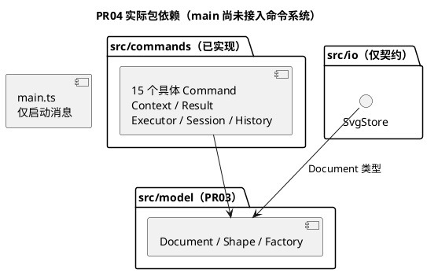
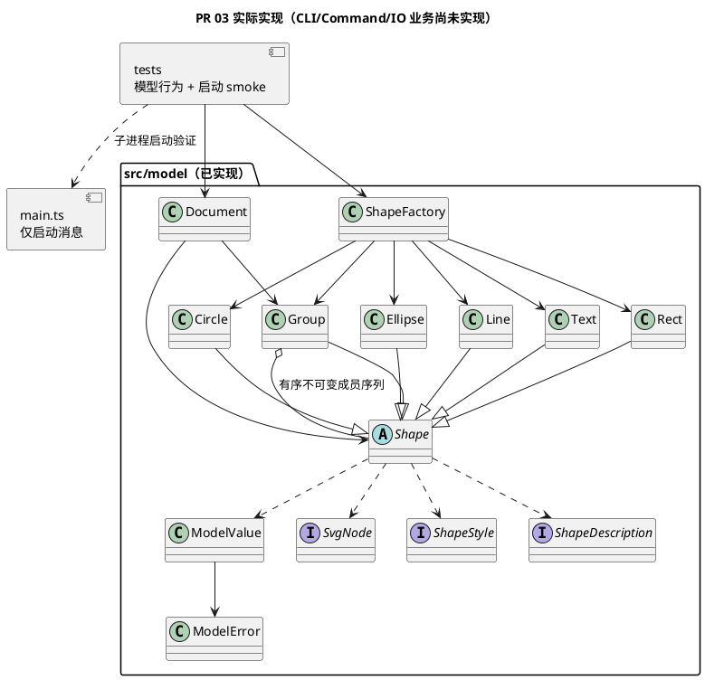
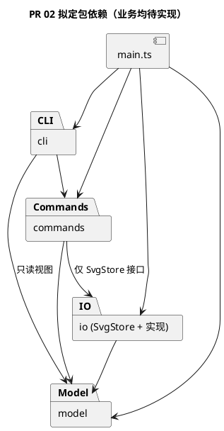
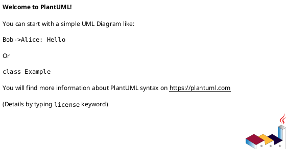

# Lab1 Phase 1 — 架构设计与开发过程报告

> 本文件是课程要求的交付文档，实际仓库路径必须为 **`doc/README.md`**。`doc/requirements/phase_cli_1.md` 仅保存原始需求。本文由开发过程中的 Codex 增量维护，最终内容需由学生审查确认。
>
> 记录状态：`[待实现]`、`[已实现待人工核验]`、`[人工已核验]`。没有证据时不得标记为已核验。

## 1. 架构方案

### PR 04 Command 与快照历史（2026-10-30，已人工验收）

当前在 `feat/CMD-001-command-execution` 完成命令层，复用 PR03 模型，已确认 D1–D6 保持不变。整体架构目标图和历史记录继续保留；本轮实际组件及取舍见 [architecture.md §14](architecture.md#14-pr-04-command-与完整快照历史实现2026-10-30)。

PR04 新增 49 项测试的逐项说明见 [PR4_test.md](../tests/doc/PR4_test.md)。本次测试说明补充无架构变化。

根 README 进度同步：本轮无架构变化，仅将项目入口的 PR04 验收状态、功能进度及目录职责与本报告对齐。

| 实际文件 | 职责 |
|---|---|
| `src/commands/Command.ts` | 泛型异步协议，name、effect、requiresDocument 元数据；具体行为多态执行 |
| `CommandContext.ts`、`CommandResult.ts` | 命令局部草稿/替换意图；结构化成功数据及警告的复制、冻结；错误用 ModelError 抛出，无终端输出 |
| `EditorSession.ts` | 私有当前文档/读入路径/历史状态；一次绑定 Executor；公开文档访问返回独立副本 |
| `CommandExecutor.ts` | 隔离候选、执行、校验、结果准备、快照准备、单次状态提交；统一 execute/undo/redo 的并发与错误处理 |
| `CommandHistory.ts` | 不可变两栈与 blocked；独立完整 before/after 快照；记录身份名称、准备撤销重做及边界清空 |
| `CreateCommand.ts`、`DeleteCommand.ts`、`MoveCommand.ts`、`ScaleCommand.ts`、`SetCommand.ts` | 图形创建及几何/属性编辑，调用 Factory/Document/Shape 的公开方法 |
| `GroupCommand.ts`、`UngroupCommand.ts`、`AddToCommand.ts`、`FrontCommand.ts`、`BackCommand.ts` | 层级与顺序命令，整体一个历史单元，按当前 Document 中的 id 定位 |
| `InitCommand.ts`、`CanvasCommand.ts` | 初始化和画布；Canvas 无参数 query、带尺寸 boundary，失败不产生历史边界 |
| `TreeCommand.ts`、`ShowCommand.ts`、`HelpCommand.ts` | 层级/属性/父位置查询、注入帮助数据；没有完整终端树形排版或 CLI 依赖 |
| `src/io/SvgStore.ts` | 仅未来 read/write 异步接口；没有实现类或 Read/Save 命令，不宣称文件 IO 完成 |



Commands 当前只依赖本模块及模型；未来存储消费仅允许 commands → io/SvgStore 接口，IO 不反向依赖 commands。model 不感知历史、会话或文件。没有新增名称分派点：按名字构造图形仍只有 Factory；未来 CLI 的 Dispatcher 尚未实现。

实际事务流程：对当前文档 clone 候选 → await 多态 execute → 复制结果 → validate 候选 → clone 并 validate 新活文档 → 准备完整 before/after 和新历史 → 构造新状态 → 一次赋值提交。所有克隆、校验、结果/历史准备均在提交前；失败保留文档、路径、两栈和 blocked。Undo/Redo 先准备恢复副本及新历史再提交，Redo 不重执行命令、不反算几何。

init 成功清除读入路径；canvas 修改保留路径，两者均清空并封锁历史。canvas 查询/tree/show/help 不改变历史；下一次成功编辑解除封锁，undo 只能回到边界后的基点。空栈用 nothing to undo/redo，blocked 优先使用任务书的 undo not allowed after io command。无文档时 help 也按任务书严格规则报错。Read/Save 历史和路径完整编排留待 IO 阶段。

实现细化登记：原拟定类图中 Executor 关联 History；实际由 Session 的状态对象持有不可变 History，Executor 仍负责调用和协调，一次提交避免两个可变字段出现部分更新。每个 Session 只绑定一个 Executor；重叠 execute/undo/redo 立即报 busy、不排队，调用方必须逐次 await，不同 Session 可并行。查询也使用文档副本，避免自定义查询改动会话。为防止命令保留候选引用，提交文档另行 clone；额外克隆开销接受，未做性能基准或历史限额。

**【人工核对】[已核验]** 请对照 `CommandExecutor.ts`、`EditorSession.ts`、`CommandHistory.ts` 核对原子状态提交及单执行器约定，确认本轮没有提前接入 REPL 或宣称 read/save 完成。结论：确认一致性。

### PR 03 核心模型实现（2026-10-29，待人工验收）

本轮在 `feat/MODEL-001-shape-document` 实现 `src/model/`，未改变 PR 02 的四模块依赖方向或 D1–D6。整体目标图仍保留为拟定；当前实际业务组件如下，仅 model 已落地，main 尚不调用模型。

| 实际文件 | 职责及设计落地 |
|---|---|
| `Shape.ts`、`Rect.ts`、`Circle.ts`、`Ellipse.ts`、`Line.ts`、`Text.ts` | 封装 id/样式和各自几何，模板方法与多态计算 move/scale；属性白名单、clone、describe 和 SVG 节点输出 |
| `Group.ts` | Composite：递归准备几何更新后统一提交；样式留在组自身，子元素显式样式不被覆盖；成员序列冻结 |
| `Document.ts` | 画布、树、idIndex、parentIndex；候选结构校验后提交；D3 最深公共祖先及绘制顺序；删除子树、归属与层级、深拷贝 |
| `ShapeFactory.ts` | 六类唯一类型映射，CLI 参数值构造与中立节点适配共用；未引入注册/插件机制 |
| `SvgNode.ts`、`ShapeStyle.ts`、`ShapeDescription.ts` | 只读传输接口：XML 中立节点、显式样式、展示数据；非图形行为的数据袋替代品 |
| `ModelError.ts`、`ModelValue.ts` | 单行领域错误与重复标量校验，避免五类中重复数字解析；没有通用框架 |



设计细化与取舍：Document 独占结构修改，但 Group 不提供可写 children 或就地结构 mutator；通过 `withChildren` 构造新祖先组、校验候选树后同步提交 roots 与两张索引。代价是结构操作后旧 Group 引用可能过期，调用者必须按 id 重新 find。insert/构造克隆输入以隔离文档所有权；clone 是完整独立快照。具体约定见 [architecture.md §13](architecture.md#13-pr-03-实现对应说明2026-10-29)。这是对模型内部编辑协议的实现细化，无跨层依赖变化。完整 Command Undo/Redo 仍待后续 PR，当前只实现其需要的深拷贝。

几何更新先计算并检查整棵目标子树，再修改字段；避免后代数值溢出导致前面的节点已更新。结构操作先验证全体目标、重复/祖孙关系，之后建立候选并重建索引；失败不修改当前树或索引。只存显式样式，输出不补 fill/stroke 默认值。模型不处理 XML 转义或文件。

本轮会话已由用户确认：画布宽高为有限正数；图形尺寸、半径、stroke-width 非负且允许 0；group 至少一个目标、重复目标报错。D3 继续采用原深度优先绘制顺序收编，而非参数顺序。这些边界是用户补充确认，不冒充任务书原文。


### PR 02 架构草案（2026-10-28）

详细草案见 [architecture.md](architecture.md)（需求、类设计、流程、三张 PlantUML 源图、验收映射和 D1–D6 决策）。以下为新增拟议方案，业务类均 **[待实现]**；保留下文 PR 01 的历史事实和原人工字段，不将当时的“待设计”回写为已完成。

| 拟定目录 | 本轮明确的职责与组件 | 禁止承担的职责 |
|---|---|---|
| `src/cli/` | CliRepl、CommandParser、CommandDispatcher、CliRenderer：逐行输入、词法、构造命令、终端排版 | 写模型字段、文件访问、几何计算和历史算法 |
| `src/commands/` | Command、各具体命令、CommandExecutor、CommandHistory、EditorSession：操作编排、事务、历史、当前文档和读入路径 | 按图形类型分支、直接 fs/readline |
| `src/model/` | Document、Shape、五种叶子、Group、ShapeFactory：多态几何/属性行为、树不变量和唯一 id | 知道终端、历史或磁盘路径 |
| `src/io/` | SvgStore 接口、SvgFileStore、SvgParser、SvgSerializer：文件与 XML，返回已验证候选和警告 | 绕过 Document 直接改私有字段 |
| `src/main.ts` | 组合注入、启动 | 承担业务逻辑 |

**Command（拟定）**：每条操作构建对象，接收者为 Document/Shape。Executor 对编辑创建候选深副本，成功后提交并保存 before/after，复杂操作一个单元；失败不提交、不清空 redo。init/read/save/canvas 修改成功后清空并封锁历史，直到下一次成功编辑；canvas 查询和显示不影响历史。当前仅设计，尚无实现落地位置。

**Composite（拟定）**：Group extends Shape，move/scale 递归委派，叶子自行计算几何。普通组 set 推荐自身 SVG 样式继承；delete 对叶子/组统一由 Document 删除子树。Document 统一树写入、顺序、idIndex 和 parentIndex，拒绝循环、重复 id 和祖孙同时 group；根级 g 禁止解组遵循原文。

**拟定依赖规则及原因**：main → 全部（组合）；cli → commands、model 只读视图（隔离输入与业务）；commands → model、io 的 SvgStore 接口（复用领域行为及可注入存储）；io → model、Node fs（格式与存储适配）；model → 仅 model（保持领域独立）。所有反向依赖禁止；图形不感知历史，IO 不依赖 commands，避免循环。未来逐 PR 检查 imports 和实际写入调用，不以目录存在代替实现审查。




当前实际依赖仍是 `src/main.ts` 无 import，`tests/smoke.test.ts` 只用 Node 标准库；上图不是当前代码组件图。详细草案中接口实现关系与这里的包依赖一致。

**变化点与取舍（拟定）**：新增图形通过 Shape 子类和 Factory，新增命令通过 Command 子类和 Dispatcher；两处名称分派显式标记待重构，后续可替换为注册机制。本轮不实现 ShapeProvider、box 或插件加载。新入口复用 commands/model/io；XML 编解码与文件存储分离便于后续格式变化，暂不做多格式框架。推荐深副本换取原子性与可审查性，接受 O(历史×文档大小) 空间；增量历史为备选，见 D1。

**修订登记**：2026-10-28 / ARCH-001（PR 待创建、commit 待创建），在 PR 01 预留四目录基础上细化职责和依赖，没有改动实际工程或配置。现为“PR 02 架构草案，已完成人工确认”可以作为架构基线。


### PR 01 工程基线（2026-10-27）

本轮无业务架构变化，仅完成工程初始化。已建立 `src/cli/`、`src/commands/`、`src/model/`、`src/io/`（各含 `.gitkeep`）、`src/main.ts` 和 `tests/smoke.test.ts`。模块目录只是初始规划；领域模型和 Command 架构尚未正式设计，最终模块职责、依赖方向及 PlantUML 图待 PR 02 确定。下面的拟定模块和未填写字段继续保留，不代表已经实现。

工程配置：`package.json` 提供 build/start/dev/typecheck/test；`tsconfig.json` 仅编译 `src/` 到 `dist/`，采用 ES2022、CommonJS、Node 模块解析、strict、esModuleInterop、skipLibCheck，并启用 noEmitOnError。`tsconfig.tests.json` 继承配置，将测试单独编译到 `dist/tests/`，避免测试位于源码 rootDir 之外的错误；typecheck 同时检查源码和测试。`package-lock.json` 锁定依赖。

环境选择：使用已安装的 Node.js 24 LTS，工程 engines 限定 24.x；本地开发依赖 TypeScript `~5.9.3` 保持要求的 CommonJS/Node 配置，`@types/node` 使用 24.x 与运行环境匹配。测试使用 Node.js 内置工具，不引入第三方测试框架或业务抽象。

### 1.1 模块划分与职责

| 模块/目录 | 职责 | 对外接口或关键类 | 状态与证据 |
|---|---|---|---|
| `src/cli/`（拟定） | REPL 输入、解析与输出 | 待设计 | [待实现] |
| `src/commands/`（拟定） | Command 执行与历史管理 | 待设计 | [待实现] |
| `src/model/`（拟定） | Document、Shape、树结构 | 待设计 | [待实现] |
| `src/io/`（拟定） | SVG 读写 | 待设计 | [待实现] |

**组件图 / 包图（PlantUML，架构确定后补充）：**



**【人工核对】** 模块职责与边界是否符合你的真实设计意图？有没有上帝类、循环依赖或过度抽象？

- 审查结论：[待填写]
- 审查日期 / 对应 PR：[待填写]

### 1.2 设计模式选择及落地

- **Command 模式（必需）**：待实现；后续由 AI 填写命令接口、具体命令类、执行入口、历史管理及代码位置。
- **Composite 语义**：待实现；后续由 AI 填写叶子/容器统一操作机制及代码位置。
- **设计权衡**：待记录（包括为何不采用其他方案，以及代价）。

**【人工核对】** 是否真的通过多态与对象职责实现，而不是换个类名继续使用过程式分派？

- 审查结论：[待填写]

### 1.3 模块依赖方向规则

| 调用方 | 允许依赖 | 禁止依赖 | 理由 | 实际核查证据 |
|---|---|---|---|---|
| 待设计 | 待设计 | 待设计 | 待设计 | [待检查] |

**【人工决策】** 正式批准依赖方向后再标记为架构基线。结论：[待填写]

### 1.4 变化点假设与取舍

| 可能变化点 | 当前设计如何应对 | 代价或明确不预留的理由 | 人工确认 |
|---|---|---|---|
| 新增图形类型（后续插件化） | [待分析] | [待分析] | [待填写] |
| 新增命令入口 | [待分析] | [待分析] | [待填写] |
| 文件格式/读写策略 | [待分析] | [待分析] | [待填写] |

### 1.5 架构决策与修订记录

| 日期 / PR | 原方案 | 调整后方案 | 触发问题与理由 | 影响范围 | 人工状态 |
|---|---|---|---|---|---|
| [待记录] | | | | | [待核验] |

## 2. 过程记录

> 只记录真实且有代表性的讨论、建议、验证、反例与纠正；不要为凑字数编造“AI 曾建议”。每次会话不必强行制造设计分歧，但应记下实际改动和证据。

### 2.1 开发会话日志（按时间追加，不覆盖历史）

| 日期 / 分支 / PR | 本次目标 | 实际修改与证据（文件、提交、测试） | AI 建议及采用情况 | 问题与纠正 | 未决事项 / 人工复核 |
|---|---|---|---|---|---|
| [待执行] | | | | | |
| 2026-10-27 / `chore/INIT-001-project-setup` / INIT-001（PR 待创建） | TypeScript 工程初始化 | 新增 `package.json`、`package-lock.json`、`tsconfig.json`、`tsconfig.tests.json`、`src/main.ts`、四个模块目录的 `.gitkeep`、`tests/smoke.test.ts`；增量更新根 `README.md` 和本报告。原有未提交的 README 内容、`AGENTS.md`、任务书和报告框架保留，并作为本阶段基线纳入提交；commit 待创建，实际 hash 见会话最终汇报 | 采用独立测试编译配置和 Node 内置测试；本轮未发生代表性业务设计纠错 | 上轮环境检查未找到 Node/npm，本轮已可用；`npm --version` 遇到 npm.ps1 执行策略限制，改用 `npm.cmd`，未修改系统策略；沙箱创建分支失败，获准提升权限后成功；依赖安装请求返回 EACCES，终止重试并获准访问 registry 后安装成功 | 自动验证均通过；人工验收、个人反思待填写；业务能力待后续 PR |

本轮实际步骤：读取约束、原始任务书和已有文档 → 检查 Git 状态及原有 README diff → 创建功能分支 → 添加工程配置、入口与 smoke test → 安装依赖 → 增量更新 README → 执行验证 → 更新本报告 → 检查 diff 与暂存内容 → 验收通过后创建一次本地提交。不创建远程 PR、不推送、不创建 final tag。

### 2.2 有代表性的 AI 协作案例

**案例编号：[001-PR2中潜在循环依赖问题]**

- 工程背景/遇到的问题：AI写的架构文件中“命令覆盖与状态归属”的模块中可能有循环依赖的潜在问题。
- AI 原建议（如有，保留可追溯摘要）：architecture.md文件中的1.2节中说
```
| help / HelpCommand | CommandDispatcher 提供语法描述 | 全部语法；不改变历史 |
```
- 我发现的问题与判断理由：HelpCommand 需要显示所有命令的使用说明，但这些说明由 CommandDispatcher 提供，那么 HelpCommand 应该怎样拿到这些数据呢？

CommandDispatcher 位于 cli 模块，负责识别命令、提供命令语法说明。HelpCommand 位于 commands 模块，负责执行 help 命令。依赖规则规定 cli → commands，不允许 commands → cli。

如果直接
```
import { CommandDispatcher } from "../cli/CommandDispatcher";
```
就有可能形成CLI 要 import HelpCommand，HelpCommand 又要 import CommandDispatcher的情况，构成循环依赖。

- 如何验证与修正（文件、测试、结果）：明确规定Dispatcher 创建 HelpCommand 时直接把数据给它，这样HelpCommand 只知道自己收到了一段帮助文字，完全不知道文字由谁提供。


### 2.3 PR 02 会话记录（2026-10-28）

- 分支：`docs/ARCH-001-design`；PR 待创建；commit 待创建，本轮按用户要求不暂存、不提交、不推送、不创建 PR/tag。
- Git 证据：初始分支 `chore/INIT-001-project-setup` 工作区干净；`git log main -3 --oneline` 显示 `05d26ba Merge pull request #1` 包含 `8374cb9`；祖先检查成功。`git fetch origin` 首次因 `.git/FETCH_HEAD` 写权限失败，经自动审批提升权限后成功；fetch 后 `git rev-list --left-right --count main...origin/main` 为 `0 0`。从 main 创建目标分支，未修改 remote 配置或已有历史。
- 阅读 AGENTS、根 README、完整任务书、原报告、package/两份 tsconfig、现有源码和测试，确认业务未实现。新增 `doc/architecture.md`，增量更新本报告，未改源码、测试、配置、锁文件或原始任务书。
- AI 建议：保留四目录，分离解析/分发/执行和 XML/文件职责；采用 Command + 候选副本，模型多态 clone 及 before/after 历史，替代仅靠逆操作。考虑逆操作/局部快照可节省内存，但浮点回算和复合结构恢复增加验证成本，建议作为备选交人工决策，未宣称用户已接受。
- 实际发现：任务书根级 g 解组限制与常见编辑器习惯不同；跨父 group 的组位置/顺序、普通 g 样式 set、save-as 路径生命周期与外部 transform 范围未完全明确，草案列 D2–D5 供用户确认，没有补写为老师强制规则。
- 检查与纠正：首次 PowerShell 读取中文显示乱码，显式 UTF-8 重读；首次批量读取输出过长，分文件补读，避免凭截断内容设计。未发生用户与 AI 的代表性设计争论，不编造人工反馈。工程检查和设计检查结果见 §3.3、§4.4。
- **【人工填写】[已填写]** 请在 §2.2 或此处记录本人实际判断、是否采纳推荐及真实分歧和收获；个人反思：本轮主要围绕 SVG 编辑器的整体架构设计展开。起初，我对任务书要求的软件功能及模块之间的关系理解不够清晰。通过梳理完整的命令执行流程，逐渐明确了 CLI、Commands、Model 和 IO 四个模块的职责：CLI 负责输入解析与命令分发，Commands 负责操作执行和历史管理，Model 负责图形行为与结构约束，IO 负责 SVG 文件读写。采用这种划分，可以避免将输入处理、业务逻辑和状态管理集中在同一模块中，也有利于后续功能扩展。

在设计模式方面，我进一步理解了 Command 模式将操作封装为对象的意义。相比由 CLI 直接修改图形，通过统一执行器管理命令，可以集中处理 Undo/Redo、失败原子性和执行流程，同时减少具体命令与用户交互方式之间的耦合。对于 Composite 模式，我认可通过统一的 Shape 接口处理单个图形与 Group 容器，使移动、缩放等操作能够利用多态完成。

在 D1 撤销重做方案的选择上，我重点比较了逆向操作、完整快照、局部状态记录和结构共享。虽然完整快照存在额外的内存与复制开销，但考虑到本阶段图形规模有限，且 group、delete、ungroup 等操作涉及复杂的父子关系和顺序恢复，最终决定采用完整快照，优先保证实现正确性和可测试性。

对于 D2～D6，我认可普通 Group 遵循 SVG 样式继承、跨父分组采用最深公共祖先规则、保存路径遵循任务书描述，以及保留四模块架构等方案。同时认识到，部分具体行为并非任务书明确规定，而是需要由开发者作出的设计选择。对于外部 SVG 的 transform 等兼容性问题，应明确当前支持范围并保留后续验证事项，不能直接将 AI 的建议视为课程要求。

### 2.4 PR 03 会话记录（2026-10-29）

- 分支 `feat/MODEL-001-shape-document`；PR 待创建；commit 待创建，本轮不暂存、提交、推送、合并或创建 PR。
- 前置证据：fetch 成功，原 PR02 远程分支已不存在，不能再用该远程分支名判断合并；改查已知提交 `c488e2f` 的祖先关系，退出码 0。`main` 和 `origin/main` 均为 `5be3aae`（Merge pull request #2），差异计数 `0 0`，初始工作区干净；从 main 创建指定分支。
- 阅读规范、根 README、报告、任务书、架构及当前配置/源码/测试；沿用 TypeScript、Node 内置测试。向用户说明尺寸/group 边界并收到“采用以上规则”，随后落实有限正画布、非负几何尺寸/笔宽、至少一个 group 目标和重复目标拒绝。
- 实际新增 `src/model/` 下 14 个 TS 文件、`tests/shapes.test.ts`、`tests/document.test.ts`、`tests/factory.test.ts`；移除 model/.gitkeep；package.json 只扩大原测试发现范围，避免 npm test 漏跑新测试；更新根 README、architecture.md §13 与本报告。
- AI 设计取舍：采用冻结 children 和重建祖先组，替代导出可写结构能力；保留领域对象的几何行为与私有状态，Document 统一校验后提交树/索引。采用两阶段几何更新确保直接调用 Group.move/scale 也具备数值失败原子性。代价与引用生命周期如实记录在架构说明，未新增历史执行器或 IO。
- 检查与修正：源码审阅时限制 Shape 构造器样式参数只能走公共样式分支，避免未知参数触发尚未初始化的叶子字段；将 D3 公共祖先变量显式保留 null（根）语义。首轮 39 项测试通过后，补查中立 SVG 节点循环输入，添加访问路径检测及回归测试，最终 40 项通过。没有实际测试失败，不虚构失败/人工争论。
- 本轮没有修改 D1–D6 人工结论，也没有代填个人反思；后续 IO 负责 XML 解析、缺 id 分配、几何缺省值规范化和文件回读。模型中立节点往返不等于 SVG 文件读写已实现。

**【人工填写】[已填写]** 请记录本人对“冻结成员序列、按 id 重新定位”和“两阶段几何更新”取舍的真实判断，以及亲自运行模型测试后的观察；如没有分歧如实填写。个人反思：对于 Group 成员序列冻结与按 ID 重新定位，我理解到，Document 不直接暴露可写的 children，可以避免外部代码绕过 Document 修改图形的父子关系和顺序。结构操作通过重建相关 Group 并统一提交，可以更好地维护树结构与索引的一致性。虽然这意味着旧对象引用可能失效，但图形 ID 保持不变，因此后续 Command 可以保存 ID，并在执行时通过 Document 重新查找目标。我接受这一设计取舍。
对于 两阶段几何更新，我认为其主要价值在于保证失败原子性：先计算并校验所有受影响图形的新几何值，只有全部合法后才统一更新，避免在嵌套 Group 移动或缩放过程中出现部分图形已修改、部分图形因数值溢出而失败的情况。虽然增加了一定的实现复杂度，但有利于保证模型状态可靠，因此接受该方案。

### 2.5 PR 04 会话记录（2026-10-30）

- 分支 `feat/CMD-001-command-execution`。初始工作区干净，PR03 为 `13c7f2a`。fetch 获取 `origin/main=afd4dfb`（Merge pull request #3），祖先检查确认含 PR03。通过本地 fetch 的无强制快进 refspec 将 main 同步至 origin/main，再创建指定分支；未执行 merge、暂存、提交、push 或创建 PR。
- 阅读 AGENTS、根 README、课程报告、任务书、架构、全部模型和既有测试、package/tsconfig。复核 PR03 只有公开 find/insert/树操作/clone/validate 等方法，不直接写模型私有字段或索引，不改模型实现。
- 本轮新增 commands 下 21 个 TS 文件（20 类和 1 个命令协议文件）、io/SvgStore 接口、三份命令专项测试；删除 commands/.gitkeep；更新三份入口/课程/架构文档。没有更换工具、依赖或测试配置。
- AI 建议并实施：用不可变 History + Session 单一状态引用协调提交；Context 只持候选，不给具体命令 Session；公开会话检查返回副本，提交文档再 clone，以隔离命令保留的草稿。并发选择单 Session/单 Executor/重叠拒绝，未引入队列框架。read/save 选择仅保留契约，不做假读写或存储替身实现。
- 实际问题与纠正：首次 `npm.cmd test` 源码构建成功，但测试编译因异构查询数组的泛型结果推断报 TS2345。将测试集合显式标注 `Command[]`，保留单独执行时的具体结果类型；修正后全量 89 项通过。错误不是业务测试断言失败，不编造人工争论或额外失败过程。
- 验证再以专项命令单独运行新增 49 项，全部通过；完成源文件 AST 类名/依赖/循环检查，37 个源 TS 文件无跨层违规。具体证据见 §4.6。

**【人工填写】[已填写]** 请记录本人如何理解“候选、提交文档和历史快照相互隔离”“单次会话状态提交”，是否接受拒绝重叠调用的接口约定，以及亲自运行测试后的观察；仅按真实经历填写。个人反思：对于候选文档、正式文档与历史快照的隔离，我认为其主要目的是避免命令执行失败或外部引用修改导致正式状态被意外改变。执行器先在候选 Document 上执行并校验，再分别准备提交文档和历史快照，只有全部成功后才提交。虽然多次深拷贝会增加内存和计算开销，但与此前选择的 D1 完整快照方案一致，能够降低复杂编辑操作的状态恢复难度。

对于单次会话状态提交，我认可由 EditorSession 统一持有 Document、readPath 和 CommandHistory，并由 CommandExecutor 负责协调提交。这样可以避免文档已更新、历史却未成功记录的问题，保证一次命令的状态变化作为整体生效。

在并发处理方面，我接受单 Session、单 Executor、拒绝重叠调用的约定。考虑到本阶段是单用户顺序操作的 CLI 编辑器，没有必要引入额外的并发队列。后续 CLI 应逐条 await 命令执行结果。

根据 Codex 提供的测试报告，PR04 新增的 49 项专项测试覆盖了命令执行、Undo/Redo、历史边界、失败原子性及并发控制。后续仍需结合实际 CLI 和 SVG 文件读写进行完整集成验证。本轮认可上述实现取舍，未发现需要调整 D1～D6 的问题。

### 2.6 PR04 测试说明补充（2026-10-30）

在 `feat/CMD-001-command-execution` 按用户要求仿照 PR3_test.md 新增 `tests/doc/PR4_test.md`，逐项对应实际的 24 项命令、10 项历史和 15 项原子性测试，注明参数化展开、验证边界和运行方式。仅新增测试说明并更新本报告，未改源码、测试断言或配置；PR 待创建、commit 待创建。路径统一使用相对链接，本轮未发生代表性纠错。

### 2.7 根 README 进度同步（2026-10-30）

在 `feat/CMD-001-command-execution` 根据本报告已填写的 PR04 人工验收结论，更新根 `README.md` 的当前状态、功能进度、目录职责及 PR04 规划行，并链接架构与测试说明。仅修改根 README 和本报告，保留已有代码及人工结论；PR 待创建、commit 待创建。本轮未发生代表性纠错。

## 3. 一致性自查

根 README 同步自查：入口说明区分已实现的模型/命令 API、尚未接入的 CLI 和仅有接口的 IO；PR04 人工验收状态引用本报告，不将验收解释为已提交或已合并。无模块或依赖变化。

PR04 测试说明补充自查：对照三份测试源码核对 49 项顺序与行为，四次克隆阶段按当前 Executor 的执行顺序解释；明确中立数据/命令 API 测试不等于文件 IO/CLI 验收。新增文件为用户指定的 `tests/doc/PR4_test.md`，课程交付主文档仍为本报告。

### PR 04 一致性检查（2026-10-30）

| 项目 | 结果 | 依据与限制 |
|---|---|---|
| 模块职责和范围 | 通过（源代码审查） | 15 个具体命令、5 个支撑类；SvgStore 只有接口，main/cli/model 与原模型测试未改动 |
| 一类一文件 | 通过（TypeScript AST） | commands 下 21 文件、20 类，各类名与文件名一致；没有机械增加每个类的接口 |
| 源码依赖与环 | 通过（TypeScript AST + DFS） | 37 个 src TS 文件均按本地路径引用，无环；commands 仅依赖本模块/model，io 接口只引用 Document；model 未增加对 Commands/IO/CLI 的依赖 |
| 分派和输入输出 | 通过（静态扫描及审阅） | Executor 根据 effect 选择事务策略，不按命令名 switch；具体行为多态；没有终端/文件系统调用，没有新增类型名分派 |
| PR02/PR03 适配 | 通过（源码/测试） | ID 定位、冻结 Group 协议及 D3 均复用模型；D1 完整快照落地，D4 init 清路径和普通编辑保留路径已验证，实际 save 生命周期待实现 |
| 历史原记录与新图 | 已登记 | 新实际图在 §1/architecture.md §14；旧目标图和人工字段保留，Session 持有 History 的细化如实说明 |

**【人工核对】[已核验]** 请核对新实际图与代码调用关系、effect 的三类职责以及失败前后文档/两栈/blocked 保持；自动检查不代替个人认可。结论：在调用关系上，CommandExecutor 通过 EditorSession 获取和提交会话状态，EditorSession 统一持有 Document、readPath 和 CommandHistory，Executor 负责执行命令及准备历史转移。该实现与 §14 实际架构图一致，没有引入反向依赖或循环依赖。关于effect的三类职责：edit 负责编辑文档并记录历史；boundary 负责建立历史边界，清空 Undo/Redo 并设置 blocked；query 只返回查询结果，不修改正式文档或历史。CanvasCommand 能够根据参数区分查询与修改，符合任务书要求。最后失败前后文档/两栈/blocked保持，CommandExecutor 在候选文档上完成操作、校验、复制和历史准备，成功后由 Session 一次性提交。根据已有专项测试，命令失败时 Document、Undo 栈、Redo 栈及 blocked 状态保持不变，避免发生部分提交。

### PR 03 一致性检查（2026-10-29）

| 检查项 | 结果 | 证据及限制 |
|---|---|---|
| 实际目录与范围 | 通过（自动检查） | 14 个 model TS 文件（11 类、3 接口）；3 份新增模型测试；移除 model/.gitkeep；未修改其他业务层或 main |
| 一类一文件 | 通过（TypeScript AST 检查） | 每个类名与文件名一致，单文件最多一类；接口文件单独命名 |
| 允许依赖及无循环 | 通过（TypeScript AST + DFS 检查） | 全部模型 import 为本目录路径且目标存在；含类型依赖在内没有环；没有 cli/commands/io/fs 依赖 |
| 多态与两处分派 | 通过（源代码检查） | 模型无 switch；几何各叶子独立实现；Factory 私有 Map 是唯一类型名映射；instanceof Group 只用于结构容器 |
| 既有配置与源码范围 | 通过 | src/cli、commands、io、main、两份 tsconfig、锁文件、AGENTS、任务书无 diff；package.json 仅将单项测试入口改为测试通配符 |
| PR 02 设计细化 | 已登记 | architecture.md §13 记录冻结成员序列、候选提交、引用生命周期与 Factory 适配范围；已确认 D1–D6 未改写 |

**【人工核对】[已核验]** 请复核 Group 结构封装、D3、模型依赖与实际图；自动结果不等同人工认可。结论：结合 PR02 已确认的架构方案及 PR03 的实现和测试报告，对模型层的一致性进行了复核。认可Group 结构封装通过冻结成员序列、重建相关 Group 并由 Document 统一提交结构变化的设计。该方式能够限制外部代码直接修改父子关系，维护图形树与索引的一致性。接受结构变更后旧对象引用可能失效、调用者需按 ID 重新定位的约定。确认D3 跨父分组采用最深公共祖先作为新组父节点，按照原文档深度优先绘制顺序收编选中图形，并依据已确认规则确定新组位置。理解该操作不保证所有未选图形的视觉叠放关系保持不变，且 `ungroup` 不等同于撤销 `group`。关于模块依赖与架构一致性，根据现有静态检查报告，模型层不存在对 CLI、Commands、IO 或 Node 文件系统的依赖，未发现循环依赖。Shape 子类负责各自的几何行为，Document 负责结构管理，ShapeFactory 集中处理图形类型分派，整体符合 PR02 确定的架构方向。
基于目前的实现说明、测试报告和静态检查结果，未发现 PR03 模型层与 PR02 已确认架构之间的明显冲突，认可当前实现方案。实际功能的正确性以已有自动化测试为初步依据，后续仍需通过 Command、CLI 与 IO 层的集成测试进一步验证。

### 3.1 模块划分与方案一致性

| 计划模块 | 实际文件/目录 | 是否一致 | 差异与修订记录 | 人工确认 |
|---|---|---|---|---|
| PR 01 初始目录与文档 | `src/main.ts`、四个预留模块目录、`tests/smoke.test.ts`、`doc/README.md`、`doc/requirements/phase_cli_1.md` | 通过（自动检查） | 与本轮规划一致；未创建 `docs/`；业务模块仍未实现。原有 `AGENTS.md`、需求文件未改写 | 【人工核对】[已核验] |
| 工程与依赖配置 | `package.json`、`package-lock.json`、`tsconfig.json`、`tsconfig.tests.json`、`.gitignore` | 通过（自动检查） | `npm.cmd ls --depth=0` 显示 typescript 5.9.3、@types/node 24.19.2；现有忽略规则已覆盖所需产物，无需修改 `.gitignore` | 【人工核对】[已核验] |

路径检查：`rg -n 'docs/' AGENTS.md README.md doc` 只命中 README 中 PR 02 的分支名 `docs/ARCH-001-design`，其含义是 Git 分支命名，不是课程文档路径，故保留。

### 3.2 依赖方向一致性

| 规则 | 检查方式与范围 | 检查结果 | 违规证据/修复提交 | 人工确认 |
|---|---|---|---|---|
| [待确定] | [待执行] | [未检查] | | [待填写] |

PR 01：业务架构与模块依赖关系暂不适用，待后续实现。检查 `src/main.ts` 仅包含启动输出，没有 import 或业务类；测试只依赖 Node.js 标准库，通过子进程验证已编译入口。未发现本轮越界实现；不将此结论视为最终架构一致性验收。

**【人工核对】** 结论是否与实际代码相符？抽查哪些 import、调用关系？结论：[待填写]

### 3.3 PR 02 一致性自查（2026-10-28）

| 检查范围 | 结果 | 依据及限制 |
|---|---|---|
| 实际目录与改动范围 | 通过 | `rg --files --hidden` 显示四目录 .gitkeep、main 和 smoke；仅新增 architecture.md 和修改本报告。没有建立课程 `docs/` 目录，分支的 docs/ 前缀不代表文件目录 |
| 需求与命令责任覆盖 | 通过（设计检查） | architecture.md §1.2 覆盖四类文档命令、十个编辑命令、三类显示和 undo/redo；§11 按原文段落映射后续测试。不能视为功能测试通过 |
| 图文内部一致性 | 通过（源文本审阅） | 三张图对应四目录、Document/Shape、Command/Executor/History 和候选提交；组件/包图均为 commands → io 接口、io → model，无 io → commands；移动流程与快照恢复相符 |
| 业务代码依赖与封装 | 未检查（尚无实现） | 当前 main 无业务依赖；未来类图中的模型封装、树协议和 import 必须在实现后逐项验证 |
| 工程与配置未误改 | 通过 | `git diff -- src tests package.json package-lock.json tsconfig.json tsconfig.tests.json README.md AGENTS.md doc/requirements/phase_cli_1.md` 无输出 |


## 4. 质量保证手段

### 4.1 验证记录

| 日期 / PR | 验证命令或测试场景 | 实际结果 | 证据（输出摘要 / 文件位置） | 已知限制 |
|---|---|---|---|---|
| [待执行] | | [未运行] | | |
| 2026-10-27 / INIT-001 | `git --version`、`node --version`、`npm.cmd --version`、`node -p "process.release.lts"` | 通过 | Git 2.54.0.windows.1；Node v24.22.1；npm 11.19.1；LTS 代号 Krypton | `npm --version` 被 PowerShell 策略阻止，使用 npm.cmd 解决 |
| 2026-10-27 / INIT-001 | `npm.cmd install --save-dev typescript@~5.9.3 @types/node@24 --cache .npm --fetch-retries=0` | 通过 | added 3 packages，audited 4 packages，0 vulnerabilities；`npm.cmd ls --depth=0` 无缺失依赖 | 先前沙箱安装尝试因 EACCES 未完成，获准访问后成功；未安装全局依赖 |
| 2026-10-27 / INIT-001 | `npm.cmd run build` | 通过，退出码 0 | 生成 `dist/main.js` | 仅最小入口 |
| 2026-10-27 / INIT-001 | `npm.cmd run typecheck` | 通过，退出码 0 | 源码及测试均无类型错误 | 尚无业务类型 |
| 2026-10-27 / INIT-001 | `npm.cmd test` | 通过，退出码 0 | Node 内置测试执行 1 项，pass 1 / fail 0；检查子进程无启动错误、退出码 0、stderr 为空和正确启动消息 | 仅启动 smoke test；业务测试尚未实现 |
| 2026-10-27 / INIT-001 | `npm.cmd start`、`npm.cmd run dev` | 均通过，退出码 0 | 均输出 `SVG Editor CLI started!` | 没有 REPL 或 SVG 编辑功能 |
| 2026-10-27 / INIT-001 | `git check-ignore -v node_modules/ dist/ .npm/ .env setup.log setup.tsbuildinfo` | 通过 | 命中现有 `.gitignore` 规则 | 源码、配置、锁文件、文档的暂存检查在提交前执行 |
| 2026-10-27 / INIT-001 | `git diff --cached --stat`、`git diff --cached --name-only`、`git status --short` | 通过 | 暂存 14 个工程与文档文件，包含原有规范和任务书；没有依赖、构建产物、日志或环境文件 | 尚未创建提交，hash 由最终汇报提供 |
| 2026-10-27 / INIT-001 | `git diff --cached --check` | 存在原始文件格式提示 | 仅提示 `doc/requirements/phase_cli_1.md:522: new blank line at EOF` | 该文件原有末尾空行保留，未为消除提示改写任务书；本轮新增工程文件无此问题 |

截至 2026-10-27，根据 [Node.js 官方发布计划](https://raw.githubusercontent.com/nodejs/Release/main/schedule.json)，24.x LTS 支持至 2028-04-30，本轮沿用该已安装版本。`npm ci` 尚未运行；未进行 SVG 功能测试、IO 回读或最终课程验收，下面功能覆盖项继续保持 [未验证]。

### 4.2 功能与异常覆盖

| 场景 | 状态 | 测试位置 / 手工操作证据 |
|---|---|---|
| 六种图形类型 | [未验证] | |
| create / delete / move / scale / set | [未验证] | |
| group / ungroup / addto / front / back | [未验证] | |
| undo / redo 和 IO 后禁止规则 | [未验证] | |
| read / save SVG 回读 | [未验证] | |
| 唯一 id、错误原子性和非法参数 | [未验证] | |
| tree / show / help 与 REPL | [未验证] | |

### 4.3 遗留风险与最终人工验收

- 已知缺陷或未覆盖情况：[待记录]
- **【人工填写】** 你亲自运行/观察过的主要场景：[待填写]
- **【人工填写】** 你认为当前架构最值得改进之处：[待填写]
- **【人工填写】** 是否认可本阶段功能完整性与质量依据，为什么：[待填写]
- 最终签收日期、PR/Commit：[待填写]

### 4.4 PR 02 实际验证记录（2026-10-28）

| 命令 / 检查 | 结果 | 范围与限制 |
|---|---|---|
| `npm.cmd run build` | 通过，退出码 0 | 原有最小入口编译 |
| `npm.cmd run typecheck` | 通过，退出码 0 | src 与 tests 两份配置 |
| `npm.cmd test` | 通过，退出码 0；1 项 pass、0 fail | 仅原有启动 smoke，不含 SVG 业务功能 |
| `rg --files --hidden`（排除 git/依赖/产物）、读取文件与链接检查 | 通过 | 文档均在 doc，architecture.md 到报告和任务书的相对路径存在 |
| 对照原始任务书逐条检查、审阅 PlantUML 源与职责表 | 通过（设计检查） | 覆盖详见 architecture.md §11；D1–D6 未经人工确认 |
| `Get-Command plantuml, java -ErrorAction SilentlyContinue` | 无命令返回 | 未运行 PlantUML 渲染或语法工具；三图仅保存源代码和人工源文本检查 |
| `git diff --check`、新增文档空白检查 | 通过 | 完成后再次检查；未暂存文件需额外检查，不只依赖 git diff |
| 临时 Node stdin 脚本（未新增脚本文件） | 通过 | 两份文档无行尾空白；UML 起止配对，草案 3 块、报告 2 块（含原占位图）；19 个命令名及文档目标存在；仅为存在性检查，不代表语义或 UML 语法验证 |
| `git status --short`、受保护路径 diff | 仅报告修改和新增架构文档；其他路径无 diff | 没有提交或暂存；dist 为被忽略构建产物 |

本轮 `npm ci`、start/dev、业务测试、SVG 文件回读、浏览器演示、最终功能验收均 **未运行**；没有新增测试或声称测试覆盖率。既有 §4.2 功能项仍为 [未验证]。文档设计风险及后续测试计划不能代替实现结果。

### 4.5 PR 03 验证记录（2026-10-29）

| 实际命令 / 检查 | 结果 | 验证范围与限制 |
|---|---|---|
| `npm.cmd run typecheck` | 通过，退出码 0 | 同时检查 src 与 tests；实现初版及最终模型均运行 |
| `npm.cmd test`（内部执行 `npm run build`） | 最终通过，退出码 0；40 项 pass、0 fail | 39 项新增模型测试 + 1 项原有启动 smoke；构建和测试编译均通过 |
| 首轮 `npm.cmd test` | 39 项通过、0 fail | 随后新增循环中立节点防护用例，最终测试数增加至 40，无失败修复记录 |
| `rg -n '^import.../class/interface/switch' src/model`、临时 Node + TypeScript AST 检查 | 通过 | 14 文件、11 类；名称与文件一致；本目录 import、无循环；无 switch、无行尾空白。临时脚本经 stdin 运行，未新增通用检查框架 |
| `git diff -- src/cli src/commands src/io src/main.ts tsconfig.json tsconfig.tests.json package-lock.json AGENTS.md doc/requirements/phase_cli_1.md` | 无输出 | 没有跨范围业务改动或改写权威任务书 |
| `git diff --check`、文档链接及新增文件空白检查 | 通过（本轮改动） | 新文件单独检查；首次整文件扫描发现 architecture.md 第 361 行已有人工标记尾空格，与 main 完全相同，保留人工内容；复查只要求本轮新增内容无空白错误。相对链接目标存在，UML 起止配对，不代表渲染通过 |

模型测试的要求映射：六类构造/描述/属性读取和几何/样式白名单见 shapes.test 与 factory.test；嵌套递归、显式子样式保留、数值溢出原子性见 shapes.test；id 大小写、插入/子树删除、D3 跨父/同父/根公共祖先、ungroup 根限制、addTo 成环拒绝、front/back、快照独立性及失败内容/索引保持见 document.test。Factory 还检查未知 box/类型、参数个数、数值 token、中立节点往返和循环输入。不是仅检查文件存在。

当前质量边界：没有安装/配置 lint 或测试覆盖率工具，未运行 lint、覆盖率或 PlantUML 渲染；无对应结果。未运行 CLI 业务、Command Undo/Redo、实际 SVG 文件读写、浏览器演示或性能基准。§4.2 的 CLI 功能验收项保留 [未验证]，本轮模型成功不将它们升级为完成。

已知限制：结构操作需要遍历重建索引，Group 构造还校验子树，深层大树可能有额外遍历成本；未做深度/性能基准。结构变更后应重新 find 容器 id。fromSvgNode 期望已解析/规范化节点，不能代替 SVG Parser。用户人工验收仍待完成。

### 4.6 PR 04 验证记录（2026-10-30）

| 实际命令/检查 | 实际结果 | 证据及限制 |
|---|---|---|
| `npm.cmd run typecheck` | 通过，退出码 0 | 源码初版及新增测试修正后均运行；检查 src/tests |
| 首次 `npm.cmd test` | 失败，测试编译退出码 1 | src build 成功；command-history.test 的异构查询数组产生 TS2345；修正测试类型标注后重跑 |
| 修正后 `npm.cmd test` | 通过，退出码 0；89 pass / 0 fail | 内部完成 `npm run build` 与测试编译；保留既有 40 项，新增 49 项 |
| `node --test dist/tests/tests/commands.test.js dist/tests/tests/command-history.test.js dist/tests/tests/command-atomicity.test.js` | 通过，退出码 0；49 pass / 0 fail | 新增专项单独执行；不依赖只有模型的原测试代替命令验证 |
| 临时 Node + TypeScript AST/依赖 DFS（stdin 执行） | 通过 | 37 个源 TS 文件，commands 21 文件/20 类；文件类名一致、路径存在、无循环依赖；commands 无 switch/终端/文件系统调用 |
| model/cli/main、package/锁文件、tsconfig、原测试及任务书 diff | 无输出 | 未重写原模型/测试，不提前实施 REPL 或实际 IO；io 仅新增 SvgStore.ts |
| `git diff --check`、新增文件空白与文档相对链接检查 | 通过 | 单独检查 25 个新增源码/测试文件无行尾空白；三份文档相对链接目标存在、UML 起止配对；未运行渲染器 |

新增测试按文件划分：

- `tests/commands.test.ts` **24 项**：六类创建及 in；十种编辑分别校验实际行为并一次 undo/redo 恢复完整结构；init、无文档错误、tree/show/help 数据、canvas effect/路径、参数数组隔离、Session 外部副本/单执行器、非法命令保留 redo。
- `tests/command-history.test.ts` **10 项**：连续精确快照恢复、浮点不逆算、原本未设置样式恢复、成功无变化编辑、新编辑清 redo、查询保持 redo、init/canvas 历史边界、blocked 解禁、失败保持边界、空栈、输入/恢复副本与历史独立、命令按 id 复用、会话检查副本隔离。
- `tests/command-atomicity.test.ts` **15 项**：执行中部分草稿修改后抛错、候选 validate 故障、候选/提交/before/after 四次 clone 故障、History.record 准备后故障、边界历史准备故障、结果复制故障、Undo/Redo 克隆故障、保留草稿隔离、查询副本隔离、禁止 edit 改路径、重叠 edit/query/undo/redo 拒绝、不同会话并行及异步失败解除 busy。

故障通过测试自定义 Command 和 Node test mock 注入，不在生产代码加入“失败开关”。断言比较实际文档中立节点、父位置/索引、readPath、两栈数量、blocked，且再执行 redo/正常编辑证明失败后仍可继续使用。

未运行/未覆盖：真实 ReadCommand/SaveCommand、SvgFileStore/XML、缺 id 警告文件回读、REPL/字符串解析/终端格式、浏览器展示、性能与覆盖率、lint、UML 渲染。本轮未配置 lint/覆盖率工具；不报告虚构百分比。现有 §4.2 全阶段 CLI 功能项仍保留未验证，不以本轮 TypeScript API 通过冒充最终验收。

### 4.7 PR04 测试说明文档验证（2026-10-30）

本次仅文档变更，对照测试源码和既有 49/89 项结果编写说明；未重新运行 build/typecheck/npm test，不把既有结果当作本次重跑。实际执行文档表格编号/分组数量、相对链接目标、行尾空白及 `git diff --check` 检查，结果见本轮汇报。无架构或依赖变化。

### 4.8 根 README 同步验证（2026-10-30）

本轮仅修改文档；检查根 README 与本报告的进度一致性、两份文档的本地相对链接和 `git diff --check`。未运行 npm 构建、类型检查或测试；根 README 的 89/49 项结果引用 §4.6 既有记录，不作为本轮重跑结果。

## 5. 本次会话待人工处理清单

> AI 每次开发会话结束时更新这里，只保留当前仍未处理的问题；已解决事项迁移到相应章节的审查结论或记录中。不得替用户填“已审核”。

- [ ] **【人工核对】[待核验]** 根 README 进度同步：核对根 `README.md` 的当前状态、第 3/5/6 节与本报告 PR04 验收结论是否一致；确认命令 API 已实现、CLI/真实 IO 待实现的表述准确。核对结论：[待填写]。

- [ ] **【人工核对】[已核验]** 对照 `package.json`、两份 tsconfig、`src/main.ts` 和 `tests/smoke.test.ts`，复核第 1 节工程基线、第 3 节一致性自查，确认目录创建没有被误写为完成业务架构。[判断]没有被误写为完成业务架构
- [ ] **【人工核对】[已核验]** 在本机用 `npm.cmd run build`、`npm.cmd run typecheck`、`npm.cmd test`、`npm.cmd start` 复现第 4.1 节结果，确认启动输出和 1 项测试；第 4.3 节保留个人验收结论。[判断]复现成功，确认启动输出和测试没问题。
- [ ] **【人工填写】[已填写]** 在第 2.2 节按真实经历填写个人判断与收获；没有实际分歧时如实注明，不补写不存在的讨论。第 4.3 节填写本人观察、质量评价及签收信息；架构相关字段待 PR 02 设计后填写。[判断]
- [ ] **【人工决策】[已填写]** 在 `doc/architecture.md` §12 D1–D6（进入 PR 03 前）逐项填写：快照历史 / 普通 g 样式 / 跨父分组 / 默认保存路径 / 外部 SVG 和 transform 范围 / 模块及树写入协议。每项已提供推荐理由与备选；将批准结论同步本报告 PR 02 架构小节。
- [ ] **【人工核对】[已核验]** 在 `doc/architecture.md` §12 核对任务书限制、两处分派及三图，建议用跨父 group 和子节点显式 fill 两个例子检验 D2/D3；本报告 §3.3 填写结论。使用 PlantUML 预览工具检查三图语法/布局，本轮尚未渲染。
- [ ] **【人工核对】[已核验]** 核验本报告 §2.3 的分支与 PR #1 合并事实、§4.4 的自动检查结果；可用 git log 和 npm 三条命令复现，确认只有两份文档改动。人工核验结果仍待本人填写。
- [ ] **【人工填写】[已填写]** 在本报告 §2.2/§2.3 补充对架构取舍的真实判断和反思；在 architecture.md §12 填写本人接受或调整的理由。§4.3 最终验收字段继续保留
- [ ] **【人工核对】[已核验]** PR03：对照本报告 §1 PR03 实现图、§3 PR03 自查及 architecture.md §13，抽查 `Group.ts` 的冻结数组/withChildren/clone 和 `Document.ts` 的 transform/commit；确认结构操作后按 id 重定位可接受，并确认没有实现 CLI/Commands/IO。
- [ ] **【人工核对】[已核验]** PR03：运行 `npm.cmd run typecheck`、`npm.cmd test`，复现 §4.5 的 40 项通过；特别查看 document.test 的 D3 嵌套跨父用例、shapes.test 的溢出用例和 factory.test 的循环输入用例。
- [ ] **【人工填写】[已填写]** PR03：在 §2.4 填写本人对结构封装、深副本及失败原子性的真实反思；本轮验收意见与是否提交由本人决定，不代填通过或执行 commit。
- [ ] **【人工核对】[已核验]** PR04：在本报告 §1/§3 PR04 字段及 architecture.md §14 填写结论；抽查 Executor 的准备/单次提交、Session 的副本访问/一次绑定、History 的完整快照与 blocked，确认不按命令名分派且没有 CLI/真实 IO。
- [ ] **【人工核对】[已核验]** PR04：运行 typecheck、npm test 及 §4.6 的专项命令，复现 89/49 项通过；重点查看四个克隆阶段故障、候选校验故障、边界后重新编辑和异步重叠拒绝用例。UML 实际图尚未渲染，可用预览工具核对布局/语法。
- [ ] **【人工填写】[已填写]** PR04：在 §2.5 记录真实反思与测试观察，确认每 Session 一个 Executor/逐次 await 的调用约定；个人验收与提交决定保留给本人，不代填或执行暂存、提交、推送。
- [ ] **【人工核对】[已核验]** 测试说明补充：对照三份测试源码抽查 `tests/doc/PR4_test.md`，尤其是第 28～29 项历史边界、第 37～40 项克隆阶段与第 48 项异步重叠限制；确认说明符合本人理解，不代填已核验。
