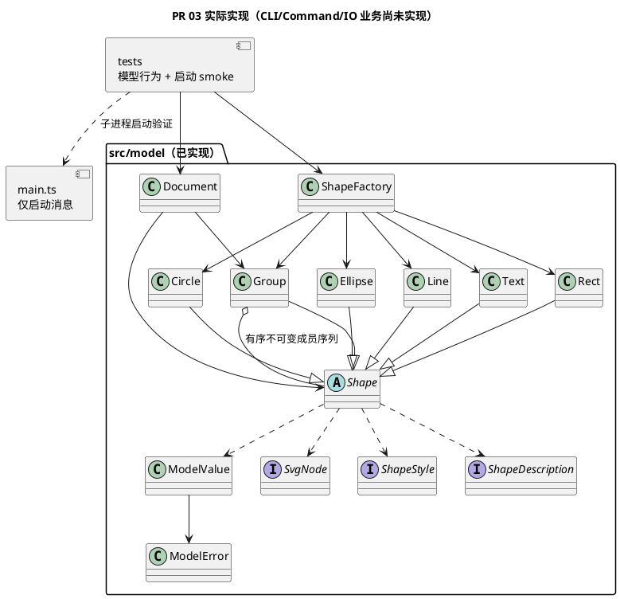
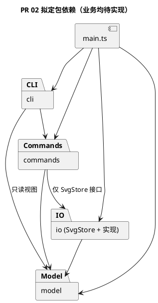
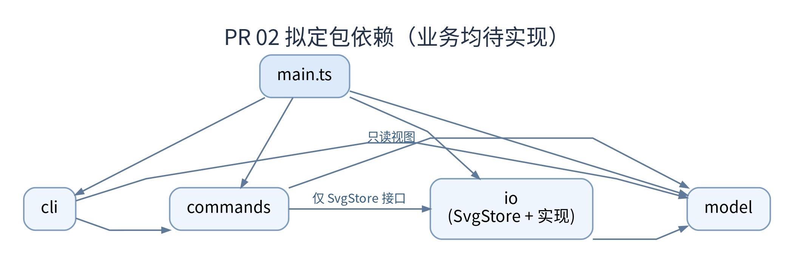
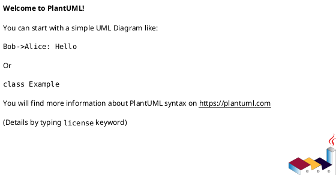

# Lab1 Phase 1 — 架构设计与开发过程报告

> 本文件是课程要求的交付文档，实际仓库路径必须为 **`doc/README.md`**。`doc/requirements/phase_cli_1.md` 仅保存原始需求。本文由开发过程中的 Codex 增量维护，最终内容需由学生审查确认。
>
> 记录状态：`[待实现]`、`[已实现待人工核验]`、`[人工已核验]`。没有证据时不得标记为已核验。

## 1. 架构方案

### PR 03 核心模型实现（2026-10-29，待人工验收）

本轮在 `feat/MODEL-001-shape-document` 实现 `src/model/`，未改变 PR 02 的四模块依赖方向或 D1–D6。整体目标图仍保留为拟定；当前实际业务组件如下，仅 model 已落地，main 尚不调用模型。

| 实际文件 | 职责及设计落地 |
|---|---|
| `Shape.ts`、`Rect.ts`、`Circle.ts`、`Ellipse.ts`、`Line.ts`、`Text.ts` | 封装 id/样式和各自几何，模板方法与多态计算 move/scale；属性白名单、clone、describe 和 SVG 节点输出 |
| `Group.ts` | Composite：递归准备几何更新后统一提交；样式留在组自身，子元素显式样式不被覆盖；成员序列冻结 |
| `Document.ts` | 画布、树、idIndex、parentIndex；候选结构校验后提交；D3 最深公共祖先及绘制顺序；删除子树、归属与层级、深拷贝 |
| `ShapeFactory.ts` | 六类唯一类型映射，CLI 参数值构造与中立节点适配共用；未引入注册/插件机制 |
| `SvgNode.ts`、`ShapeStyle.ts`、`ShapeDescription.ts` | 只读传输接口：XML 中立节点、显式样式、展示数据；非图形行为的数据袋替代品 |
| `ModelError.ts`、`ModelValue.ts` | 单行领域错误与重复标量校验，避免五类中重复数字解析；没有通用框架 |



设计细化与取舍：Document 独占结构修改，但 Group 不提供可写 children 或就地结构 mutator；通过 `withChildren` 构造新祖先组、校验候选树后同步提交 roots 与两张索引。代价是结构操作后旧 Group 引用可能过期，调用者必须按 id 重新 find。insert/构造克隆输入以隔离文档所有权；clone 是完整独立快照。具体约定见 [architecture.md §13](architecture.md#13-pr-03-实现对应说明2026-10-29)。这是对模型内部编辑协议的实现细化，无跨层依赖变化。完整 Command Undo/Redo 仍待后续 PR，当前只实现其需要的深拷贝。

几何更新先计算并检查整棵目标子树，再修改字段；避免后代数值溢出导致前面的节点已更新。结构操作先验证全体目标、重复/祖孙关系，之后建立候选并重建索引；失败不修改当前树或索引。只存显式样式，输出不补 fill/stroke 默认值。模型不处理 XML 转义或文件。

本轮会话已由用户确认：画布宽高为有限正数；图形尺寸、半径、stroke-width 非负且允许 0；group 至少一个目标、重复目标报错。D3 继续采用原深度优先绘制顺序收编，而非参数顺序。这些边界是用户补充确认，不冒充任务书原文。


### PR 02 架构草案（2026-10-28）

详细草案见 [architecture.md](architecture.md)（需求、类设计、流程、三张 PlantUML 源图、验收映射和 D1–D6 决策）。以下为新增拟议方案，业务类均 **[待实现]**；保留下文 PR 01 的历史事实和原人工字段，不将当时的“待设计”回写为已完成。

| 拟定目录 | 本轮明确的职责与组件 | 禁止承担的职责 |
|---|---|---|
| `src/cli/` | CliRepl、CommandParser、CommandDispatcher、CliRenderer：逐行输入、词法、构造命令、终端排版 | 写模型字段、文件访问、几何计算和历史算法 |
| `src/commands/` | Command、各具体命令、CommandExecutor、CommandHistory、EditorSession：操作编排、事务、历史、当前文档和读入路径 | 按图形类型分支、直接 fs/readline |
| `src/model/` | Document、Shape、五种叶子、Group、ShapeFactory：多态几何/属性行为、树不变量和唯一 id | 知道终端、历史或磁盘路径 |
| `src/io/` | SvgStore 接口、SvgFileStore、SvgParser、SvgSerializer：文件与 XML，返回已验证候选和警告 | 绕过 Document 直接改私有字段 |
| `src/main.ts` | 组合注入、启动 | 承担业务逻辑 |

**Command（拟定）**：每条操作构建对象，接收者为 Document/Shape。Executor 对编辑创建候选深副本，成功后提交并保存 before/after，复杂操作一个单元；失败不提交、不清空 redo。init/read/save/canvas 修改成功后清空并封锁历史，直到下一次成功编辑；canvas 查询和显示不影响历史。当前仅设计，尚无实现落地位置。

**Composite（拟定）**：Group extends Shape，move/scale 递归委派，叶子自行计算几何。普通组 set 推荐自身 SVG 样式继承；delete 对叶子/组统一由 Document 删除子树。Document 统一树写入、顺序、idIndex 和 parentIndex，拒绝循环、重复 id 和祖孙同时 group；根级 g 禁止解组遵循原文。

**拟定依赖规则及原因**：main → 全部（组合）；cli → commands、model 只读视图（隔离输入与业务）；commands → model、io 的 SvgStore 接口（复用领域行为及可注入存储）；io → model、Node fs（格式与存储适配）；model → 仅 model（保持领域独立）。所有反向依赖禁止；图形不感知历史，IO 不依赖 commands，避免循环。未来逐 PR 检查 imports 和实际写入调用，不以目录存在代替实现审查。




当前实际依赖仍是 `src/main.ts` 无 import，`tests/smoke.test.ts` 只用 Node 标准库；上图不是当前代码组件图。详细草案中接口实现关系与这里的包依赖一致。

**变化点与取舍（拟定）**：新增图形通过 Shape 子类和 Factory，新增命令通过 Command 子类和 Dispatcher；两处名称分派显式标记待重构，后续可替换为注册机制。本轮不实现 ShapeProvider、box 或插件加载。新入口复用 commands/model/io；XML 编解码与文件存储分离便于后续格式变化，暂不做多格式框架。推荐深副本换取原子性与可审查性，接受 O(历史×文档大小) 空间；增量历史为备选，见 D1。

**修订登记**：2026-10-28 / ARCH-001（PR 待创建、commit 待创建），在 PR 01 预留四目录基础上细化职责和依赖，没有改动实际工程或配置。现为“PR 02 架构草案，已完成人工确认”可以作为架构基线。


### PR 01 工程基线（2026-10-27）

本轮无业务架构变化，仅完成工程初始化。已建立 `src/cli/`、`src/commands/`、`src/model/`、`src/io/`（各含 `.gitkeep`）、`src/main.ts` 和 `tests/smoke.test.ts`。模块目录只是初始规划；领域模型和 Command 架构尚未正式设计，最终模块职责、依赖方向及 PlantUML 图待 PR 02 确定。下面的拟定模块和未填写字段继续保留，不代表已经实现。

工程配置：`package.json` 提供 build/start/dev/typecheck/test；`tsconfig.json` 仅编译 `src/` 到 `dist/`，采用 ES2022、CommonJS、Node 模块解析、strict、esModuleInterop、skipLibCheck，并启用 noEmitOnError。`tsconfig.tests.json` 继承配置，将测试单独编译到 `dist/tests/`，避免测试位于源码 rootDir 之外的错误；typecheck 同时检查源码和测试。`package-lock.json` 锁定依赖。

环境选择：使用已安装的 Node.js 24 LTS，工程 engines 限定 24.x；本地开发依赖 TypeScript `~5.9.3` 保持要求的 CommonJS/Node 配置，`@types/node` 使用 24.x 与运行环境匹配。测试使用 Node.js 内置工具，不引入第三方测试框架或业务抽象。

### 1.1 模块划分与职责

| 模块/目录 | 职责 | 对外接口或关键类 | 状态与证据 |
|---|---|---|---|
| `src/cli/`（拟定） | REPL 输入、解析与输出 | 待设计 | [待实现] |
| `src/commands/`（拟定） | Command 执行与历史管理 | 待设计 | [待实现] |
| `src/model/`（拟定） | Document、Shape、树结构 | 待设计 | [待实现] |
| `src/io/`（拟定） | SVG 读写 | 待设计 | [待实现] |

**组件图 / 包图（PlantUML，架构确定后补充）：**



**【人工核对】** 模块职责与边界是否符合你的真实设计意图？有没有上帝类、循环依赖或过度抽象？

- 审查结论：[待填写]
- 审查日期 / 对应 PR：[待填写]

### 1.2 设计模式选择及落地

- **Command 模式（必需）**：待实现；后续由 AI 填写命令接口、具体命令类、执行入口、历史管理及代码位置。
- **Composite 语义**：待实现；后续由 AI 填写叶子/容器统一操作机制及代码位置。
- **设计权衡**：待记录（包括为何不采用其他方案，以及代价）。

**【人工核对】** 是否真的通过多态与对象职责实现，而不是换个类名继续使用过程式分派？

- 审查结论：[待填写]

### 1.3 模块依赖方向规则

| 调用方 | 允许依赖 | 禁止依赖 | 理由 | 实际核查证据 |
|---|---|---|---|---|
| 待设计 | 待设计 | 待设计 | 待设计 | [待检查] |

**【人工决策】** 正式批准依赖方向后再标记为架构基线。结论：[待填写]

### 1.4 变化点假设与取舍

| 可能变化点 | 当前设计如何应对 | 代价或明确不预留的理由 | 人工确认 |
|---|---|---|---|
| 新增图形类型（后续插件化） | [待分析] | [待分析] | [待填写] |
| 新增命令入口 | [待分析] | [待分析] | [待填写] |
| 文件格式/读写策略 | [待分析] | [待分析] | [待填写] |

### 1.5 架构决策与修订记录

| 日期 / PR | 原方案 | 调整后方案 | 触发问题与理由 | 影响范围 | 人工状态 |
|---|---|---|---|---|---|
| [待记录] | | | | | [待核验] |

## 2. 过程记录

> 只记录真实且有代表性的讨论、建议、验证、反例与纠正；不要为凑字数编造“AI 曾建议”。每次会话不必强行制造设计分歧，但应记下实际改动和证据。

### 2.1 开发会话日志（按时间追加，不覆盖历史）

| 日期 / 分支 / PR | 本次目标 | 实际修改与证据（文件、提交、测试） | AI 建议及采用情况 | 问题与纠正 | 未决事项 / 人工复核 |
|---|---|---|---|---|---|
| [待执行] | | | | | |
| 2026-10-27 / `chore/INIT-001-project-setup` / INIT-001（PR 待创建） | TypeScript 工程初始化 | 新增 `package.json`、`package-lock.json`、`tsconfig.json`、`tsconfig.tests.json`、`src/main.ts`、四个模块目录的 `.gitkeep`、`tests/smoke.test.ts`；增量更新根 `README.md` 和本报告。原有未提交的 README 内容、`AGENTS.md`、任务书和报告框架保留，并作为本阶段基线纳入提交；commit 待创建，实际 hash 见会话最终汇报 | 采用独立测试编译配置和 Node 内置测试；本轮未发生代表性业务设计纠错 | 上轮环境检查未找到 Node/npm，本轮已可用；`npm --version` 遇到 npm.ps1 执行策略限制，改用 `npm.cmd`，未修改系统策略；沙箱创建分支失败，获准提升权限后成功；依赖安装请求返回 EACCES，终止重试并获准访问 registry 后安装成功 | 自动验证均通过；人工验收、个人反思待填写；业务能力待后续 PR |

本轮实际步骤：读取约束、原始任务书和已有文档 → 检查 Git 状态及原有 README diff → 创建功能分支 → 添加工程配置、入口与 smoke test → 安装依赖 → 增量更新 README → 执行验证 → 更新本报告 → 检查 diff 与暂存内容 → 验收通过后创建一次本地提交。不创建远程 PR、不推送、不创建 final tag。

### 2.2 有代表性的 AI 协作案例

**案例编号：[001-PR2中潜在循环依赖问题]**

- 工程背景/遇到的问题：AI写的架构文件中“命令覆盖与状态归属”的模块中可能有循环依赖的潜在问题。
- AI 原建议（如有，保留可追溯摘要）：architecture.md文件中的1.2节中说
```
| help / HelpCommand | CommandDispatcher 提供语法描述 | 全部语法；不改变历史 |
```
- 我发现的问题与判断理由：HelpCommand 需要显示所有命令的使用说明，但这些说明由 CommandDispatcher 提供，那么 HelpCommand 应该怎样拿到这些数据呢？

CommandDispatcher 位于 cli 模块，负责识别命令、提供命令语法说明。HelpCommand 位于 commands 模块，负责执行 help 命令。依赖规则规定 cli → commands，不允许 commands → cli。

如果直接
```
import { CommandDispatcher } from "../cli/CommandDispatcher";
```
就有可能形成CLI 要 import HelpCommand，HelpCommand 又要 import CommandDispatcher的情况，构成循环依赖。

- 如何验证与修正（文件、测试、结果）：明确规定Dispatcher 创建 HelpCommand 时直接把数据给它，这样HelpCommand 只知道自己收到了一段帮助文字，完全不知道文字由谁提供。


### 2.3 PR 02 会话记录（2026-10-28）

- 分支：`docs/ARCH-001-design`；PR 待创建；commit 待创建，本轮按用户要求不暂存、不提交、不推送、不创建 PR/tag。
- Git 证据：初始分支 `chore/INIT-001-project-setup` 工作区干净；`git log main -3 --oneline` 显示 `05d26ba Merge pull request #1` 包含 `8374cb9`；祖先检查成功。`git fetch origin` 首次因 `.git/FETCH_HEAD` 写权限失败，经自动审批提升权限后成功；fetch 后 `git rev-list --left-right --count main...origin/main` 为 `0 0`。从 main 创建目标分支，未修改 remote 配置或已有历史。
- 阅读 AGENTS、根 README、完整任务书、原报告、package/两份 tsconfig、现有源码和测试，确认业务未实现。新增 `doc/architecture.md`，增量更新本报告，未改源码、测试、配置、锁文件或原始任务书。
- AI 建议：保留四目录，分离解析/分发/执行和 XML/文件职责；采用 Command + 候选副本，模型多态 clone 及 before/after 历史，替代仅靠逆操作。考虑逆操作/局部快照可节省内存，但浮点回算和复合结构恢复增加验证成本，建议作为备选交人工决策，未宣称用户已接受。
- 实际发现：任务书根级 g 解组限制与常见编辑器习惯不同；跨父 group 的组位置/顺序、普通 g 样式 set、save-as 路径生命周期与外部 transform 范围未完全明确，草案列 D2–D5 供用户确认，没有补写为老师强制规则。
- 检查与纠正：首次 PowerShell 读取中文显示乱码，显式 UTF-8 重读；首次批量读取输出过长，分文件补读，避免凭截断内容设计。未发生用户与 AI 的代表性设计争论，不编造人工反馈。工程检查和设计检查结果见 §3.3、§4.4。
- **【人工填写】[待填写]** 请在 §2.2 或此处记录本人实际判断、是否采纳推荐及真实分歧和收获；个人反思：[待填写]。

### 2.4 PR 03 会话记录（2026-10-29）

- 分支 `feat/MODEL-001-shape-document`；PR 待创建；commit 待创建，本轮不暂存、提交、推送、合并或创建 PR。
- 前置证据：fetch 成功，原 PR02 远程分支已不存在，不能再用该远程分支名判断合并；改查已知提交 `c488e2f` 的祖先关系，退出码 0。`main` 和 `origin/main` 均为 `5be3aae`（Merge pull request #2），差异计数 `0 0`，初始工作区干净；从 main 创建指定分支。
- 阅读规范、根 README、报告、任务书、架构及当前配置/源码/测试；沿用 TypeScript、Node 内置测试。向用户说明尺寸/group 边界并收到“采用以上规则”，随后落实有限正画布、非负几何尺寸/笔宽、至少一个 group 目标和重复目标拒绝。
- 实际新增 `src/model/` 下 14 个 TS 文件、`tests/shapes.test.ts`、`tests/document.test.ts`、`tests/factory.test.ts`；移除 model/.gitkeep；package.json 只扩大原测试发现范围，避免 npm test 漏跑新测试；更新根 README、architecture.md §13 与本报告。
- AI 设计取舍：采用冻结 children 和重建祖先组，替代导出可写结构能力；保留领域对象的几何行为与私有状态，Document 统一校验后提交树/索引。采用两阶段几何更新确保直接调用 Group.move/scale 也具备数值失败原子性。代价与引用生命周期如实记录在架构说明，未新增历史执行器或 IO。
- 检查与修正：源码审阅时限制 Shape 构造器样式参数只能走公共样式分支，避免未知参数触发尚未初始化的叶子字段；将 D3 公共祖先变量显式保留 null（根）语义。首轮 39 项测试通过后，补查中立 SVG 节点循环输入，添加访问路径检测及回归测试，最终 40 项通过。没有实际测试失败，不虚构失败/人工争论。
- 本轮没有修改 D1–D6 人工结论，也没有代填个人反思；后续 IO 负责 XML 解析、缺 id 分配、几何缺省值规范化和文件回读。模型中立节点往返不等于 SVG 文件读写已实现。

**【人工填写】[已填写]** 请记录本人对“冻结成员序列、按 id 重新定位”和“两阶段几何更新”取舍的真实判断，以及亲自运行模型测试后的观察；如没有分歧如实填写。个人反思：对于 Group 成员序列冻结与按 ID 重新定位，我理解到，Document 不直接暴露可写的 children，可以避免外部代码绕过 Document 修改图形的父子关系和顺序。结构操作通过重建相关 Group 并统一提交，可以更好地维护树结构与索引的一致性。虽然这意味着旧对象引用可能失效，但图形 ID 保持不变，因此后续 Command 可以保存 ID，并在执行时通过 Document 重新查找目标。我接受这一设计取舍。
对于 两阶段几何更新，我认为其主要价值在于保证失败原子性：先计算并校验所有受影响图形的新几何值，只有全部合法后才统一更新，避免在嵌套 Group 移动或缩放过程中出现部分图形已修改、部分图形因数值溢出而失败的情况。虽然增加了一定的实现复杂度，但有利于保证模型状态可靠，因此接受该方案。

## 3. 一致性自查

### PR 03 一致性检查（2026-10-29）

| 检查项 | 结果 | 证据及限制 |
|---|---|---|
| 实际目录与范围 | 通过（自动检查） | 14 个 model TS 文件（11 类、3 接口）；3 份新增模型测试；移除 model/.gitkeep；未修改其他业务层或 main |
| 一类一文件 | 通过（TypeScript AST 检查） | 每个类名与文件名一致，单文件最多一类；接口文件单独命名 |
| 允许依赖及无循环 | 通过（TypeScript AST + DFS 检查） | 全部模型 import 为本目录路径且目标存在；含类型依赖在内没有环；没有 cli/commands/io/fs 依赖 |
| 多态与两处分派 | 通过（源代码检查） | 模型无 switch；几何各叶子独立实现；Factory 私有 Map 是唯一类型名映射；instanceof Group 只用于结构容器 |
| 既有配置与源码范围 | 通过 | src/cli、commands、io、main、两份 tsconfig、锁文件、AGENTS、任务书无 diff；package.json 仅将单项测试入口改为测试通配符 |
| PR 02 设计细化 | 已登记 | architecture.md §13 记录冻结成员序列、候选提交、引用生命周期与 Factory 适配范围；已确认 D1–D6 未改写 |

**【人工核对】[已核验]** 请复核 Group 结构封装、D3、模型依赖与实际图；自动结果不等同人工认可。结论：结合 PR02 已确认的架构方案及 PR03 的实现和测试报告，对模型层的一致性进行了复核。认可Group 结构封装通过冻结成员序列、重建相关 Group 并由 Document 统一提交结构变化的设计。该方式能够限制外部代码直接修改父子关系，维护图形树与索引的一致性。接受结构变更后旧对象引用可能失效、调用者需按 ID 重新定位的约定。确认D3 跨父分组采用最深公共祖先作为新组父节点，按照原文档深度优先绘制顺序收编选中图形，并依据已确认规则确定新组位置。理解该操作不保证所有未选图形的视觉叠放关系保持不变，且 `ungroup` 不等同于撤销 `group`。关于模块依赖与架构一致性，根据现有静态检查报告，模型层不存在对 CLI、Commands、IO 或 Node 文件系统的依赖，未发现循环依赖。Shape 子类负责各自的几何行为，Document 负责结构管理，ShapeFactory 集中处理图形类型分派，整体符合 PR02 确定的架构方向。
基于目前的实现说明、测试报告和静态检查结果，未发现 PR03 模型层与 PR02 已确认架构之间的明显冲突，认可当前实现方案。实际功能的正确性以已有自动化测试为初步依据，后续仍需通过 Command、CLI 与 IO 层的集成测试进一步验证。

### 3.1 模块划分与方案一致性

| 计划模块 | 实际文件/目录 | 是否一致 | 差异与修订记录 | 人工确认 |
|---|---|---|---|---|
| PR 01 初始目录与文档 | `src/main.ts`、四个预留模块目录、`tests/smoke.test.ts`、`doc/README.md`、`doc/requirements/phase_cli_1.md` | 通过（自动检查） | 与本轮规划一致；未创建 `docs/`；业务模块仍未实现。原有 `AGENTS.md`、需求文件未改写 | 【人工核对】[已核验] |
| 工程与依赖配置 | `package.json`、`package-lock.json`、`tsconfig.json`、`tsconfig.tests.json`、`.gitignore` | 通过（自动检查） | `npm.cmd ls --depth=0` 显示 typescript 5.9.3、@types/node 24.19.2；现有忽略规则已覆盖所需产物，无需修改 `.gitignore` | 【人工核对】[已核验] |

路径检查：`rg -n 'docs/' AGENTS.md README.md doc` 只命中 README 中 PR 02 的分支名 `docs/ARCH-001-design`，其含义是 Git 分支命名，不是课程文档路径，故保留。

### 3.2 依赖方向一致性

| 规则 | 检查方式与范围 | 检查结果 | 违规证据/修复提交 | 人工确认 |
|---|---|---|---|---|
| [待确定] | [待执行] | [未检查] | | [待填写] |

PR 01：业务架构与模块依赖关系暂不适用，待后续实现。检查 `src/main.ts` 仅包含启动输出，没有 import 或业务类；测试只依赖 Node.js 标准库，通过子进程验证已编译入口。未发现本轮越界实现；不将此结论视为最终架构一致性验收。

**【人工核对】** 结论是否与实际代码相符？抽查哪些 import、调用关系？结论：[待填写]

### 3.3 PR 02 一致性自查（2026-10-28）

| 检查范围 | 结果 | 依据及限制 |
|---|---|---|
| 实际目录与改动范围 | 通过 | `rg --files --hidden` 显示四目录 .gitkeep、main 和 smoke；仅新增 architecture.md 和修改本报告。没有建立课程 `docs/` 目录，分支的 docs/ 前缀不代表文件目录 |
| 需求与命令责任覆盖 | 通过（设计检查） | architecture.md §1.2 覆盖四类文档命令、十个编辑命令、三类显示和 undo/redo；§11 按原文段落映射后续测试。不能视为功能测试通过 |
| 图文内部一致性 | 通过（源文本审阅） | 三张图对应四目录、Document/Shape、Command/Executor/History 和候选提交；组件/包图均为 commands → io 接口、io → model，无 io → commands；移动流程与快照恢复相符 |
| 业务代码依赖与封装 | 未检查（尚无实现） | 当前 main 无业务依赖；未来类图中的模型封装、树协议和 import 必须在实现后逐项验证 |
| 工程与配置未误改 | 通过 | `git diff -- src tests package.json package-lock.json tsconfig.json tsconfig.tests.json README.md AGENTS.md doc/requirements/phase_cli_1.md` 无输出 |


## 4. 质量保证手段

### 4.1 验证记录

| 日期 / PR | 验证命令或测试场景 | 实际结果 | 证据（输出摘要 / 文件位置） | 已知限制 |
|---|---|---|---|---|
| [待执行] | | [未运行] | | |
| 2026-10-27 / INIT-001 | `git --version`、`node --version`、`npm.cmd --version`、`node -p "process.release.lts"` | 通过 | Git 2.54.0.windows.1；Node v24.22.1；npm 11.19.1；LTS 代号 Krypton | `npm --version` 被 PowerShell 策略阻止，使用 npm.cmd 解决 |
| 2026-10-27 / INIT-001 | `npm.cmd install --save-dev typescript@~5.9.3 @types/node@24 --cache .npm --fetch-retries=0` | 通过 | added 3 packages，audited 4 packages，0 vulnerabilities；`npm.cmd ls --depth=0` 无缺失依赖 | 先前沙箱安装尝试因 EACCES 未完成，获准访问后成功；未安装全局依赖 |
| 2026-10-27 / INIT-001 | `npm.cmd run build` | 通过，退出码 0 | 生成 `dist/main.js` | 仅最小入口 |
| 2026-10-27 / INIT-001 | `npm.cmd run typecheck` | 通过，退出码 0 | 源码及测试均无类型错误 | 尚无业务类型 |
| 2026-10-27 / INIT-001 | `npm.cmd test` | 通过，退出码 0 | Node 内置测试执行 1 项，pass 1 / fail 0；检查子进程无启动错误、退出码 0、stderr 为空和正确启动消息 | 仅启动 smoke test；业务测试尚未实现 |
| 2026-10-27 / INIT-001 | `npm.cmd start`、`npm.cmd run dev` | 均通过，退出码 0 | 均输出 `SVG Editor CLI started!` | 没有 REPL 或 SVG 编辑功能 |
| 2026-10-27 / INIT-001 | `git check-ignore -v node_modules/ dist/ .npm/ .env setup.log setup.tsbuildinfo` | 通过 | 命中现有 `.gitignore` 规则 | 源码、配置、锁文件、文档的暂存检查在提交前执行 |
| 2026-10-27 / INIT-001 | `git diff --cached --stat`、`git diff --cached --name-only`、`git status --short` | 通过 | 暂存 14 个工程与文档文件，包含原有规范和任务书；没有依赖、构建产物、日志或环境文件 | 尚未创建提交，hash 由最终汇报提供 |
| 2026-10-27 / INIT-001 | `git diff --cached --check` | 存在原始文件格式提示 | 仅提示 `doc/requirements/phase_cli_1.md:522: new blank line at EOF` | 该文件原有末尾空行保留，未为消除提示改写任务书；本轮新增工程文件无此问题 |

截至 2026-10-27，根据 [Node.js 官方发布计划](https://raw.githubusercontent.com/nodejs/Release/main/schedule.json)，24.x LTS 支持至 2028-04-30，本轮沿用该已安装版本。`npm ci` 尚未运行；未进行 SVG 功能测试、IO 回读或最终课程验收，下面功能覆盖项继续保持 [未验证]。

### 4.2 功能与异常覆盖

| 场景 | 状态 | 测试位置 / 手工操作证据 |
|---|---|---|
| 六种图形类型 | [未验证] | |
| create / delete / move / scale / set | [未验证] | |
| group / ungroup / addto / front / back | [未验证] | |
| undo / redo 和 IO 后禁止规则 | [未验证] | |
| read / save SVG 回读 | [未验证] | |
| 唯一 id、错误原子性和非法参数 | [未验证] | |
| tree / show / help 与 REPL | [未验证] | |

### 4.3 遗留风险与最终人工验收

- 已知缺陷或未覆盖情况：[待记录]
- **【人工填写】** 你亲自运行/观察过的主要场景：[待填写]
- **【人工填写】** 你认为当前架构最值得改进之处：[待填写]
- **【人工填写】** 是否认可本阶段功能完整性与质量依据，为什么：[待填写]
- 最终签收日期、PR/Commit：[待填写]

### 4.4 PR 02 实际验证记录（2026-10-28）

| 命令 / 检查 | 结果 | 范围与限制 |
|---|---|---|
| `npm.cmd run build` | 通过，退出码 0 | 原有最小入口编译 |
| `npm.cmd run typecheck` | 通过，退出码 0 | src 与 tests 两份配置 |
| `npm.cmd test` | 通过，退出码 0；1 项 pass、0 fail | 仅原有启动 smoke，不含 SVG 业务功能 |
| `rg --files --hidden`（排除 git/依赖/产物）、读取文件与链接检查 | 通过 | 文档均在 doc，architecture.md 到报告和任务书的相对路径存在 |
| 对照原始任务书逐条检查、审阅 PlantUML 源与职责表 | 通过（设计检查） | 覆盖详见 architecture.md §11；D1–D6 未经人工确认 |
| `Get-Command plantuml, java -ErrorAction SilentlyContinue` | 无命令返回 | 未运行 PlantUML 渲染或语法工具；三图仅保存源代码和人工源文本检查 |
| `git diff --check`、新增文档空白检查 | 通过 | 完成后再次检查；未暂存文件需额外检查，不只依赖 git diff |
| 临时 Node stdin 脚本（未新增脚本文件） | 通过 | 两份文档无行尾空白；UML 起止配对，草案 3 块、报告 2 块（含原占位图）；19 个命令名及文档目标存在；仅为存在性检查，不代表语义或 UML 语法验证 |
| `git status --short`、受保护路径 diff | 仅报告修改和新增架构文档；其他路径无 diff | 没有提交或暂存；dist 为被忽略构建产物 |

本轮 `npm ci`、start/dev、业务测试、SVG 文件回读、浏览器演示、最终功能验收均 **未运行**；没有新增测试或声称测试覆盖率。既有 §4.2 功能项仍为 [未验证]。文档设计风险及后续测试计划不能代替实现结果。

### 4.5 PR 03 验证记录（2026-10-29）

| 实际命令 / 检查 | 结果 | 验证范围与限制 |
|---|---|---|
| `npm.cmd run typecheck` | 通过，退出码 0 | 同时检查 src 与 tests；实现初版及最终模型均运行 |
| `npm.cmd test`（内部执行 `npm run build`） | 最终通过，退出码 0；40 项 pass、0 fail | 39 项新增模型测试 + 1 项原有启动 smoke；构建和测试编译均通过 |
| 首轮 `npm.cmd test` | 39 项通过、0 fail | 随后新增循环中立节点防护用例，最终测试数增加至 40，无失败修复记录 |
| `rg -n '^import.../class/interface/switch' src/model`、临时 Node + TypeScript AST 检查 | 通过 | 14 文件、11 类；名称与文件一致；本目录 import、无循环；无 switch、无行尾空白。临时脚本经 stdin 运行，未新增通用检查框架 |
| `git diff -- src/cli src/commands src/io src/main.ts tsconfig.json tsconfig.tests.json package-lock.json AGENTS.md doc/requirements/phase_cli_1.md` | 无输出 | 没有跨范围业务改动或改写权威任务书 |
| `git diff --check`、文档链接及新增文件空白检查 | 通过（本轮改动） | 新文件单独检查；首次整文件扫描发现 architecture.md 第 361 行已有人工标记尾空格，与 main 完全相同，保留人工内容；复查只要求本轮新增内容无空白错误。相对链接目标存在，UML 起止配对，不代表渲染通过 |

模型测试的要求映射：六类构造/描述/属性读取和几何/样式白名单见 shapes.test 与 factory.test；嵌套递归、显式子样式保留、数值溢出原子性见 shapes.test；id 大小写、插入/子树删除、D3 跨父/同父/根公共祖先、ungroup 根限制、addTo 成环拒绝、front/back、快照独立性及失败内容/索引保持见 document.test。Factory 还检查未知 box/类型、参数个数、数值 token、中立节点往返和循环输入。不是仅检查文件存在。

当前质量边界：没有安装/配置 lint 或测试覆盖率工具，未运行 lint、覆盖率或 PlantUML 渲染；无对应结果。未运行 CLI 业务、Command Undo/Redo、实际 SVG 文件读写、浏览器演示或性能基准。§4.2 的 CLI 功能验收项保留 [未验证]，本轮模型成功不将它们升级为完成。

已知限制：结构操作需要遍历重建索引，Group 构造还校验子树，深层大树可能有额外遍历成本；未做深度/性能基准。结构变更后应重新 find 容器 id。fromSvgNode 期望已解析/规范化节点，不能代替 SVG Parser。用户人工验收仍待完成。

## 5. 本次会话待人工处理清单

> AI 每次开发会话结束时更新这里，只保留当前仍未处理的问题；已解决事项迁移到相应章节的审查结论或记录中。不得替用户填“已审核”。

- [ ] **【人工核对】[已核验]** 对照 `package.json`、两份 tsconfig、`src/main.ts` 和 `tests/smoke.test.ts`，复核第 1 节工程基线、第 3 节一致性自查，确认目录创建没有被误写为完成业务架构。[判断]没有被误写为完成业务架构
- [ ] **【人工核对】[已核验]** 在本机用 `npm.cmd run build`、`npm.cmd run typecheck`、`npm.cmd test`、`npm.cmd start` 复现第 4.1 节结果，确认启动输出和 1 项测试；第 4.3 节保留个人验收结论。[判断]复现成功，确认启动输出和测试没问题。
- [ ] **【人工填写】[已填写]** 在第 2.2 节按真实经历填写个人判断与收获；没有实际分歧时如实注明，不补写不存在的讨论。第 4.3 节填写本人观察、质量评价及签收信息；架构相关字段待 PR 02 设计后填写。[判断]
- [ ] **【人工决策】[已填写]** 在 `doc/architecture.md` §12 D1–D6（进入 PR 03 前）逐项填写：快照历史 / 普通 g 样式 / 跨父分组 / 默认保存路径 / 外部 SVG 和 transform 范围 / 模块及树写入协议。每项已提供推荐理由与备选；将批准结论同步本报告 PR 02 架构小节。
- [ ] **【人工核对】[已核验]** 在 `doc/architecture.md` §12 核对任务书限制、两处分派及三图，建议用跨父 group 和子节点显式 fill 两个例子检验 D2/D3；本报告 §3.3 填写结论。使用 PlantUML 预览工具检查三图语法/布局，本轮尚未渲染。
- [ ] **【人工核对】[已核验]** 核验本报告 §2.3 的分支与 PR #1 合并事实、§4.4 的自动检查结果；可用 git log 和 npm 三条命令复现，确认只有两份文档改动。人工核验结果仍待本人填写。
- [ ] **【人工填写】[已填写]** 在本报告 §2.2/§2.3 补充对架构取舍的真实判断和反思；在 architecture.md §12 填写本人接受或调整的理由。§4.3 最终验收字段继续保留
- [ ] **【人工核对】[已核验]** PR03：对照本报告 §1 PR03 实现图、§3 PR03 自查及 architecture.md §13，抽查 `Group.ts` 的冻结数组/withChildren/clone 和 `Document.ts` 的 transform/commit；确认结构操作后按 id 重定位可接受，并确认没有实现 CLI/Commands/IO。
- [ ] **【人工核对】[已核验]** PR03：运行 `npm.cmd run typecheck`、`npm.cmd test`，复现 §4.5 的 40 项通过；特别查看 document.test 的 D3 嵌套跨父用例、shapes.test 的溢出用例和 factory.test 的循环输入用例。
- [ ] **【人工填写】[已填写]** PR03：在 §2.4 填写本人对结构封装、深副本及失败原子性的真实反思；本轮验收意见与是否提交由本人决定，不代填通过或执行 commit。
