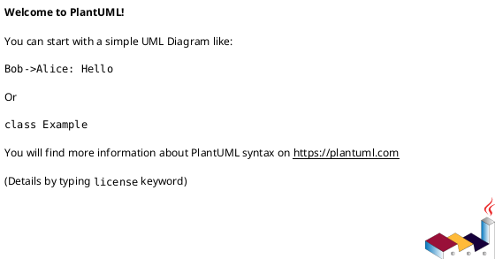

# Lab1 Phase 1 — 架构设计与开发过程报告

> 本文件是课程要求的交付文档，实际仓库路径必须为 **`doc/README.md`**。`doc/requirements/phase_cli_1.md` 仅保存原始需求。本文由开发过程中的 Codex 增量维护，最终内容需由学生审查确认。
>
> 记录状态：`[待实现]`、`[已实现待人工核验]`、`[人工已核验]`。没有证据时不得标记为已核验。

## 1. 架构方案

### PR 01 工程基线（2026-10-27）

本轮无业务架构变化，仅完成工程初始化。已建立 `src/cli/`、`src/commands/`、`src/model/`、`src/io/`（各含 `.gitkeep`）、`src/main.ts` 和 `tests/smoke.test.ts`。模块目录只是初始规划；领域模型和 Command 架构尚未正式设计，最终模块职责、依赖方向及 PlantUML 图待 PR 02 确定。下面的拟定模块和未填写字段继续保留，不代表已经实现。

工程配置：`package.json` 提供 build/start/dev/typecheck/test；`tsconfig.json` 仅编译 `src/` 到 `dist/`，采用 ES2022、CommonJS、Node 模块解析、strict、esModuleInterop、skipLibCheck，并启用 noEmitOnError。`tsconfig.tests.json` 继承配置，将测试单独编译到 `dist/tests/`，避免测试位于源码 rootDir 之外的错误；typecheck 同时检查源码和测试。`package-lock.json` 锁定依赖。

环境选择：使用已安装的 Node.js 24 LTS，工程 engines 限定 24.x；本地开发依赖 TypeScript `~5.9.3` 保持要求的 CommonJS/Node 配置，`@types/node` 使用 24.x 与运行环境匹配。测试使用 Node.js 内置工具，不引入第三方测试框架或业务抽象。

### 1.1 模块划分与职责

| 模块/目录 | 职责 | 对外接口或关键类 | 状态与证据 |
|---|---|---|---|
| `src/cli/`（拟定） | REPL 输入、解析与输出 | 待设计 | [待实现] |
| `src/commands/`（拟定） | Command 执行与历史管理 | 待设计 | [待实现] |
| `src/model/`（拟定） | Document、Shape、树结构 | 待设计 | [待实现] |
| `src/io/`（拟定） | SVG 读写 | 待设计 | [待实现] |

**组件图 / 包图（PlantUML，架构确定后补充）：**

**【人工核对】** 模块职责与边界是否符合你的真实设计意图？有没有上帝类、循环依赖或过度抽象？

- 审查结论：[待填写]
- 审查日期 / 对应 PR：[待填写]

### 1.2 设计模式选择及落地

- **Command 模式（必需）**：待实现；后续由 AI 填写命令接口、具体命令类、执行入口、历史管理及代码位置。
- **Composite 语义**：待实现；后续由 AI 填写叶子/容器统一操作机制及代码位置。
- **设计权衡**：待记录（包括为何不采用其他方案，以及代价）。

**【人工核对】** 是否真的通过多态与对象职责实现，而不是换个类名继续使用过程式分派？

- 审查结论：[待填写]

### 1.3 模块依赖方向规则

| 调用方 | 允许依赖 | 禁止依赖 | 理由 | 实际核查证据 |
|---|---|---|---|---|
| 待设计 | 待设计 | 待设计 | 待设计 | [待检查] |

**【人工决策】** 正式批准依赖方向后再标记为架构基线。结论：[待填写]

### 1.4 变化点假设与取舍

| 可能变化点 | 当前设计如何应对 | 代价或明确不预留的理由 | 人工确认 |
|---|---|---|---|
| 新增图形类型（后续插件化） | [待分析] | [待分析] | [待填写] |
| 新增命令入口 | [待分析] | [待分析] | [待填写] |
| 文件格式/读写策略 | [待分析] | [待分析] | [待填写] |

### 1.5 架构决策与修订记录

| 日期 / PR | 原方案 | 调整后方案 | 触发问题与理由 | 影响范围 | 人工状态 |
|---|---|---|---|---|---|
| [待记录] | | | | | [待核验] |

## 2. 过程记录

> 只记录真实且有代表性的讨论、建议、验证、反例与纠正；不要为凑字数编造“AI 曾建议”。每次会话不必强行制造设计分歧，但应记下实际改动和证据。

### 2.1 开发会话日志（按时间追加，不覆盖历史）

| 日期 / 分支 / PR | 本次目标 | 实际修改与证据（文件、提交、测试） | AI 建议及采用情况 | 问题与纠正 | 未决事项 / 人工复核 |
|---|---|---|---|---|---|
| [待执行] | | | | | |
| 2026-10-27 / `chore/INIT-001-project-setup` / INIT-001（PR 待创建） | TypeScript 工程初始化 | 新增 `package.json`、`package-lock.json`、`tsconfig.json`、`tsconfig.tests.json`、`src/main.ts`、四个模块目录的 `.gitkeep`、`tests/smoke.test.ts`；增量更新根 `README.md` 和本报告。原有未提交的 README 内容、`AGENTS.md`、任务书和报告框架保留，并作为本阶段基线纳入提交；commit 待创建，实际 hash 见会话最终汇报 | 采用独立测试编译配置和 Node 内置测试；本轮未发生代表性业务设计纠错 | 上轮环境检查未找到 Node/npm，本轮已可用；`npm --version` 遇到 npm.ps1 执行策略限制，改用 `npm.cmd`，未修改系统策略；沙箱创建分支失败，获准提升权限后成功；依赖安装请求返回 EACCES，终止重试并获准访问 registry 后安装成功 | 自动验证均通过；人工验收、个人反思待填写；业务能力待后续 PR |

本轮实际步骤：读取约束、原始任务书和已有文档 → 检查 Git 状态及原有 README diff → 创建功能分支 → 添加工程配置、入口与 smoke test → 安装依赖 → 增量更新 README → 执行验证 → 更新本报告 → 检查 diff 与暂存内容 → 验收通过后创建一次本地提交。不创建远程 PR、不推送、不创建 final tag。

### 2.2 有代表性的 AI 协作案例

**案例编号：[待记录]**

- 工程背景/遇到的问题：[待填写]
- AI 原建议（如有，保留可追溯摘要）：[待填写]
- 我发现的问题与判断理由：**【人工填写】** [待填写]
- 如何验证与修正（文件、测试、结果）：[待填写]
- 最终取舍及收获：**【人工填写】** [待填写]

## 3. 一致性自查

### 3.1 模块划分与方案一致性

| 计划模块 | 实际文件/目录 | 是否一致 | 差异与修订记录 | 人工确认 |
|---|---|---|---|---|
| [待检查] | | [未检查] | | [待填写] |
| PR 01 初始目录与文档 | `src/main.ts`、四个预留模块目录、`tests/smoke.test.ts`、`doc/README.md`、`doc/requirements/phase_cli_1.md` | 通过（自动检查） | 与本轮规划一致；未创建 `docs/`；业务模块仍未实现。原有 `AGENTS.md`、需求文件未改写 | 【人工核对】[待核验] |
| 工程与依赖配置 | `package.json`、`package-lock.json`、`tsconfig.json`、`tsconfig.tests.json`、`.gitignore` | 通过（自动检查） | `npm.cmd ls --depth=0` 显示 typescript 5.9.3、@types/node 24.19.2；现有忽略规则已覆盖所需产物，无需修改 `.gitignore` | 【人工核对】[待核验] |

路径检查：`rg -n 'docs/' AGENTS.md README.md doc` 只命中 README 中 PR 02 的分支名 `docs/ARCH-001-design`，其含义是 Git 分支命名，不是课程文档路径，故保留。

### 3.2 依赖方向一致性

| 规则 | 检查方式与范围 | 检查结果 | 违规证据/修复提交 | 人工确认 |
|---|---|---|---|---|
| [待确定] | [待执行] | [未检查] | | [待填写] |

PR 01：业务架构与模块依赖关系暂不适用，待后续实现。检查 `src/main.ts` 仅包含启动输出，没有 import 或业务类；测试只依赖 Node.js 标准库，通过子进程验证已编译入口。未发现本轮越界实现；不将此结论视为最终架构一致性验收。

**【人工核对】** 结论是否与实际代码相符？抽查哪些 import、调用关系？结论：[待填写]

## 4. 质量保证手段

### 4.1 验证记录

| 日期 / PR | 验证命令或测试场景 | 实际结果 | 证据（输出摘要 / 文件位置） | 已知限制 |
|---|---|---|---|---|
| [待执行] | | [未运行] | | |
| 2026-10-27 / INIT-001 | `git --version`、`node --version`、`npm.cmd --version`、`node -p "process.release.lts"` | 通过 | Git 2.54.0.windows.1；Node v24.22.1；npm 11.19.1；LTS 代号 Krypton | `npm --version` 被 PowerShell 策略阻止，使用 npm.cmd 解决 |
| 2026-10-27 / INIT-001 | `npm.cmd install --save-dev typescript@~5.9.3 @types/node@24 --cache .npm --fetch-retries=0` | 通过 | added 3 packages，audited 4 packages，0 vulnerabilities；`npm.cmd ls --depth=0` 无缺失依赖 | 先前沙箱安装尝试因 EACCES 未完成，获准访问后成功；未安装全局依赖 |
| 2026-10-27 / INIT-001 | `npm.cmd run build` | 通过，退出码 0 | 生成 `dist/main.js` | 仅最小入口 |
| 2026-10-27 / INIT-001 | `npm.cmd run typecheck` | 通过，退出码 0 | 源码及测试均无类型错误 | 尚无业务类型 |
| 2026-10-27 / INIT-001 | `npm.cmd test` | 通过，退出码 0 | Node 内置测试执行 1 项，pass 1 / fail 0；检查子进程无启动错误、退出码 0、stderr 为空和正确启动消息 | 仅启动 smoke test；业务测试尚未实现 |
| 2026-10-27 / INIT-001 | `npm.cmd start`、`npm.cmd run dev` | 均通过，退出码 0 | 均输出 `SVG Editor CLI started!` | 没有 REPL 或 SVG 编辑功能 |
| 2026-10-27 / INIT-001 | `git check-ignore -v node_modules/ dist/ .npm/ .env setup.log setup.tsbuildinfo` | 通过 | 命中现有 `.gitignore` 规则 | 源码、配置、锁文件、文档的暂存检查在提交前执行 |
| 2026-10-27 / INIT-001 | `git diff --cached --stat`、`git diff --cached --name-only`、`git status --short` | 通过 | 暂存 14 个工程与文档文件，包含原有规范和任务书；没有依赖、构建产物、日志或环境文件 | 尚未创建提交，hash 由最终汇报提供 |
| 2026-10-27 / INIT-001 | `git diff --cached --check` | 存在原始文件格式提示 | 仅提示 `doc/requirements/phase_cli_1.md:522: new blank line at EOF` | 该文件原有末尾空行保留，未为消除提示改写任务书；本轮新增工程文件无此问题 |

截至 2026-10-27，根据 [Node.js 官方发布计划](https://raw.githubusercontent.com/nodejs/Release/main/schedule.json)，24.x LTS 支持至 2028-04-30，本轮沿用该已安装版本。`npm ci` 尚未运行；未进行 SVG 功能测试、IO 回读或最终课程验收，下面功能覆盖项继续保持 [未验证]。

### 4.2 功能与异常覆盖

| 场景 | 状态 | 测试位置 / 手工操作证据 |
|---|---|---|
| 六种图形类型 | [未验证] | |
| create / delete / move / scale / set | [未验证] | |
| group / ungroup / addto / front / back | [未验证] | |
| undo / redo 和 IO 后禁止规则 | [未验证] | |
| read / save SVG 回读 | [未验证] | |
| 唯一 id、错误原子性和非法参数 | [未验证] | |
| tree / show / help 与 REPL | [未验证] | |

### 4.3 遗留风险与最终人工验收

- 已知缺陷或未覆盖情况：[待记录]
- **【人工填写】** 你亲自运行/观察过的主要场景：[待填写]
- **【人工填写】** 你认为当前架构最值得改进之处：[待填写]
- **【人工填写】** 是否认可本阶段功能完整性与质量依据，为什么：[待填写]
- 最终签收日期、PR/Commit：[待填写]

## 5. 本次会话待人工处理清单

> AI 每次开发会话结束时更新这里，只保留当前仍未处理的问题；已解决事项迁移到相应章节的审查结论或记录中。不得替用户填“已审核”。

- [ ] **【人工核对】[待核验]** 对照 `package.json`、两份 tsconfig、`src/main.ts` 和 `tests/smoke.test.ts`，复核第 1 节工程基线、第 3 节一致性自查，确认目录创建没有被误写为完成业务架构。
- [ ] **【人工核对】[待核验]** 在本机用 `npm.cmd run build`、`npm.cmd run typecheck`、`npm.cmd test`、`npm.cmd start` 复现第 4.1 节结果，确认启动输出和 1 项测试；第 4.3 节保留个人验收结论。
- [ ] **【人工填写】[待填写]** 在第 2.2 节按真实经历填写个人判断与收获；没有实际分歧时如实注明，不补写不存在的讨论。第 4.3 节填写本人观察、质量评价及签收信息；架构相关字段待 PR 02 设计后填写。
