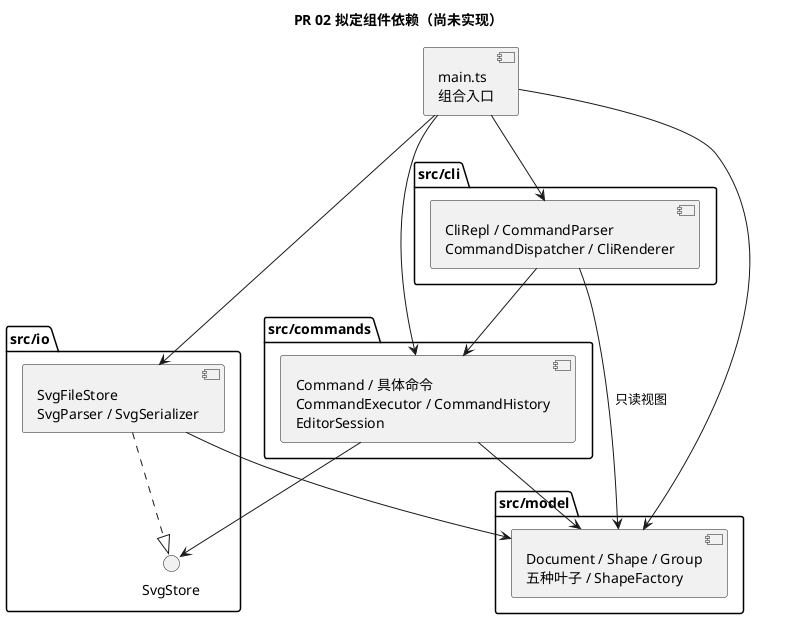
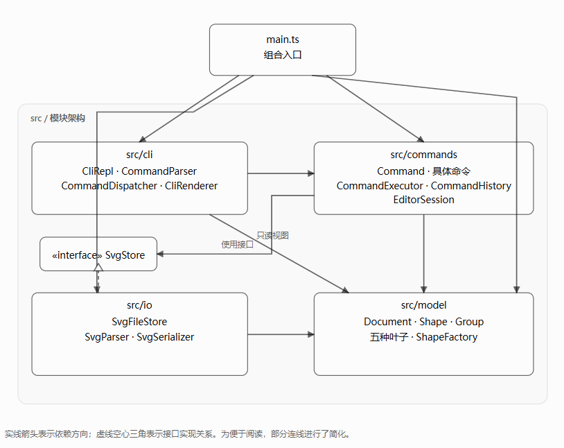
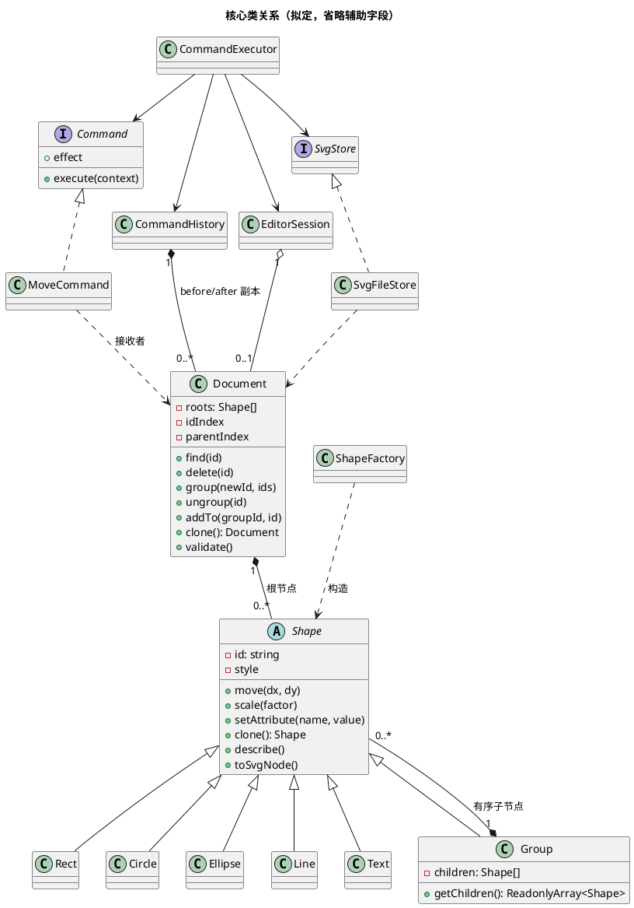
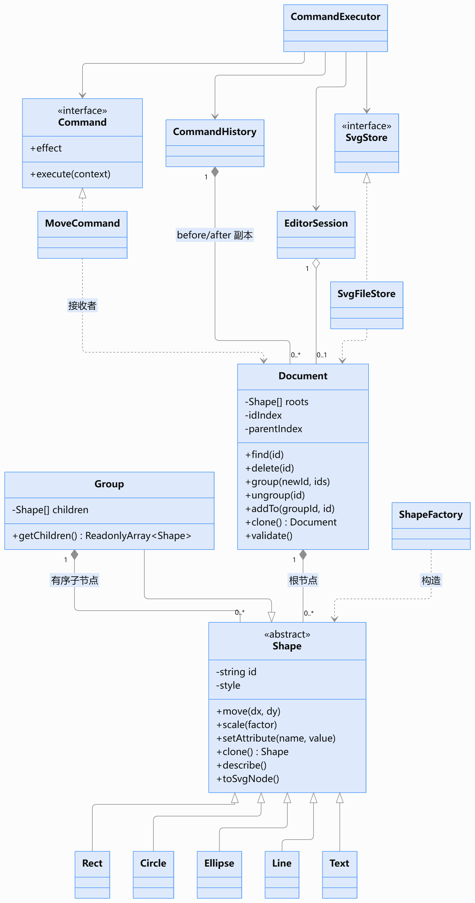
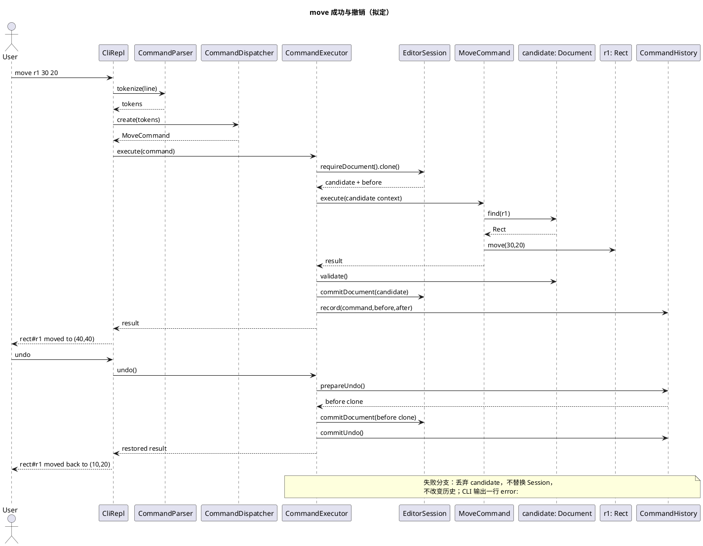
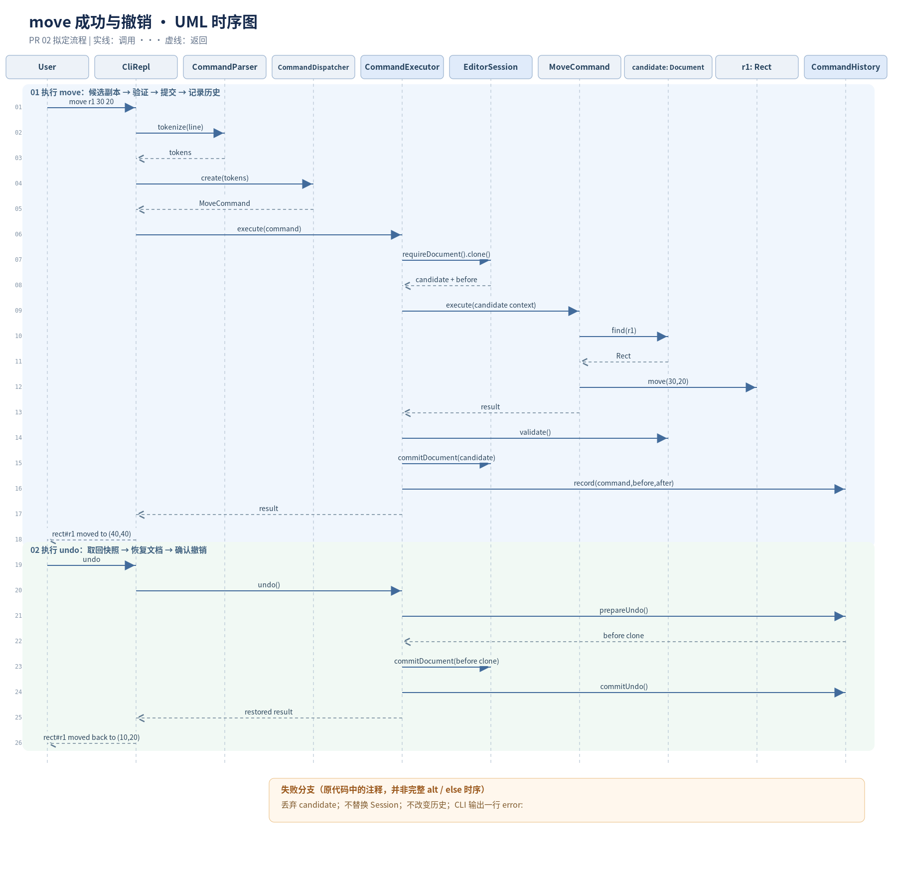

# PR 02：SVG 编辑器架构方案草案

> 2026-10-28；分支 `docs/ARCH-001-design`；PR 待创建；commit 待创建（本轮不提交）。
> **拟定设计，待人工确认，业务功能均未实现。** 权威需求为 [Phase 1 任务书](requirements/phase_cli_1.md)，课程交付主文档仍是 [doc/README.md](README.md)。本文细化设计，不替代课程报告。类名、接口和算法属于设计建议，不能视为老师规定的实现。

## 1. 需求与架构目标

当前只有 `src/main.ts` 启动输出、四个模块占位目录和 `tests/smoke.test.ts`。PR 02 不新增业务类、脚本、依赖或测试。任务书 §2.1 强制面向对象、封装、多态、一类一文件和 Command；容器采用 Composite 统一语义。目标是让输入、操作编排、领域不变量、文件格式分别变化，并使每条失败命令保持文档与历史不变。

### 1.1 图形与属性（任务书 §2、§4.1）

| 拟定类 / 标签 | 私有几何或内容字段 | move 行为 | scale 行为 |
|---|---|---|---|
| Rect / rect | x、y、width、height | x、y 加增量 | 四项乘 factor |
| Circle / circle | cx、cy、r | cx、cy 加增量 | 三项乘 factor |
| Ellipse / ellipse | cx、cy、rx、ry | cx、cy 加增量 | 四项乘 factor |
| Line / line | x1、y1、x2、y2 | 两端点加增量 | 四项乘 factor |
| Text / text | x、y、content | x、y 加增量 | x、y 乘 factor，文字内容不变 |
| Group / g | 有序 children，无自身几何坐标 | 递归调用孩子 | 递归调用孩子，不重复缩放孙节点 |

公共私有字段：只读且大小写敏感的 id，可选 fill、stroke、stroke-width。缺省样式保持“未设置”，不能在保存时擅自补 black/none。`set` 支持公共三项及各类表中几何字段，Text 的内容通过 `text` 设置；id 不可用 set 修改。Group 没有 x/y 等几何属性。scale 必须为正且数值有限；只乘几何属性，不把 stroke-width 或字体大小自行纳入几何范围。

根 svg 是 Document 所有的根容器，不是可通过图形 id 编辑的 Group。Document 保存画布尺寸、有序根节点和 `Map<string, Shape>` 索引，容器也纳入唯一性检查。输入 id 的大小写不得归一化。

### 1.2 命令覆盖与状态归属

以下具体命令类拟定放在 `src/commands/`，每类独立文件。所有命令由统一执行器调用；表中“状态”包含成功后可能改变的状态。

| 命令 / 拟定类 | 接收者及责任 | 状态与历史策略 |
|---|---|---|
| init / InitCommand | EditorSession、Document 构建 | 默认 800×600，新文档；成功后清空并禁止历史 |
| read / ReadCommand | SvgFileStore 解析候选文档，EditorSession 接收 | 文档、读入路径、缺 id 警告；成功后历史边界 |
| save / SaveCommand | SvgFileStore 从只读模型写文件 | 文件；缺参数用读入路径；成功后历史边界 |
| canvas / CanvasCommand | Document 查询或修改尺寸 | 无参数只读；带参数成功修改后历史边界 |
| create / CreateCommand | ShapeFactory 构建，Document 插入 | 树、索引；支持所有六类及尾缀 in；一个历史单元 |
| delete / DeleteCommand | Document 删除目标子树 | 树、索引及全部子孙；一个历史单元 |
| move / MoveCommand | Document 定位，Shape.move | 目标或子树坐标；一个历史单元 |
| scale / ScaleCommand | Document 定位，Shape.scale | 位置与尺寸；一个历史单元 |
| set / SetCommand | Shape.setAttribute | 白名单属性或文本；一个历史单元 |
| group / GroupCommand | Document.group | 新组、原父节点、顺序和索引；整体一个单元 |
| ungroup / UngroupCommand | Document.ungroup | 去除组、提升孩子、索引；禁止根级 g 解组 |
| addto / AddToCommand | Document.addTo | 目标原位置和新容器末尾位置；禁止自包含和成环 |
| front / FrontCommand | Document.bringToFront | 同父容器序列末尾，即最后绘制、视觉最前 |
| back / BackCommand | Document.sendToBack | 同父容器序列开头，即最先绘制、视觉最后 |
| tree / TreeCommand | Document 只读视图、CliRenderer | 全树或指定子树；不改变文档或历史 |
| show / ShowCommand | Shape 只读属性视图、CliRenderer | 包含 parent 和属性明细；不改变历史 |
| help / HelpCommand | CommandDispatcher 创建 HelpCommand 时注入只读命令语法描述；HelpCommand 负责返回帮助信息，不反向依赖 cli | 全部语法；不改变历史 |
| undo、redo | CommandExecutor、CommandHistory | 恢复一个完整编辑状态，仅成功后转移栈项 |

REPL 逐行显示 `svg>`；双引号保留带空格文本；只有注释行开头的 `#` 被当注释，颜色中的 `#` 不截断命令。成功反馈和 tree 内联几何属性、show 明细由 Renderer 处理，不以简单 id 列表替代任务书 §5 格式。失败统一一行 `error:`；缺 id 读入警告按 `warning: assigned id rect1 to unnamed <rect>` 格式。

### 1.3 阶段边界与未定语义

Phase 1 内置六类；`create box` 使用 §4.2 的 unknown shape type 错误模板，保留 `(is the plugin loaded?)` 提示，并不意味着已有插件。ShapeProvider、box 模板、data-kind 类型恢复、图形界面和自主操作入口均不实现。§4.4 的 box 专属 set 传播和禁止解组不能套到普通 g。

任务书已规定但容易误读的规则：允许跨原父容器 group；选择集含祖先和子孙必须拒绝；**svg 直接子节点的 g 不得 ungroup**；普通 g 解组后孩子占据它在父容器的位置。跨父容器的新组落点和不同父节点之间的“相对顺序”没有完整定义，详见第 12 节 D3，未经确认不能写死为课程规则。

## 2. 模块划分与职责

保留现有四个目录，通过类区分职责，暂不增加第五个业务层或插件框架。

| 模块 / 拟定组件 | 对外接口 | 允许依赖 | 职责边界及独立理由；合并风险 |
|---|---|---|---|
| cli / CliRepl | run、处理逐行输入 | commands、model 的只读视图、Node readline | 控制提示符、输入输出；不修改树。合并到模型会使领域对象依赖终端 |
| cli / CommandParser | tokenize(line) | 无业务依赖 | 引号、token 和注释；类型专属参数校验交给工厂/命令。合并到分发器会混合词法与命令构造 |
| cli / CommandDispatcher | create(tokens)、help 描述 | commands | 唯一命令名分派点；把原始参数交给命令，不实现编辑。合并执行器会让历史依赖字符串语法 |
| cli / CliRenderer | render(result) | commands 结果、model 只读视图 | tree/show/错误/摘要的终端布局；不计算几何。合并到 Shape 会污染 SVG 或未来其他入口 |
| commands / CommandExecutor、CommandHistory | execute、undo、redo | model、io 的 SvgStore 接口 | 统一事务、历史与模式；不按图形类型分支。暂不拆通用事件总线或事务框架 |
| commands / 各具体 Command | execute(context)、effect | model、io 的 SvgStore 接口 | 一条用户操作的参数与编排；不读 stdin、不写 stdout。合并到 CLI 会失去可复用的命令对象 |
| commands / EditorSession | 当前文档访问、替换、读入路径管理 | model | 会话持有当前文档及路径；不持有终端。与 Document 合并会把磁盘路径带入模型 |
| model / Document、Shape、Group、各叶子 | 领域操作、clone、只读视图 | 仅 model | 封装状态、不变量与多态行为；不感知历史、CLI、磁盘。并入 Command 会导致重复业务校验 |
| model / ShapeFactory | create、fromSvgNode | model | 唯一图形类型分派点，CLI 创建和 XML 导入复用同一类型映射；不访问文件。分散到 IO 和各命令会增加 tag 分派点 |
| io / SvgStore 接口、SvgFileStore | read(path)、write(path, document) | model、Node fs | 隔离文件失败与路径处理；返回候选文档及警告。接口便于注入失败场景，不引入服务容器 |
| io / SvgParser、SvgSerializer | parse(xml)、serialize(document) | model | XML 格式处理与纯字符串往返；不得写私有字段。合并到文件类会使格式测试必须依赖磁盘 |
| main.ts | 组合启动 | 全部模块 | 构建并注入上述对象；不放命令逻辑 |

文件名与类名一致，例如 `Rect.ts`、`MoveCommand.ts`。接口可独立同名文件；不为每个具体类机械增加接口。SvgStore 是 IO 边界接口，Command 是命令协议，Shape 是共享行为抽象，三个抽象都有明确的变化或测试需求。

## 3. 整体组件图（拟定）

箭头表示源码允许依赖，非运行时反向回调；当前四个目录仅有 .gitkeep，图中业务组件均待实现。

## 4. 核心类与接口设计（拟定）

以下签名只描述契约，尚非可编译代码；数值/属性校验由对应领域行为完成，所有字段默认 private/protected，数组和 Map 不返回可写引用。

| 类 / 接口 | 核心字段与公开行为 | 封装与关系 |
|---|---|---|
| Shape 抽象类 | id、可选样式；move(dx,dy)、scale(f)、setAttribute(name,value)、clone()、describe()、toSvgNode() | id 只读；行为由子类多态实现；私有几何值通过只读视图暴露 |
| Rect/Circle/Ellipse/Line/Text | §1.1 私有字段；重写几何、属性校验、clone、属性描述及 SVG 节点生成 | 各自知道合法属性和数值含义，不依赖调用者 switch(tag) |
| Group extends Shape | 私有有序 children；递归 move/scale、公共样式 set、只读 children 访问、clone | 子节点插入/移除只通过 Document 的树编辑协议完成；不开放任意可写数组 |
| Document | width、height、根序列、idIndex、parentIndex；find、insert、delete、group、ungroup、addTo、bringToFront、sendToBack、resize、clone、validate | 唯一管理结构写入，parentIndex 记录父容器和位置；Shape 无需反向依赖 Document |
| ShapeFactory | 六类构造映射；create(type,args,id)、fromSvgNode(node) | 同一类型映射含 CLI 构造和 XML 构造能力；未知类型在此失败 |
| Command 接口 | readonly effect；execute(context): Promise<CommandResult> | effect 为 edit / boundary / query，canvas 由参数确定；undo/redo 是执行器入口 |
| 具体编辑命令 | 私有目标 id、参数；execute(context) | 接收候选 Document，调用公开领域行为，不持有旧 Shape 引用 |
| EditorSession | currentDocument?、readPath?；requireDocument、commitDocument、replaceFromRead | 路径和当前文档切换与历史在执行器提交阶段协调 |
| CommandExecutor | session、history、store；execute、undo、redo | 执行 edit 时创建候选副本，成功后提交；不含图形类型知识 |
| CommandHistory | undoEntries、redoEntries、blocked；record、undo、redo、blockAndClear | 栈项含命令身份、before/after 文档副本；副本不可供外部修改 |
| CommandResult | 摘要数据 / 只读视图 / 警告集合 | 仅输出传输值；允许结果记录，不以数据袋替代 Shape 行为 |
| SvgParser / SvgSerializer | parse、serialize | parser 用 ShapeFactory 构建并验证树；serializer 遍历多态生成的 XML 中立节点 |

父关系集中在 Document 的 parentIndex，避免 Shape 直接引用 Document 形成模块循环。Group 的内部结构修改入口属于模型内部协议，Command 与 IO 不得直接使用；实现时优先采用模块内受控编辑器或能力令牌限制调用，并测试非法操作不能绕过 Document。无需为令牌建立额外框架。

`describe()` 返回类型自己生成的属性条目和摘要片段，Renderer 仅排版。`toSvgNode()` 返回 XML 中立结构（标签、属性、子节点、文本），通用 XML 写出器统一转义，不按 tag 分派。XML 导入遇到元素标签仅经 ShapeFactory 的同一映射分派，具体类构造行为负责其属性。这样不会在 tree/show、几何编辑和序列化各处新增 switch(tag)。

## 5. Command 模式设计

CLI 的职责是把一行输入变为 Command，然后呈现结果。若 CLI 直接操作 children 和坐标，几何约束、原子性、历史规则就会重复在每个分支中；新增输入入口也无法复用。命令对象保存一次意图及参数，Document/Shape 是接收者，Executor 是调用者，History 保存一次操作的完整历史单元。

**两处名称分派，均标记为待重构点**：① CommandDispatcher 的命令名到命令构造映射；② ShapeFactory 的类型名到类构造映射。Phase 1 允许集中映射，暂不开发注册机制；以后插件化可将这两处改为注册表。属性白名单是各类自己的校验，不得演变为跨类型的 tag 分支。具体命令通过多态执行，Executor 不写每个命令业务的巨大 switch。

命令 effect 是固定策略元数据，Executor 据此选择事务流程，不是第三处名称到实现的分派。tree/show/help 也经统一入口，但不记录历史。undo/redo 使用 History 协议，不作为可再次撤销的编辑命令入栈。REPL await 每次执行，防止两个异步命令同时提交。

## 6. Composite 模式设计

叶子与 Group 都是 Shape；move、scale、set 经同一 Shape 接口调用。Group.move/scale 逐层委派，叶子执行类型自身的计算；不采用 g transform 累加来代替任务书要求的子孙属性更新。

普通 g 的样式推荐保存于组自身，遵循 SVG 继承，已有显式子样式保留；不直接复制 box 的样式传播语义。不合法的几何属性仍报 `error: unknown attribute: <attr>`。delete 对叶子或组统一调用 Document.delete，删除整棵子树及其索引；结构操作归拥有树的 Document，没必要给每个叶子实现一份摘除逻辑。这同时保持统一命令语义与结构不变量。

Document 的每次结构操作检查：id 全局唯一、每个节点恰有一个父位置、索引与遍历一致、目标容器存在、不能把自己或祖先移入后代、group 选择集不能同时含祖先和后代。group 先完整解析所有 id 再修改；同父兄弟按原序收编，不按参数次序重排。跨父规则D3已决定，跨容器group放在最深公共祖先下面，插入最早被选择的图形所在的直接分支之前。

ungroup 对允许解组的嵌套组，以其 children 原序替换它在父序列中的槽位，移除 gid 索引并更新孩子 parentIndex；更深层的父关系保持。front/back 只修改同父顺序，addto 在目标末尾追加，所有层级变动保持图形几何属性不变。对根级组的解组限制来自任务书，而非通用 SVG 行为。

## 7. 核心操作流程

### 7.1 move 与 undo

假定 r1 的 x=10、y=20。`move r1 30 20`：Parser 产生 tokens → Dispatcher 构建 MoveCommand → Executor 检查文档并克隆候选 → MoveCommand 定位候选中的 r1，调用 move → Rect 得到 x=40、y=40 → Document.validate → Executor 提交候选并记录一个 before/after 单元 → Renderer 输出摘要。undo 用 before 的新副本替换当前文档，r1 精确恢复 10、20；redo 用 after 副本恢复 40、40。Group 走完全相同的命令路径。

提交区间必须同步完成且不调用可失败的外部 IO；预先准备克隆及新栈内容，避免先换文档再做可能抛错的副本构建。时序图压缩了该准备阶段，Session 与 History 的提交属于一个执行器操作。

### 7.2 group/delete、read/save

group/delete 在候选文档完成全部结构修改和校验，再整体提交。undo 的 before 包含原父位置、原组结构、兄弟顺序、属性及索引重建依据；不会通过多次 child delete 创建多条历史。

read：读文件 → XML 解析 → 预收集显式 id、拒绝重复 → 对缺 id 按标签名+序号分配并避开所有显式及已生成 id → Factory 构建完整候选 → validate → 同步替换文档、路径和历史 → 输出已收集警告。失败不提前替换文档、路径或打印成功警告。

save：先序列化完整文本 → 同目录临时文件写出 → 成功替换目标文件 → 执行无失败的历史边界提交；写入/替换失败保留内存和历史并清理临时文件。平台文件替换失败要报 cannot write file；不得先删目标文件再重命名。磁盘原子替换的实际能力必须在 IO 阶段验证，不能仅靠设计宣称已保证。save 无参数且无 readPath 的处理、save-as 是否改变默认路径见 D4。

## 8. Undo/Redo 与失败原子性

AI 推荐 Phase 1 采用 **Command + 模型深副本历史**。Command 保存意图，模型负责正确行为；快照只保存 Document，不保存终端、文件句柄或磁盘内容，不是 JSON 数据袋代替面向对象。clone 经各具体类多态复制，保留类型、可选属性与子树并重建索引；历史副本不被后续命令修改。

| 事件 | 文档提交 | 历史变化 |
|---|---|---|
| 成功 edit | 候选替换当前文档 | push 一个 before/after；清空 redo；解除 blocked |
| 失败 edit | 丢弃候选 | 两栈和 blocked 完全不变，包括保留 redo |
| 成功 init/read/save/canvas 修改 | 完成对应操作 | 清空两栈，blocked=true |
| 失败文档/IO 操作 | 原文档、路径不变 | 不封锁、不清空历史 |
| tree/show/help/canvas 查询 | 不变 | 不变，不能解除 blocked |
| undo/redo 且 blocked=true | 不变 | `error: undo not allowed after io command`（两者均按 §4.3 模板） |
| 正常 undo/redo | 先准备目标快照副本，再原子提交 | 成功后在两栈之间转移同一单元 |

边界后第一次编辑的 before 是边界后的文档，undo 只回到这个基点，不能穿越旧历史。空栈错误文案任务书未定，待实现前统一确定；不能用空栈错误代替 blocked 错误。成功但数值无变化的编辑也按一条成功命令记录，除非用户另定，不借优化跳过任务书的单元规则。

逆操作备选：move 可用 -dx/-dy、scale 可用倒数；但浮点回算可能有误差。set 须保存原值及“原来未设置”，delete 须保存整个子树与插入位置，group/ungroup/addto/front/back 须保存全部原父和顺序。仅凭反向命令不能完整恢复这些结构。混合增量历史更省内存但实现与失败回滚复杂；全副本在本阶段小文档中更容易审查，代价约为 O(历史条数×文档大小) 内存及每次 O(节点数) 克隆，暂不设置任务书没有要求的历史上限。

## 9. 依赖方向规则

1. **model 仅依赖 model 与纯语言能力**：不得 import cli、commands、io、fs/readline；保证模型无需终端或磁盘即可测试。Shape 不知道 History；Document 不保存路径。
2. **commands → model、io 的 SvgStore 接口**：只用公开领域行为；以接口注入读写失败，禁止具体命令直接 fs 操作或打印。io 不反向依赖 commands，因此无环。
3. **io → model、Node 文件系统**：解析以 Factory/Document 构建候选，序列化用只读多态视图；不得修改私有字段，避免绕开唯一性检查。不依赖 cli/history。
4. **cli → commands、model 只读视图、readline**：CLI 不写坐标、children 或历史数组，不直接访问 io。几何校验留在模型，输出格式留在 CLI。
5. **main → 各模块**：负责构造和注入。没有模块反向 import main，避免启动副作用和循环依赖。

接口减少对 SvgFileStore 的耦合；Shape 抽象减少调用者对具体叶子的耦合。类放在职责所属目录，避免任意 shared/utils 反向依赖所有层。未来每个 PR 用 `rg` 检查 import、具体类调用点及两处名称映射；结合模型单测、CLI 集成测试和人工读调用关系，识别“无 import 违规但直接修改状态”等问题，暂不增加架构测试框架。

## 10. 变化点与设计取舍

| 可能变化 / 原因 | 当前预留能力 | 暂不实现及理由 |
|---|---|---|
| 新增图形，后续课程扩展类型 | 新 Shape 子类，集中 Factory 入口，describe/toSvgNode 多态 | 不做动态加载；当前六类足够验收，Factory 映射标记待重构 |
| 新增编辑命令，用户工作流扩展 | 新 Command 类及 Dispatcher 单处映射，复用事务历史 | 不做命令插件注册；先保证现有命令覆盖 |
| 新增输入入口，任务书提及其他通道 | 复用 commands/model/io；替换 CLI，Renderer 不渗透核心 | 不开发网页或 agent；无当前交互需求 |
| 新增序列化格式或存储介质 | 文件接口与 XML 解析分离，模型只读视图可被新适配器消费 | 不设计多格式注册中心；当前只交付 SVG |
| 插件注册，Phase 后续阶段目标 | 两处映射是明确替换点，Shape 支持多态 | 不实现 ShapeProvider、加载器或“内核零改动”承诺 |
| box 等有语义的组合体 | Group 与 Shape 的继承/组合关系可继续扩展 | 不做模板、label 转发或 data-kind 恢复；普通 g 已满足当前组合需求 |
| 大文档或长历史 | History 与 Command 解耦，日后可改增量状态 | 不做持久化数据结构和压缩，先接受深副本成本 |

## 11. 风险、未验证事项与验收映射

| 任务书依据 | 已完成的设计检查 | 后续必须执行的验证（均未运行） |
|---|---|---|
| §2、§4.1 id 与创建 | 六类、in、全局索引、读入两遍补 id 设计覆盖 | 重复/缺失/大小写 id、后出现显式 rect1 与补号冲突、非容器目标 |
| §2.1 范式 | 逐类职责、封装、两处名称分派及多态输出覆盖 | 实际 import 与字段写入审查、检查无第三处 tag 分派 |
| §3、§4.1 几何属性 | 各叶子和容器的 move/scale/set 设计覆盖 | 浮点、NaN/Infinity、非正 factor、深层递归仅变换一次、白名单 |
| §3、§4.2 树操作 | delete、group、ungroup、addto、front/back 责任明确 | 祖孙同时选择、循环、跨父分组、根组禁止解散、恢复原序 |
| §4.3 历史 | 编辑单元、redo 清空、IO 边界、canvas 查询/修改区分 | 失败时保留 redo、save 后封锁、边界后的新编辑再 undo、复合操作一次撤销 |
| §0、§3 SVG | Parser/Serializer/Store 和候选提交覆盖 | 实际文件 save→read→save→read，比较关键属性/顺序/文本转义/可选样式；文件缺失和不可写 |
| §2、§5、§6 交互 | 提示符、注释、引号、错误、摘要、tree/show 归属明确 | transcript 回放、颜色 #、中文/空格文本、带空格路径、子树显示 |
| §4.4 阶段边界 | box 与 ShapeProvider 明确排除 | create box 确实为未知类型，无额外插件业务 |

XML 不可用正则替代完整结构解析。Node 标准库没有现成 XML DOM 解析器；推荐 IO 阶段评估一个小型 XML 解析依赖，再核验属性、命名空间、实体转义和不加载外部实体行为；本轮不安装包，不指定未经核验的包能力。XML 支持范围见 D5；任务书 §0 展示了 transform，但 CLI 明确要求直接变更几何属性，这里存在导入范围需要确认，不能静默忽略 transform 后声称外部文件回读正确。

其他尚待确定的边缘行为：负尺寸/零尺寸校验、重复 group 参数与最小参数个数、空栈错误、启动后 help 是否豁免无文档错误。任务书 §4.2 写“未 read/init 就执行其他命令”报错，推荐默认严格遵循；若希望 help 豁免须用户明确确认。所有推荐的补充规则须在实现前记录，不擅自当成需求。

本文 PlantUML 保存源代码；尚未使用渲染器进行语法/布局验证。设计检查不代表 SVG 功能测试通过；业务实现和功能覆盖均为 [待实现]/[未验证]。

## 12. 在进入 PR 03 编码前，必须由用户确认的架构决策

推荐方案仅是 AI 建议，已获人工批准。可按编号填写“接受 / 调整 / 备选及理由”。

| 编号 / 需要决定的问题 | 推荐方案与理由 | 备选方案与代价 |
|---|---|---|
| D1 历史和失败原子性如何实现？ | Command + 候选深副本 + before/after 历史；复杂树操作容易完整恢复，浮点不反算 | 逐命令逆操作/局部状态，节省内存但需复杂回滚和完整位置记录 |
| D2 普通 g 的 set 公共样式如何生效？ | 写 g 自身，遵循 SVG 继承；保留子元素显式样式，区别于 §4.4 box 的专属传播 | 向全部后代覆盖，视觉一致但会改掉原有样式；任务书未明确要求此传播 |
| D3 跨父 group 放在哪里、按什么顺序？ | 以最深公共祖先为新父，按操作前全文档深度优先绘制顺序收编；新组放在最早被选节点所在直接分支之前（同父时替代最早被选槽位）。确定且支持跨父，但组合后 z-order 可能变化 | 新组始终放根末尾，简单但层级变化更大；按参数顺序收编会偏离“保持相对顺序”，不推荐。不得直接禁止跨父 |
| D4 路径生命周期如何定义？ | 无参 save 仅用最近 read 的路径，init 清空路径；显式 save-as 不改变 readPath；无路径时报一行 error；贴合“读入时的路径”原文 | save-as 更新默认路径，更常见但需要用户批准扩充；请一并确认错误文案 |
| D5 外部 SVG 导入范围与 XML 策略？ | 六类、数值几何、嵌套组、公共样式及文字先保证 round-trip；影响视觉的 transform/viewBox 非默认映射/其他属性不得静默丢弃，未支持时明确报错；IO 阶段评估 XML 库 | 直接支持 §0 的 translate/scale 及样式等，兼容性更强但需扩充模型/规范化；请确认老师对“范围内 SVG”的预期，不能把推荐子集冒充原文限制 |
| D6 模块与模型结构是否采用此草案？ | 四目录 + 独立 Parser/Dispatcher/Executor/Factory/Parser/Serializer，Document 独占树写入与 parentIndex；保持可测且无额外框架 | 先合并 IO 编解码为一类、或采用节点私有 parent 引用；类更少或定位更直接，但职责/一致性维护成本不同 |

**【人工核对】[已核验]** 对照任务书 §4.2、§4.3 确认根级组禁止解组、canvas 历史边界和 box 排除；复查三张图和 §9 同向依赖、两处名称分派；用跨父分组和混合显式样式例子检验 D2/D3 的实际意图。核对结论：根级组禁止解组，符合任务书；修改画布尺寸后，之前的undo/redo历史不能继续用，直到执行新的编辑命令；不实现box功能；对照了3/4/7.1图示与第九节的依赖规则，未发现明显的依赖方向冲突；当前设计将命令名称集中在CommandDispatcher，将图形类型集中在ShapeFactory，其他图形行为通过多态处理，符合任务书要求；已明确样式继承和跨父容器分组的推荐处理规则。相关规则属于架构设计选择，后续应通过典型测试验证颜色继承、父子关系、图形顺序与 Undo 恢复行为。

**【人工填写】[已填写]** 
D1：采用Command+Document完整快照。与ai讨论时，曾考虑过逆向操作或者局部状态记录，但是逆向操作对于复杂的结构来说恢复逻辑也更复杂，局部状态记录也会增加不同命令的状态管理和回滚复杂度，所以最终还是选择完整快照。
D2：推荐方案的样式继承符合直觉，也符合SVG的原本规则。
D3：跨容器group放在最深公共祖先下面，插入最早被选择的图形所在的直接分支之前。
D4：方案A更符合任务书中“无参数时保存到读入时的路径”这句话。
D5：首先保证六种内置图形、嵌套容器、基本样式、几何属性以及文本能够正确读取和保存。对于尚未支持、且会影响实际效果的 transform、非默认 viewBox 映射等内容明确报错。
D6：采用当前这套模块设计。