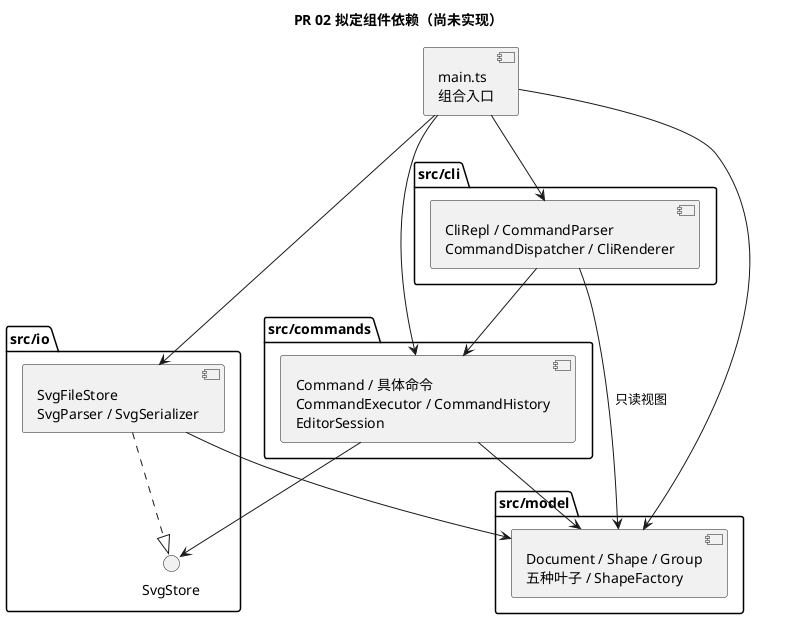
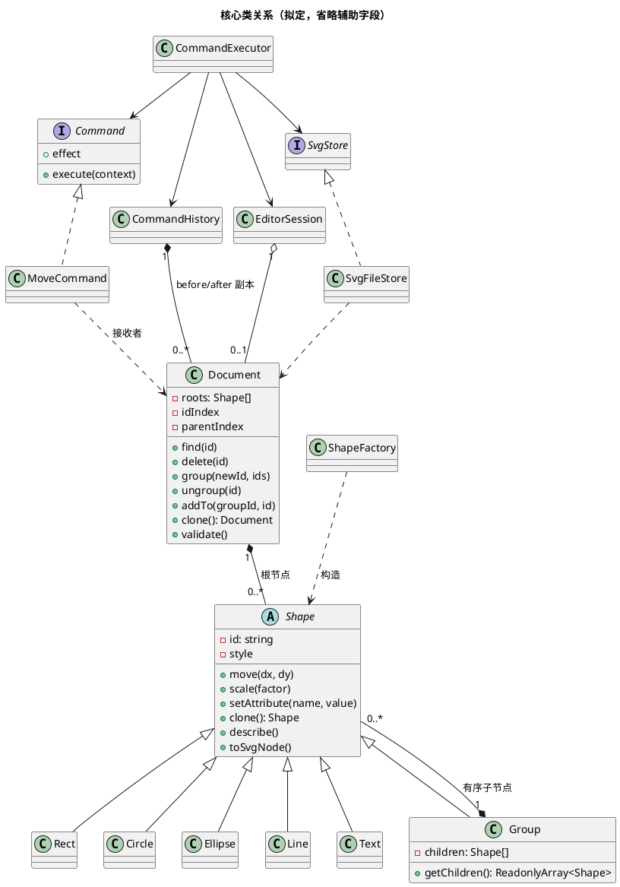
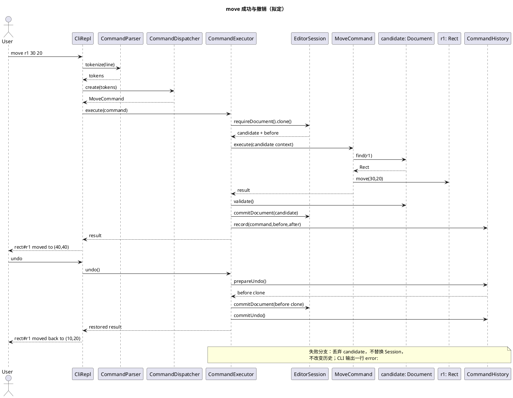
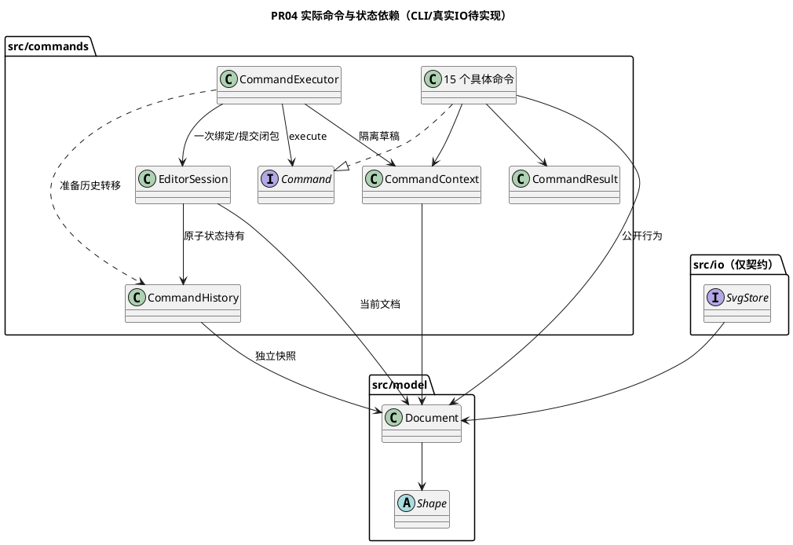
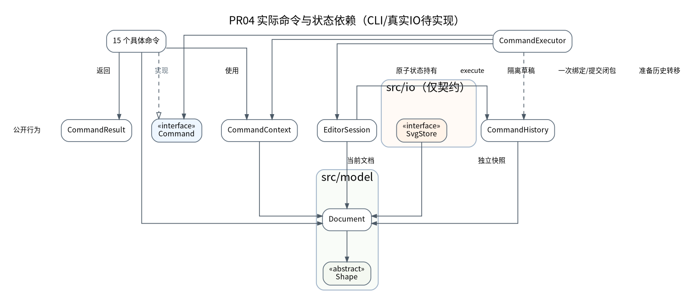

# PR 02：SVG 编辑器架构方案草案

> 阅读说明（PR07）：§1～§12 保留 PR02 设计与已确认决策，§13～§16 保留各阶段实际实现记录。当前实现以 §16 及课程报告 §1.1～§1.5 为准；PR07 复核见 §17。历史章节中的“未实现/未验证”描述的是当时状态，不代表当前状态。

> 2026-10-28；分支 `docs/ARCH-001-design`；PR 待创建；commit 待创建（本轮不提交）。
> **拟定设计，待人工确认，业务功能均未实现。** 权威需求为 [Phase 1 任务书](requirements/phase_cli_1.md)，课程交付主文档仍是 [doc/README.md](README.md)。本文细化设计，不替代课程报告。类名、接口和算法属于设计建议，不能视为老师规定的实现。

## 1. 需求与架构目标

当前只有 `src/main.ts` 启动输出、四个模块占位目录和 `tests/smoke.test.ts`。PR 02 不新增业务类、脚本、依赖或测试。任务书 §2.1 强制面向对象、封装、多态、一类一文件和 Command；容器采用 Composite 统一语义。目标是让输入、操作编排、领域不变量、文件格式分别变化，并使每条失败命令保持文档与历史不变。

### 1.1 图形与属性（任务书 §2、§4.1）

| 拟定类 / 标签 | 私有几何或内容字段 | move 行为 | scale 行为 |
|---|---|---|---|
| Rect / rect | x、y、width、height | x、y 加增量 | 四项乘 factor |
| Circle / circle | cx、cy、r | cx、cy 加增量 | 三项乘 factor |
| Ellipse / ellipse | cx、cy、rx、ry | cx、cy 加增量 | 四项乘 factor |
| Line / line | x1、y1、x2、y2 | 两端点加增量 | 四项乘 factor |
| Text / text | x、y、content | x、y 加增量 | x、y 乘 factor，文字内容不变 |
| Group / g | 有序 children，无自身几何坐标 | 递归调用孩子 | 递归调用孩子，不重复缩放孙节点 |

公共私有字段：只读且大小写敏感的 id，可选 fill、stroke、stroke-width。缺省样式保持“未设置”，不能在保存时擅自补 black/none。`set` 支持公共三项及各类表中几何字段，Text 的内容通过 `text` 设置；id 不可用 set 修改。Group 没有 x/y 等几何属性。scale 必须为正且数值有限；只乘几何属性，不把 stroke-width 或字体大小自行纳入几何范围。

根 svg 是 Document 所有的根容器，不是可通过图形 id 编辑的 Group。Document 保存画布尺寸、有序根节点和 `Map<string, Shape>` 索引，容器也纳入唯一性检查。输入 id 的大小写不得归一化。

### 1.2 命令覆盖与状态归属

以下具体命令类拟定放在 `src/commands/`，每类独立文件。所有命令由统一执行器调用；表中“状态”包含成功后可能改变的状态。

| 命令 / 拟定类 | 接收者及责任 | 状态与历史策略 |
|---|---|---|
| init / InitCommand | EditorSession、Document 构建 | 默认 800×600，新文档；成功后清空并禁止历史 |
| read / ReadCommand | SvgFileStore 解析候选文档，EditorSession 接收 | 文档、读入路径、缺 id 警告；成功后历史边界 |
| save / SaveCommand | SvgFileStore 从只读模型写文件 | 文件；缺参数用读入路径；成功后历史边界 |
| canvas / CanvasCommand | Document 查询或修改尺寸 | 无参数只读；带参数成功修改后历史边界 |
| create / CreateCommand | ShapeFactory 构建，Document 插入 | 树、索引；支持所有六类及尾缀 in；一个历史单元 |
| delete / DeleteCommand | Document 删除目标子树 | 树、索引及全部子孙；一个历史单元 |
| move / MoveCommand | Document 定位，Shape.move | 目标或子树坐标；一个历史单元 |
| scale / ScaleCommand | Document 定位，Shape.scale | 位置与尺寸；一个历史单元 |
| set / SetCommand | Shape.setAttribute | 白名单属性或文本；一个历史单元 |
| group / GroupCommand | Document.group | 新组、原父节点、顺序和索引；整体一个单元 |
| ungroup / UngroupCommand | Document.ungroup | 去除组、提升孩子、索引；禁止根级 g 解组 |
| addto / AddToCommand | Document.addTo | 目标原位置和新容器末尾位置；禁止自包含和成环 |
| front / FrontCommand | Document.bringToFront | 同父容器序列末尾，即最后绘制、视觉最前 |
| back / BackCommand | Document.sendToBack | 同父容器序列开头，即最先绘制、视觉最后 |
| tree / TreeCommand | Document 只读视图、CliRenderer | 全树或指定子树；不改变文档或历史 |
| show / ShowCommand | Shape 只读属性视图、CliRenderer | 包含 parent 和属性明细；不改变历史 |
| help / HelpCommand | CommandDispatcher 创建 HelpCommand 时注入只读命令语法描述；HelpCommand 负责返回帮助信息，不反向依赖 cli | 全部语法；不改变历史 |
| undo、redo | CommandExecutor、CommandHistory | 恢复一个完整编辑状态，仅成功后转移栈项 |

REPL 逐行显示 `svg>`；双引号保留带空格文本；只有注释行开头的 `#` 被当注释，颜色中的 `#` 不截断命令。成功反馈和 tree 内联几何属性、show 明细由 Renderer 处理，不以简单 id 列表替代任务书 §5 格式。失败统一一行 `error:`；缺 id 读入警告按 `warning: assigned id rect1 to unnamed <rect>` 格式。

### 1.3 阶段边界与未定语义

Phase 1 内置六类；`create box` 使用 §4.2 的 unknown shape type 错误模板，保留 `(is the plugin loaded?)` 提示，并不意味着已有插件。ShapeProvider、box 模板、data-kind 类型恢复、图形界面和自主操作入口均不实现。§4.4 的 box 专属 set 传播和禁止解组不能套到普通 g。

任务书已规定但容易误读的规则：允许跨原父容器 group；选择集含祖先和子孙必须拒绝；**svg 直接子节点的 g 不得 ungroup**；普通 g 解组后孩子占据它在父容器的位置。跨父容器的新组落点和不同父节点之间的“相对顺序”没有完整定义，详见第 12 节 D3，未经确认不能写死为课程规则。

## 2. 模块划分与职责

保留现有四个目录，通过类区分职责，暂不增加第五个业务层或插件框架。

| 模块 / 拟定组件 | 对外接口 | 允许依赖 | 职责边界及独立理由；合并风险 |
|---|---|---|---|
| cli / CliRepl | run、处理逐行输入 | commands、model 的只读视图、Node readline | 控制提示符、输入输出；不修改树。合并到模型会使领域对象依赖终端 |
| cli / CommandParser | tokenize(line) | 无业务依赖 | 引号、token 和注释；类型专属参数校验交给工厂/命令。合并到分发器会混合词法与命令构造 |
| cli / CommandDispatcher | create(tokens)、help 描述 | commands | 唯一命令名分派点；把原始参数交给命令，不实现编辑。合并执行器会让历史依赖字符串语法 |
| cli / CliRenderer | render(result) | commands 结果、model 只读视图 | tree/show/错误/摘要的终端布局；不计算几何。合并到 Shape 会污染 SVG 或未来其他入口 |
| commands / CommandExecutor、CommandHistory | execute、undo、redo | model、io 的 SvgStore 接口 | 统一事务、历史与模式；不按图形类型分支。暂不拆通用事件总线或事务框架 |
| commands / 各具体 Command | execute(context)、effect | model、io 的 SvgStore 接口 | 一条用户操作的参数与编排；不读 stdin、不写 stdout。合并到 CLI 会失去可复用的命令对象 |
| commands / EditorSession | 当前文档访问、替换、读入路径管理 | model | 会话持有当前文档及路径；不持有终端。与 Document 合并会把磁盘路径带入模型 |
| model / Document、Shape、Group、各叶子 | 领域操作、clone、只读视图 | 仅 model | 封装状态、不变量与多态行为；不感知历史、CLI、磁盘。并入 Command 会导致重复业务校验 |
| model / ShapeFactory | create、fromSvgNode | model | 唯一图形类型分派点，CLI 创建和 XML 导入复用同一类型映射；不访问文件。分散到 IO 和各命令会增加 tag 分派点 |
| io / SvgStore 接口、SvgFileStore | read(path)、write(path, document) | model、Node fs | 隔离文件失败与路径处理；返回候选文档及警告。接口便于注入失败场景，不引入服务容器 |
| io / SvgParser、SvgSerializer | parse(xml)、serialize(document) | model | XML 格式处理与纯字符串往返；不得写私有字段。合并到文件类会使格式测试必须依赖磁盘 |
| main.ts | 组合启动 | 全部模块 | 构建并注入上述对象；不放命令逻辑 |

文件名与类名一致，例如 `Rect.ts`、`MoveCommand.ts`。接口可独立同名文件；不为每个具体类机械增加接口。SvgStore 是 IO 边界接口，Command 是命令协议，Shape 是共享行为抽象，三个抽象都有明确的变化或测试需求。

## 3. 整体组件图（拟定）

箭头表示源码允许依赖，非运行时反向回调；当前四个目录仅有 .gitkeep，图中业务组件均待实现。




## 4. 核心类与接口设计（拟定）

以下签名只描述契约，尚非可编译代码；数值/属性校验由对应领域行为完成，所有字段默认 private/protected，数组和 Map 不返回可写引用。

| 类 / 接口 | 核心字段与公开行为 | 封装与关系 |
|---|---|---|
| Shape 抽象类 | id、可选样式；move(dx,dy)、scale(f)、setAttribute(name,value)、clone()、describe()、toSvgNode() | id 只读；行为由子类多态实现；私有几何值通过只读视图暴露 |
| Rect/Circle/Ellipse/Line/Text | §1.1 私有字段；重写几何、属性校验、clone、属性描述及 SVG 节点生成 | 各自知道合法属性和数值含义，不依赖调用者 switch(tag) |
| Group extends Shape | 私有有序 children；递归 move/scale、公共样式 set、只读 children 访问、clone | 子节点插入/移除只通过 Document 的树编辑协议完成；不开放任意可写数组 |
| Document | width、height、根序列、idIndex、parentIndex；find、insert、delete、group、ungroup、addTo、bringToFront、sendToBack、resize、clone、validate | 唯一管理结构写入，parentIndex 记录父容器和位置；Shape 无需反向依赖 Document |
| ShapeFactory | 六类构造映射；create(type,args,id)、fromSvgNode(node) | 同一类型映射含 CLI 构造和 XML 构造能力；未知类型在此失败 |
| Command 接口 | readonly effect；execute(context): Promise<CommandResult> | effect 为 edit / boundary / query，canvas 由参数确定；undo/redo 是执行器入口 |
| 具体编辑命令 | 私有目标 id、参数；execute(context) | 接收候选 Document，调用公开领域行为，不持有旧 Shape 引用 |
| EditorSession | currentDocument?、readPath?；requireDocument、commitDocument、replaceFromRead | 路径和当前文档切换与历史在执行器提交阶段协调 |
| CommandExecutor | session、history、store；execute、undo、redo | 执行 edit 时创建候选副本，成功后提交；不含图形类型知识 |
| CommandHistory | undoEntries、redoEntries、blocked；record、undo、redo、blockAndClear | 栈项含命令身份、before/after 文档副本；副本不可供外部修改 |
| CommandResult | 摘要数据 / 只读视图 / 警告集合 | 仅输出传输值；允许结果记录，不以数据袋替代 Shape 行为 |
| SvgParser / SvgSerializer | parse、serialize | parser 用 ShapeFactory 构建并验证树；serializer 遍历多态生成的 XML 中立节点 |

父关系集中在 Document 的 parentIndex，避免 Shape 直接引用 Document 形成模块循环。Group 的内部结构修改入口属于模型内部协议，Command 与 IO 不得直接使用；实现时优先采用模块内受控编辑器或能力令牌限制调用，并测试非法操作不能绕过 Document。无需为令牌建立额外框架。

`describe()` 返回类型自己生成的属性条目和摘要片段，Renderer 仅排版。`toSvgNode()` 返回 XML 中立结构（标签、属性、子节点、文本），通用 XML 写出器统一转义，不按 tag 分派。XML 导入遇到元素标签仅经 ShapeFactory 的同一映射分派，具体类构造行为负责其属性。这样不会在 tree/show、几何编辑和序列化各处新增 switch(tag)。




## 5. Command 模式设计

CLI 的职责是把一行输入变为 Command，然后呈现结果。若 CLI 直接操作 children 和坐标，几何约束、原子性、历史规则就会重复在每个分支中；新增输入入口也无法复用。命令对象保存一次意图及参数，Document/Shape 是接收者，Executor 是调用者，History 保存一次操作的完整历史单元。

**两处名称分派，均标记为待重构点**：① CommandDispatcher 的命令名到命令构造映射；② ShapeFactory 的类型名到类构造映射。Phase 1 允许集中映射，暂不开发注册机制；以后插件化可将这两处改为注册表。属性白名单是各类自己的校验，不得演变为跨类型的 tag 分支。具体命令通过多态执行，Executor 不写每个命令业务的巨大 switch。

命令 effect 是固定策略元数据，Executor 据此选择事务流程，不是第三处名称到实现的分派。tree/show/help 也经统一入口，但不记录历史。undo/redo 使用 History 协议，不作为可再次撤销的编辑命令入栈。REPL await 每次执行，防止两个异步命令同时提交。

## 6. Composite 模式设计

叶子与 Group 都是 Shape；move、scale、set 经同一 Shape 接口调用。Group.move/scale 逐层委派，叶子执行类型自身的计算；不采用 g transform 累加来代替任务书要求的子孙属性更新。

普通 g 的样式推荐保存于组自身，遵循 SVG 继承，已有显式子样式保留；不直接复制 box 的样式传播语义。不合法的几何属性仍报 `error: unknown attribute: <attr>`。delete 对叶子或组统一调用 Document.delete，删除整棵子树及其索引；结构操作归拥有树的 Document，没必要给每个叶子实现一份摘除逻辑。这同时保持统一命令语义与结构不变量。

Document 的每次结构操作检查：id 全局唯一、每个节点恰有一个父位置、索引与遍历一致、目标容器存在、不能把自己或祖先移入后代、group 选择集不能同时含祖先和后代。group 先完整解析所有 id 再修改；同父兄弟按原序收编，不按参数次序重排。跨父规则D3已决定，跨容器group放在最深公共祖先下面，插入最早被选择的图形所在的直接分支之前。

ungroup 对允许解组的嵌套组，以其 children 原序替换它在父序列中的槽位，移除 gid 索引并更新孩子 parentIndex；更深层的父关系保持。front/back 只修改同父顺序，addto 在目标末尾追加，所有层级变动保持图形几何属性不变。对根级组的解组限制来自任务书，而非通用 SVG 行为。

## 7. 核心操作流程

### 7.1 move 与 undo

假定 r1 的 x=10、y=20。`move r1 30 20`：Parser 产生 tokens → Dispatcher 构建 MoveCommand → Executor 检查文档并克隆候选 → MoveCommand 定位候选中的 r1，调用 move → Rect 得到 x=40、y=40 → Document.validate → Executor 提交候选并记录一个 before/after 单元 → Renderer 输出摘要。undo 用 before 的新副本替换当前文档，r1 精确恢复 10、20；redo 用 after 副本恢复 40、40。Group 走完全相同的命令路径。




提交区间必须同步完成且不调用可失败的外部 IO；预先准备克隆及新栈内容，避免先换文档再做可能抛错的副本构建。时序图压缩了该准备阶段，Session 与 History 的提交属于一个执行器操作。

### 7.2 group/delete、read/save

group/delete 在候选文档完成全部结构修改和校验，再整体提交。undo 的 before 包含原父位置、原组结构、兄弟顺序、属性及索引重建依据；不会通过多次 child delete 创建多条历史。

read：读文件 → XML 解析 → 预收集显式 id、拒绝重复 → 对缺 id 按标签名+序号分配并避开所有显式及已生成 id → Factory 构建完整候选 → validate → 同步替换文档、路径和历史 → 输出已收集警告。失败不提前替换文档、路径或打印成功警告。

save：先序列化完整文本 → 同目录临时文件写出 → 成功替换目标文件 → 执行无失败的历史边界提交；写入/替换失败保留内存和历史并清理临时文件。平台文件替换失败要报 cannot write file；不得先删目标文件再重命名。磁盘原子替换的实际能力必须在 IO 阶段验证，不能仅靠设计宣称已保证。save 无参数且无 readPath 的处理、save-as 是否改变默认路径见 D4。

## 8. Undo/Redo 与失败原子性

AI 推荐 Phase 1 采用 **Command + 模型深副本历史**。Command 保存意图，模型负责正确行为；快照只保存 Document，不保存终端、文件句柄或磁盘内容，不是 JSON 数据袋代替面向对象。clone 经各具体类多态复制，保留类型、可选属性与子树并重建索引；历史副本不被后续命令修改。

| 事件 | 文档提交 | 历史变化 |
|---|---|---|
| 成功 edit | 候选替换当前文档 | push 一个 before/after；清空 redo；解除 blocked |
| 失败 edit | 丢弃候选 | 两栈和 blocked 完全不变，包括保留 redo |
| 成功 init/read/save/canvas 修改 | 完成对应操作 | 清空两栈，blocked=true |
| 失败文档/IO 操作 | 原文档、路径不变 | 不封锁、不清空历史 |
| tree/show/help/canvas 查询 | 不变 | 不变，不能解除 blocked |
| undo/redo 且 blocked=true | 不变 | `error: undo not allowed after io command`（两者均按 §4.3 模板） |
| 正常 undo/redo | 先准备目标快照副本，再原子提交 | 成功后在两栈之间转移同一单元 |

边界后第一次编辑的 before 是边界后的文档，undo 只回到这个基点，不能穿越旧历史。空栈错误文案任务书未定，待实现前统一确定；不能用空栈错误代替 blocked 错误。成功但数值无变化的编辑也按一条成功命令记录，除非用户另定，不借优化跳过任务书的单元规则。

逆操作备选：move 可用 -dx/-dy、scale 可用倒数；但浮点回算可能有误差。set 须保存原值及“原来未设置”，delete 须保存整个子树与插入位置，group/ungroup/addto/front/back 须保存全部原父和顺序。仅凭反向命令不能完整恢复这些结构。混合增量历史更省内存但实现与失败回滚复杂；全副本在本阶段小文档中更容易审查，代价约为 O(历史条数×文档大小) 内存及每次 O(节点数) 克隆，暂不设置任务书没有要求的历史上限。

## 9. 依赖方向规则

1. **model 仅依赖 model 与纯语言能力**：不得 import cli、commands、io、fs/readline；保证模型无需终端或磁盘即可测试。Shape 不知道 History；Document 不保存路径。
2. **commands → model、io 的 SvgStore 接口**：只用公开领域行为；以接口注入读写失败，禁止具体命令直接 fs 操作或打印。io 不反向依赖 commands，因此无环。
3. **io → model、Node 文件系统**：解析以 Factory/Document 构建候选，序列化用只读多态视图；不得修改私有字段，避免绕开唯一性检查。不依赖 cli/history。
4. **cli → commands、model 只读视图、readline**：CLI 不写坐标、children 或历史数组，不直接访问 io。几何校验留在模型，输出格式留在 CLI。
5. **main → 各模块**：负责构造和注入。没有模块反向 import main，避免启动副作用和循环依赖。

接口减少对 SvgFileStore 的耦合；Shape 抽象减少调用者对具体叶子的耦合。类放在职责所属目录，避免任意 shared/utils 反向依赖所有层。未来每个 PR 用 `rg` 检查 import、具体类调用点及两处名称映射；结合模型单测、CLI 集成测试和人工读调用关系，识别“无 import 违规但直接修改状态”等问题，暂不增加架构测试框架。

## 10. 变化点与设计取舍

| 可能变化 / 原因 | 当前预留能力 | 暂不实现及理由 |
|---|---|---|
| 新增图形，后续课程扩展类型 | 新 Shape 子类，集中 Factory 入口，describe/toSvgNode 多态 | 不做动态加载；当前六类足够验收，Factory 映射标记待重构 |
| 新增编辑命令，用户工作流扩展 | 新 Command 类及 Dispatcher 单处映射，复用事务历史 | 不做命令插件注册；先保证现有命令覆盖 |
| 新增输入入口，任务书提及其他通道 | 复用 commands/model/io；替换 CLI，Renderer 不渗透核心 | 不开发网页或 agent；无当前交互需求 |
| 新增序列化格式或存储介质 | 文件接口与 XML 解析分离，模型只读视图可被新适配器消费 | 不设计多格式注册中心；当前只交付 SVG |
| 插件注册，Phase 后续阶段目标 | 两处映射是明确替换点，Shape 支持多态 | 不实现 ShapeProvider、加载器或“内核零改动”承诺 |
| box 等有语义的组合体 | Group 与 Shape 的继承/组合关系可继续扩展 | 不做模板、label 转发或 data-kind 恢复；普通 g 已满足当前组合需求 |
| 大文档或长历史 | History 与 Command 解耦，日后可改增量状态 | 不做持久化数据结构和压缩，先接受深副本成本 |

## 11. 风险、未验证事项与验收映射

| 任务书依据 | 已完成的设计检查 | 后续必须执行的验证（均未运行） |
|---|---|---|
| §2、§4.1 id 与创建 | 六类、in、全局索引、读入两遍补 id 设计覆盖 | 重复/缺失/大小写 id、后出现显式 rect1 与补号冲突、非容器目标 |
| §2.1 范式 | 逐类职责、封装、两处名称分派及多态输出覆盖 | 实际 import 与字段写入审查、检查无第三处 tag 分派 |
| §3、§4.1 几何属性 | 各叶子和容器的 move/scale/set 设计覆盖 | 浮点、NaN/Infinity、非正 factor、深层递归仅变换一次、白名单 |
| §3、§4.2 树操作 | delete、group、ungroup、addto、front/back 责任明确 | 祖孙同时选择、循环、跨父分组、根组禁止解散、恢复原序 |
| §4.3 历史 | 编辑单元、redo 清空、IO 边界、canvas 查询/修改区分 | 失败时保留 redo、save 后封锁、边界后的新编辑再 undo、复合操作一次撤销 |
| §0、§3 SVG | Parser/Serializer/Store 和候选提交覆盖 | 实际文件 save→read→save→read，比较关键属性/顺序/文本转义/可选样式；文件缺失和不可写 |
| §2、§5、§6 交互 | 提示符、注释、引号、错误、摘要、tree/show 归属明确 | transcript 回放、颜色 #、中文/空格文本、带空格路径、子树显示 |
| §4.4 阶段边界 | box 与 ShapeProvider 明确排除 | create box 确实为未知类型，无额外插件业务 |

XML 不可用正则替代完整结构解析。Node 标准库没有现成 XML DOM 解析器；推荐 IO 阶段评估一个小型 XML 解析依赖，再核验属性、命名空间、实体转义和不加载外部实体行为；本轮不安装包，不指定未经核验的包能力。XML 支持范围见 D5；任务书 §0 展示了 transform，但 CLI 明确要求直接变更几何属性，这里存在导入范围需要确认，不能静默忽略 transform 后声称外部文件回读正确。

其他尚待确定的边缘行为：负尺寸/零尺寸校验、重复 group 参数与最小参数个数、空栈错误、启动后 help 是否豁免无文档错误。任务书 §4.2 写“未 read/init 就执行其他命令”报错，推荐默认严格遵循；若希望 help 豁免须用户明确确认。所有推荐的补充规则须在实现前记录，不擅自当成需求。

本文 PlantUML 保存源代码；尚未使用渲染器进行语法/布局验证。设计检查不代表 SVG 功能测试通过；业务实现和功能覆盖均为 [待实现]/[未验证]。

## 12. 在进入 PR 03 编码前，必须由用户确认的架构决策

推荐方案仅是 AI 建议，已获人工批准。可按编号填写“接受 / 调整 / 备选及理由”。

| 编号 / 需要决定的问题 | 推荐方案与理由 | 备选方案与代价 |
|---|---|---|
| D1 历史和失败原子性如何实现？ | Command + 候选深副本 + before/after 历史；复杂树操作容易完整恢复，浮点不反算 | 逐命令逆操作/局部状态，节省内存但需复杂回滚和完整位置记录 |
| D2 普通 g 的 set 公共样式如何生效？ | 写 g 自身，遵循 SVG 继承；保留子元素显式样式，区别于 §4.4 box 的专属传播 | 向全部后代覆盖，视觉一致但会改掉原有样式；任务书未明确要求此传播 |
| D3 跨父 group 放在哪里、按什么顺序？ | 以最深公共祖先为新父，按操作前全文档深度优先绘制顺序收编；新组放在最早被选节点所在直接分支之前（同父时替代最早被选槽位）。确定且支持跨父，但组合后 z-order 可能变化 | 新组始终放根末尾，简单但层级变化更大；按参数顺序收编会偏离“保持相对顺序”，不推荐。不得直接禁止跨父 |
| D4 路径生命周期如何定义？ | 无参 save 仅用最近 read 的路径，init 清空路径；显式 save-as 不改变 readPath；无路径时报一行 error；贴合“读入时的路径”原文 | save-as 更新默认路径，更常见但需要用户批准扩充；请一并确认错误文案 |
| D5 外部 SVG 导入范围与 XML 策略？ | 六类、数值几何、嵌套组、公共样式及文字先保证 round-trip；影响视觉的 transform/viewBox 非默认映射/其他属性不得静默丢弃，未支持时明确报错；IO 阶段评估 XML 库 | 直接支持 §0 的 translate/scale 及样式等，兼容性更强但需扩充模型/规范化；请确认老师对“范围内 SVG”的预期，不能把推荐子集冒充原文限制 |
| D6 模块与模型结构是否采用此草案？ | 四目录 + 独立 Parser/Dispatcher/Executor/Factory/Parser/Serializer，Document 独占树写入与 parentIndex；保持可测且无额外框架 | 先合并 IO 编解码为一类、或采用节点私有 parent 引用；类更少或定位更直接，但职责/一致性维护成本不同 |

**【人工核对】[已核验]** 对照任务书 §4.2、§4.3 确认根级组禁止解组、canvas 历史边界和 box 排除；复查三张图和 §9 同向依赖、两处名称分派；用跨父分组和混合显式样式例子检验 D2/D3 的实际意图。核对结论：根级组禁止解组，符合任务书；修改画布尺寸后，之前的undo/redo历史不能继续用，直到执行新的编辑命令；不实现box功能；对照了3/4/7.1图示与第九节的依赖规则，未发现明显的依赖方向冲突；当前设计将命令名称集中在CommandDispatcher，将图形类型集中在ShapeFactory，其他图形行为通过多态处理，符合任务书要求；已明确样式继承和跨父容器分组的推荐处理规则。相关规则属于架构设计选择，后续应通过典型测试验证颜色继承、父子关系、图形顺序与 Undo 恢复行为。

**【人工填写】[已填写]** 
D1：采用Command+Document完整快照。与ai讨论时，曾考虑过逆向操作或者局部状态记录，但是逆向操作对于复杂的结构来说恢复逻辑也更复杂，局部状态记录也会增加不同命令的状态管理和回滚复杂度，所以最终还是选择完整快照。
D2：推荐方案的样式继承符合直觉，也符合SVG的原本规则。
D3：跨容器group放在最深公共祖先下面，插入最早被选择的图形所在的直接分支之前。
D4：方案A更符合任务书中“无参数时保存到读入时的路径”这句话。
D5：首先保证六种内置图形、嵌套容器、基本样式、几何属性以及文本能够正确读取和保存。对于尚未支持、且会影响实际效果的 transform、非默认 viewBox 映射等内容明确报错。
D6：采用当前这套模块设计。

## 13. PR 03 实现对应说明（2026-10-29）

第 12 节 D1–D6 的人工结论保持不变。§3、§4、§7 的图继续表示整体目标架构；本轮仅完成其中 model 部分，实际实现图与验证记录见课程报告 PR 03 小节。Command、历史管理、XML 解析/写出和 REPL 均未实现，不能将模型 clone 测试当作 Undo/Redo 验收。

- `Shape.ts` 使用 ECMAScript `#id`、`#style`，各叶子使用私有几何字段及只读 getter。`move/scale` 使用“准备计算 → 赋值”的模板方法，叶子计算自己的几何，Group 递归准备所有后代后再统一赋值；包含有限输入运算溢出的失败原子性。`setAttribute` 在赋值前完成白名单及值校验。
- `Group.ts` 的 children 数组在构造时复制并冻结，没有结构写入方法。`withChildren` 只构造新的 Group，保留自身样式并复用传入节点，不改变原组；**只有 `clone()` 才深拷贝全部后代**。Document 负责将重建后的树及全部索引一起提交。此处把 §4 的模型内部编辑协议细化为不可变成员序列，避免增加可被外部调用的 mutator 或导出能力令牌；不改变 Document 独占文档结构写入的 D6。
- Document 构造/insert 在检查重复 id 后克隆输入，调用者修改传入对象不会影响已接管文档。`insert` 返回文档拥有的节点。结构操作可替换祖先 Group 对象，因此调用者应保存 id，操作后重新 `find(id)`，不要依赖旧 Group 引用继续指向当前树。未受影响叶子的引用可复用；`Document.clone()` 与原文档无共享节点。
- Document 的 `idIndex` 与含 `parentId/position` 的 `parentIndex` 均为私有字段；`validate()` 重新遍历树，校验引用、全局 id、父关系和顺序索引。`getRoots/getChildren/getStyle/describe/toSvgNode` 不暴露可写集合。`instanceof Group` 仅用于识别结构容器，不用于分派各叶子的几何行为。
- ShapeFactory 内一张私有 Map 集中六种构造定义，create 参数和 fromSvgNode 复用同一映射，仍是唯一图形类型名分派点；未知类型报任务书模板错误。`ModelValue` 只复用标量校验，`ModelError` 提供单行 `error:` 消息，均无按图形类型分派或跨层依赖。
- `SvgNode` 是 XML 中立的只读标签、属性、children 和可选 text；`ShapeDescription` 与 `ShapeStyle` 是只读接口，不替代富行为图形对象。文本保持原值不转义。`fromSvgNode` 仅适配已解析、已补齐 id 和必需几何属性的节点；不解析 XML，不分配缺失 id，不加载插件。未来 IO 负责解析及 SVG 缺省几何值规范化；本轮只验证模型生成节点的往返，未声称支持任意外部 SVG。未知属性不静默丢失，循环中立节点输入报错。
- **本轮用户已确认的补充规则**：画布宽高为有限正数；图形尺寸/半径/stroke-width 为有限非负数（允许 0）；group 至少一个目标、重复 id 报错且不修改状态。坐标允许负数和浮点数。它们是本轮会话确认的规则，不倒写为原始任务书强制条款。

**【人工核对】[已核验]** 请核对 Group 不可变成员序列与 Document 重建提交是否符合 D6；用 `tests/document.test.ts` 的嵌套 D3 用例复核落点及顺序，用 `tests/shapes.test.ts` 的溢出用例复核失败原子性。核对结果：首先，Document 在结构修改过程中可能替换 Group 对象，因此旧对象引用不一定继续代表当前文档中的节点。考虑到后续采用完整快照实现 Undo/Redo，我倾向于让 Command 保存图形 ID，并在执行时通过当前 Document 重新定位目标，避免使用过期对象引用。
其次，Document 插入图形时采用深拷贝，能够防止外部对象引用绕过 Document 修改内部结构。这与模型封装及结构一致性的设计目标相符。
最后，跨父分组采用 D3 规则，保留被选元素之间的相对绘制顺序，但不保证 group 后再 ungroup 能恢复原始层级顺序。这里需要区分 ungroup 的结构操作语义与 undo 的历史恢复语义。完整快照方案可以在 undo 时精确恢复原始文档。。

## 14. PR 04 Command 与完整快照历史实现（2026-10-30）

本节为当前实际实现说明，§3/§4/§7 保留为整体目标设计与历史依据，D1–D6 人工决定不变。本轮没有实现 CLI/Parser/Dispatcher/Renderer，也没有实现 ReadCommand、SaveCommand 或磁盘/XML 读写。实际依赖是 commands → model、io/SvgStore 接口 → model；Commands 当前未消费存储接口，未来 Read/Save 通过构造注入 SvgStore，而不是直接依赖 SvgFileStore。

### 14.1 组件与接口对应

- `Command<T>`：只读 name、effect（edit/boundary/query）、可选 requiresDocument 及异步 execute(context)。具体命令独立成类，只保存 id/标量/已复制的参数数组，使用 PR03 公开方法。十种编辑命令均已实现；Init、Canvas、Tree、Show、Help 也已实现。Canvas 根据是否有尺寸参数决定 effect；缺一个尺寸执行失败，不误当查询。
- `CommandContext`：命令局部草稿 Document 与 readPath，提供 requireDocument/replaceDocument；没有 EditorSession 引用和提交权限。Init 用新 Document 替换草稿并清除路径；Canvas 和编辑保留路径。未来 read 可在草稿上声明新文档/路径，再由 Executor 协调提交。
- `CommandResult<T>`：成功标志、操作名、结构化 DTO 和警告；复制并冻结数据/警告。失败以带 `error:` 前缀的 ModelError 抛出，不返回成功、不直接打印。DTO 用普通对象/数组/标量，不传 Document/Shape 等活对象；Tree 返回层级、关键属性、parentId 和 position，Show 返回单节点详情；终端树字符/列对齐留给 Renderer。
- `EditorSession`：私有状态持有 Document、readPath、CommandHistory；公开访问文档时返回深副本。通过一次性的 claimController 将状态读取/提交闭包绑定给一个 Executor，绑定后不能再获取控制器或创建第二个 Executor。该协议仅用于组合启动，不传给具体命令，不是业务入口。初始可注入文档/路径作为组合或测试基线；这不代表已经执行 read，初始历史为空且未 blocked。
- `CommandHistory`：不可变历史状态对象，私有前后快照和两栈；record、blockAndClear、prepareUndo、prepareRedo 返回新历史/恢复文档，不修改原历史。栈条目保存命令名用于身份反馈，Redo 恢复 after 快照，不重执行命令或使用逆向几何运算。
- `CommandExecutor`：调用 Command 多态，不按 name 分派；准备全部新状态后由控制器一次替换 Session 状态引用。结果、草稿、活文档与历史快照相互隔离。
- `src/io/SvgStore.ts`：仅 read(path) → Document + warnings、write(path, document) → void 的异步接口契约，没有实现类、测试假保存行为或文件系统依赖。D4 的默认 save 路径/写入失败行为仍待真正 Read/Save 编排验证。

### 14.2 实际执行与异常安全

1. 检查执行器是否空闲，并读取命令 effect。除 Init 外，已实现命令均遵循任务书“无文档先 init/read”的规则，包含 help；这是 §11 原建议的严格默认，没有增加豁免。
2. 从会话当前文档 clone 候选，构造局部 Context，await Command.execute。query 同样在副本上运行，结果完成复制后直接返回，丢弃草稿，不提交任何状态。
3. 对 edit/boundary 完成结果复制、候选 validate；edit 若试图改变 readPath 则拒绝。再 clone 并 validate 新活文档，防止 Command 保留草稿后修改会话。
4. edit 调用 History.record，从原活文档/新活文档分别 clone 独立 before/after，准备新栈；boundary 准备清空且 blocked 的新历史。此时所有可失败的克隆、校验、结果复制、数组准备均已完成。
5. 构造完整 prepared 状态并冻结，再以一次私有字段赋值提交 Document、readPath 与 History；提交后没有用户回调、克隆或 IO。失败只抛错误并解除 busy，旧状态引用不变。

Undo/Redo 同样先 clone 恢复目标、validate、准备新历史和反馈结果，最后一次提交；readPath 保留。边界成功后两栈清空且 blocked=true；失败及查询不影响 blocked。下一次成功编辑解除封锁，其 before 是边界后的文档；之后 undo 不能穿越原边界。成功但数值未变的编辑仍记录一单元。空栈错误采用 `error: nothing to undo` / `error: nothing to redo`，blocked 优先使用任务书的 `error: undo not allowed after io command`（两方向同模板）。这些空栈措辞是实现约定，不宣称为任务书原文。

### 14.3 并发与取舍

每个 Session 只绑定一个 Executor；execute/undo/redo 共用 busy 标记。重叠调用立即拒绝 `error: command executor is busy`，不会排队或执行其命令；调用方应逐次 await。失败后也会解除 busy。不同 Session 可并行。此选择明确限制调用方式并有异步 gate 测试，没有增加通用调度框架。

为限制活状态和历史被外部引用修改，编辑会有候选、提交副本以及 before/after 的额外克隆；query 和会话检查也会克隆文档。代价是时间/内存开销，本阶段优先保证隔离和可审查性，未增加历史数量限制或声称通过性能基准。CommandHistory 由 Session 的原子状态持有，而非 Executor 中另设可变字段，这是对原拟定类图的状态归属细化，职责仍是 Session 管当前状态、History 管历史、Executor 协调提交。





本图源码未通过渲染器验证；源码依赖和一类一文件已静态检查。实际 Read/Save、XML、终端交互、最终格式及性能仍未验证。

**【人工核对】[已核验]** 请核对单 Executor/逐次 await 的调用约定、查询副本、Session 原子状态提交与 D1/D6 一致；检查 `tests/command-atomicity.test.ts` 故障注入及 `tests/command-history.test.ts` 的边界用例。结论：顺序执行与并发约束：当前实现采用单 Session、单 Executor，同一执行器的重叠调用会被拒绝。认可这一接口约定，后续 CLI 需逐条 await 命令执行完成，防止异步操作交错覆盖状态。

查询副本隔离：查询命令在文档副本上执行，外部查看 Session 状态也返回独立副本，避免查询或外部引用意外修改正式 Document。该设计符合模型封装要求。

Session 原子提交：Document、readPath 和 CommandHistory 统一保存在 SessionState 中，所有候选修改与历史准备完成后，通过一次状态替换提交。该实现符合 D1 完整快照和 D6 模块职责划分的既定方案。

故障注入测试：tests/command-atomicity.test.ts 覆盖候选执行异常、校验失败、克隆失败、历史准备失败、结果准备失败、Undo/Redo 恢复异常以及重叠调用等情况。测试重点检查失败后正式文档、历史状态和路径是否保持一致。

历史边界测试：tests/command-history.test.ts 覆盖 Undo/Redo、Redo 保留、init/canvas 历史边界、查询不影响历史、失败编辑不解除 blocked，以及历史快照独立性等行为。。

## 15. PR 05 CLI 实际架构（2026-10-30）

本节描述已实现的 CLI 集成；§3/§4/§7 的目标图和 §12 D1–D6 人工结论保留。PR04 命令、Session 原子提交与 History 未修改；2026-10-31 按用户审核补充 ShapeFactory.create 的 HEX 颜色校验，其余 PR03 模型保持不变。真实 Read/Save 和 XML/磁盘功能仍未实现。

### 15.1 组件、接口与依赖

| 文件 | 实际接口与责任 |
|---|---|
| `src/cli/CommandParser.ts` | `tokenize(line)` 返回冻结的 `{value, quoted}` token；只做词法处理，quoted 用于区别文本 `"in"` 与 create 的结构关键字 |
| `src/cli/CommandDispatcher.ts` | `create(tokens)` 返回 CliAction；集中管理 19 个命令名、参数数量、构造/历史路由与结果格式回调；`helpEntries()` 从同一映射生成只读帮助 |
| `src/cli/CliRenderer.ts` | `render(result, format)` 复制后结果的排版入口；tree/show/help/canvas/shape/error 方法无模型写入；不按命令名或图形类型 switch |
| `src/cli/CliRepl.ts` | `run(input, output, errors)` 用 Node readline 异步迭代逐行 await，空行/注释跳过，单行错误输出后继续，EOF 处理完已缓冲行后退出 |
| `src/main.ts` | 创建唯一 Session/Executor，注入 Parser/Dispatcher/Renderer/REPL，连接 stdin/stdout/stderr；处理 run 的顶层异常并设置退出码 1 |

CliAction 是 CLI 内部含 execute 方法的接口记录，不是新的编辑 Command 或调度框架。其闭包持有现有 Command 与格式回调：普通命令调用 `executor.execute(command)`，Undo/Redo 直接调用执行器入口。REPL 对动作没有具体命令名知识，Renderer 无第二套结果名映射。因此名称到实现的分派仍只有 Dispatcher 和 ShapeFactory 两处，保留为后续插件化重构点。

```plantuml
@startuml
title PR05 实际 CLI 集成（真实 SVG IO 待实现）
component "main.ts" as Main
package "src/cli" {
  class CliRepl
  class CommandParser
  class CommandDispatcher
  class CliRenderer
  interface CliAction
  CliRepl --> CommandParser : tokenize
  CliRepl --> CommandDispatcher : create
  CliRepl --> CliAction : await execute
  CliRepl --> CliRenderer : error
  CommandDispatcher ..> CliAction : 构造命令及格式闭包
  CommandDispatcher --> CliRenderer : 格式回调
}
package "src/commands（PR04 未改）" {
  class EditorSession
  class CommandExecutor
  interface Command
  class CommandResult
  class CommandHistory
}
package "src/model（PR03 模型，create 颜色校验已补充）" {
  class Document
  interface ShapeDescription
  class ModelValue
  class ModelError
}
Main --> CliRepl
Main --> EditorSession
Main --> CommandExecutor
CliRepl --> CommandExecutor : 注入同一执行器
CommandDispatcher --> Command : 构造具体命令
CliAction --> CommandExecutor : execute / undo / redo
CliRenderer --> CommandResult
CliRenderer --> ShapeDescription : 只读排版
CommandDispatcher --> ModelValue : 通用数值验证
CommandParser --> ModelError
CommandExecutor --> EditorSession : PR04 控制器协议
EditorSession --> CommandHistory : 原子状态持有
EditorSession --> Document
CommandExecutor --> Document : 候选隔离（未改）
@enduml
```

CLI 仅依赖本目录、commands、model 的只读描述/通用验证与错误类型，以及 Node readline/stream；不依赖 io、fs，不保留活 Shape，不直接访问 Session 文档。`create` 的类型专属数量、几何和可选样式由现有 ShapeFactory 校验，`set` 值交既有模型白名单转换；move/scale/init/canvas 的数值通过 ModelValue 严格转换，不使用 parseFloat 截断或 Number 的宽松空串/十六进制转换。没有新增第三方依赖或修改 tsconfig。

### 15.2 词法规则与对原草案的修订

以任务书的整行注释规则为准。PR05 初版曾按 AI 生成的提示词加入行尾注释；经用户对照任务书人工审核，该扩展要求已删除，代码及测试已纠正。当前规则如下，其他未明确的引号细节仍属于 CLI 实现约定：

- 去除前导空白后以 `#` 开头的整行都是注释，包括 `#comment`。
- 不支持行尾注释。命令行中的 `#` 无特殊注释含义，`#4a90d9`、`A#B`、`#tag`、独立 `#` 都保留为普通参数；例如 `show r1 # comment` 因参数过多报错，不会悄悄执行 show。
- 2026-10-31 人工补充：create 的可选 fill/stroke 参数若去除两端空白后以 # 开头，必须符合 3/4/6/8 位 HEX（RGB/RGBA）格式，字符限 0–9/a–f/A–F；否则报 `error: invalid hex color: ...`。普通颜色名不受此项限制，ID 与 text 内容中的 # 不作为颜色校验。
- 双引号包裹完整 token，允许空串、中文、SVG 特殊字符和 `#`；反斜杠为普通字符，不支持 shell 插值、转义双引号或转义换行。不支持单引号分组。未闭合引号、引号粘连或控制字符报单行 error。
- create 仅识别参数区未加引号的 `in`，要求单个尾缀 `in <containerId>`；作为文本/样式的 `in` 应加双引号，避免歧义。类型专属语法仍由 Factory 决定。

注释处理现与 §1.2 “只有注释行开头的 #”一致；此纠偏未更改 D1–D6、模块依赖或 Command 接口。引号元数据仍用于区别结构关键字与文本。所有名称大小写敏感，不新增 exit/quit；EOF 退出。Init 直接沿用构造器默认值，0/1/2 个尺寸参数分别对应默认、宽度加默认高度、指定宽高；Canvas 只允许 0 或 2 个参数。

HEX 校验落在 ShapeFactory.create 已有 optionalStyle 分支，复用既有类型定义定位 fill/stroke，不在 CLI 按图形类型分派。CreateCommand 调用工厂后才 insert，工厂拒绝非法颜色时执行器不提交候选，路径、历史和 blocked 保持。此次仅完善 create 的 # 颜色参数，不扩展成通用 CSS 颜色校验，也未更改 set 或 fromSvgNode 的行为。

### 15.3 调用与结果呈现

`move r1 30 20` → REPL → Parser tokens → Dispatcher 严格数字转换/构造 MoveCommand/选择格式回调 → 同一 Executor.execute → PR04 候选与快照事务 → CommandResult → Renderer 排版 → stdout。失败在 REPL 转成一行 stderr；不会终止后续合法命令。查询同样走 Executor；Undo/Redo 不构造普通编辑命令，因此不新增历史单元。

Tree 用结果自带的 ShapeDescription.summary、显式样式和 children 显示 Unicode 树线；show 使用 attributes、text、parentId 显示属性，根父显示 svg；help 展示全部 19 种命令语法和六种 create 形式，Read/Save 明确标未实现。成功反馈是简洁摘要；Undo/Redo 的既有结果只含命令名，因此输出 `undid move` / `redid move`，不额外读取文档伪造坐标反馈。组级几何反馈也不虚构组自身坐标。

输出使用注入的 Writable，正常反馈/提示符在 stdout，错误在 stderr；使用 terminal=false 的 readline 逐行模式，不提供终端行编辑或历史补全框架。终端完整交互外观需人工验证；自动测试覆盖流输入及已编译子进程，未运行 Linux/macOS 实机、性能、覆盖率或本节 UML 渲染。读写错误与文件回读仍属 PR06。

**【人工核对】[已核验]** 核对四类与图的实际依赖、Dispatcher 绑定渲染回调而非新增名称分派、注释/引号规则以及 EOF 退出方式；运行 `npm.cmd run cli`，用中文文本、颜色、嵌套 group 和 Undo/Redo 观察反馈。结论：对照 PR05 实际调用流程，确认用户输入依次经过 REPL、Parser、Dispatcher、CommandExecutor 和 Renderer。普通编辑由 Executor.execute 执行，Undo/Redo 使用原有历史入口，不作为新的编辑记录。

认可 Dispatcher 绑定渲染回调的设计，Renderer 不新增命令名称分派。词法规则采用独立整行注释、双引号完整参数和 quoted 标记。正常结束通过 EOF 实现，不额外增加正式退出命令。

核对结论： 当前 CLI 设计与既有 Commands、Model 模块能够保持清晰的职责边界。终端显示和键盘 EOF 行为仍以本地实际运行观察为最终依据，真实 SVG IO 留待 PR06。

## 16. PR 06 SVG 持久化与完整集成（2026-10-31）

本节是当前实际 IO 实现；§12 D1–D6、PR03～PR05 的历史说明和已填人工结论保留。真实 Read/Save 已接入原 Dispatcher/Executor，不再返回未实现提示；PR05 已确认的注释、引号、quoted 标记规则不变。

### 16.1 类与真实接口

| 文件 | 接口与职责 |
|---|---|
| `src/io/SvgStore.ts` | 原契约不变：`read(path): Promise<{document, warnings}>`、`write(path, document): Promise<void>`；不提供 Session 或 History 访问 |
| `SvgParser.ts` | `parse(xml)` 返回 Document 与只读 warnings；XML DOM 转中立节点，校验子集/命名空间/几何/尺寸，预收集 ID 后分配缺失 ID，再经 Factory/Document 构造合法模型 |
| `SvgSerializer.ts` | `serialize(document): string`；validate 后统一遍历 toSvgNode，转义属性/文本、保持显式样式和顺序，不按图形类型分派 |
| `SvgFileStore.ts` | 实现 SvgStore，构造注入 Parser/Serializer（有默认值）；限量分块读 UTF-8 文件，同目录临时文件完整写入、sync、关闭、rename；不依赖 commands/cli |
| `src/commands/ReadCommand.ts` | boundary、requiresDocument=false；通过 SvgStore 读取并在 Context 声明新文档/readPath，返回缺 ID 警告 |
| `SaveCommand.ts` | boundary；选择显式路径或最近 readPath，在 Context 登记延迟写入，返回预先准备的结果；不改变 readPath |

main 创建唯一 SvgFileStore 并传入 Dispatcher；Dispatcher 构造器现在要求存储依赖，类型从 ReadCommand 的构造参数推导，仅依赖 commands，不直接访问 fs。read/save 的名称和格式回调仍在原 Map；它们只依赖 SvgStore 抽象。Factory 仍是唯一图形类型映射。

```plantuml
@startuml
title PR06 实际 IO 与提交依赖
component "main.ts" as Main
package "cli" {
  class CommandDispatcher
  class CliRepl
  class CliRenderer
}
package "commands" {
  class ReadCommand
  class SaveCommand
  class CommandContext
  class CommandExecutor
  class EditorSession
  class CommandHistory
}
package "io" {
  interface SvgStore
  class SvgFileStore
  class SvgParser
  class SvgSerializer
}
package "model" {
  class Document
  class ShapeFactory
}
Main --> SvgFileStore : 组合存储
Main --> CommandDispatcher : 注入存储契约
Main --> CommandExecutor
Main --> CliRepl
CliRepl --> CommandDispatcher
CliRepl --> CommandExecutor : 顺序 await
CommandDispatcher --> ReadCommand
CommandDispatcher --> SaveCommand
CommandDispatcher --> CliRenderer : 格式回调
ReadCommand --> SvgStore : read
SaveCommand --> SvgStore : 延迟 write
ReadCommand --> CommandContext
SaveCommand --> CommandContext
CommandExecutor --> CommandContext : 准备外部效果
CommandExecutor --> EditorSession : 单次状态替换
EditorSession --> CommandHistory
EditorSession --> Document
SvgFileStore ..|> SvgStore
SvgFileStore --> SvgParser
SvgFileStore --> SvgSerializer
SvgParser --> ShapeFactory
SvgParser --> Document
SvgSerializer --> Document : 中立节点
@enduml
```

### 16.2 对 PR04/PR03 的最小适配

- Command 接口、SvgStore 方法签名、EditorSession 私有状态提交、CommandHistory 两栈协议均未修改。
- Context 新增 `hasBeforeCommit`、`deferBeforeCommit(effect)`、`prepareBeforeCommit(document)`：至多登记一次外部效果，准备时克隆并校验独立文档供存储使用。它不持有文件系统或 Session 引用。
- Executor 在结果复制后拒绝 edit/query 登记外部写入；完成候选校验、提交副本、History、新状态以及写入副本准备后，await 外部效果，再单次 commit。原命令未登记效果时不增加文档克隆，旧四阶段克隆故障测试保持通过。
- ShapeFactory.fromSvgNode 新增可选 `defaultGeometry=false`，仅 SVG Parser 传 true，按其原类型定义为缺失几何补 0。默认严格行为和 create 接口不变，没有在 Parser 再维护类型到几何字段的映射。
- Dispatcher 构造器要求注入存储，main 与两份原 CLI 测试同步适配。旧“read/save 未实现”断言改为注入确定失败的 Store 并验证错误及原状态保持，原用例没有删除/跳过；真实文件验证由新增测试承担。

### 16.3 Read/Save 顺序与路径

Read：tokens → Dispatcher → ReadCommand → SvgStore.read → UTF-8/DOM/中立节点/自动 ID/Factory → Context 替换意图 → Executor 结果复制/validate/clone/新 blocked History → Session 一次提交 → Renderer 输出警告与摘要。解析、结果或提交准备失败，旧 Document/readPath/两栈/blocked 保持；未成功提交的读取不输出成功警告。

Save：tokens → Dispatcher → SaveCommand 选择路径并登记写入 → Executor 预备结果、候选与提交文档、空且 blocked 的 History、新状态、独立写入文档 → FileStore 完整序列化 → 同目录临时文件写入/sync/关闭 → rename → Session 单次状态提交 → Renderer 反馈。写入失败不提交新内存状态。IO 执行期间 busy 保持，重叠 execute/undo/redo 仍拒绝。

D4 路径不扩展：无参 save 使用最近一次成功 read 的原路径字符串；显式 save-as 不改变 readPath，init 清空 readPath。没有读入路径时无参 save 报 `error: no read path. specify a save path`。成功 read/save 都是历史边界；下一次成功编辑解封，不能撤销穿过该边界。

### 16.4 SVG 子集与用户确认的默认值

本轮用户明确选择“根尺寸缺失时使用 800×600，其余采用上述规则”。据此：缺失 width 补 800、缺失 height 补 600；已提供的尺寸仍须有限且为正，空串/0/负数/Infinity/任意单位后缀不能触发默认。几何缺省值补 0；根尺寸、几何与 stroke-width 允许完整数值或 px，不支持 %/cm/em 等单位。viewBox 仅接受 `0 0 width height`（可用合法空白/逗号分隔），其他映射明确报错，不从 viewBox 推断缺失尺寸。

支持 rect/circle/ellipse/line/text/g、嵌套与顺序、空组/空画布、显式 fill/stroke/stroke-width、中文/Unicode、基本 XML 实体和字符引用、text 内 CDATA、自闭合与普通闭合标签。SVG namespace 可省略或使用标准 URI；标准命名空间前缀会规范化为无前缀 SVG。输出包含 namespace、width/height、等值 viewBox、UTF-8 声明；注释等不影响显示的 XML 注释不作为模型内容保留。

缺 ID 在调用 Factory 前处理：先遍历预留全部显式 ID（大小写敏感，重复/空白 ID 拒绝），再按深度优先顺序、每标签从 1 开始，选取首个未占用的 `标签名+序号`；例如已有 rect1 时缺 ID 的 rect 获 rect2。已有 ID 不改；警告采用任务书模板。SVG 根是画布，不作为可编辑 Shape 自动分配 ID。

明确不支持 transform、非默认 viewBox、path/image/script/tspan/defs 等复杂元素、style/样式表、font-size/rx 圆角等模型无法表示的属性、额外或错误命名空间属性、外部 paint 引用、var()、非 UTF-8/XML 1.0、DTD/自定义实体。未知属性/元素报错而非静默丢弃。root 只接受尺寸/viewBox/version 与命名空间声明，不接收额外视觉属性。不是通用 CSS 校验器；保留 PR05 create 的 HEX 限制，不新增 set/导入的完整颜色语法校验。

### 16.5 XML 依赖、安全和资源限制

锁定运行时依赖 `@xmldom/xmldom@0.9.12`，更新 package 与锁文件；选择其 DOM 结构解析和自带类型，不用正则解析嵌套结构。版本经 npm 实际查询，安装审计为 0 个已知漏洞，不能据此宣称零缺陷。依据见 [项目文档](https://github.com/xmldom/xmldom)，并检查了安装包 dom-parser/sax 源码的 XML 实体表与忽略外部实体解析方法。

实现前置拒绝 DTD/ENTITY 声明标记，不注册/展开自定义实体，不加载外部文件或网络资源；该保守声明守卫也可能拒绝注释/CDATA 中的同类标记。使用 application/xml，解析警告/错误均中止；仅对库的“合法字面 U+FFFD”提示作精确例外，实际文件 UTF-8 解码仍使用 fatal 模式。实测发现库会接受非法字符引用如 `&#0;`，因此在原始 XML 及解码后属性/文本增加 XML 1.0 字符检查；Serializer 同样拒绝非法字符。

文件分块读取在超过 16 MiB 时停止并关闭句柄；Parser 进入 DOM 前检查 UTF-8 字节数，转换树最大 100000 个节点/256 层。Serializer 设对应输出大小/数量/深度限制，避免写出超出本工具读取范围的文件。文本/属性按 XML 转义，属性换行/Tab 和文本 CR 通过数字引用保留；不将文本拼接为 XML 标签或执行脚本。

### 16.6 文件替换与非原子窗口

FileStore 在目标目录用随机名加 wx 创建自有临时文件，完整 writeFile、sync、close 后 rename 到目标，绝不以先 unlink 旧目标为覆盖方案。常规 open/write/sync/close/rename 失败时尝试关闭句柄并只清理自己创建的临时文件；清理本身失败会明确报告临时路径，不假装清理成功。写入不自动创建缺失目录。权限等读写错误使用 cannot read/write file 模板，XML/模型错误保留可理解的原因。

同目录 rename 在本机测试中完成替换，但不能将 [Node 文件系统接口](https://nodejs.org/docs/latest-v24.x/api/fs.html#fspromisesrenameoldpath-newpath)描述为所有 Windows/Linux/网络文件系统绝对原子。未做目录 fsync、断电恢复、文件锁、元数据/权限继承或多进程写者协调；替换使用新临时文件的权限。同一会话的 busy 不等于跨进程文件锁。

内存与磁盘不共享事务。所有已知可失败的内存准备都放在写盘前，正常写盘成功后只做私有状态引用赋值；但 rename 成功后进程中断、运行时异常或人为注入 commit 失败，仍可能出现“磁盘已更新、Session 未提交”。新增故障测试明确演示这一窗口，未自动回滚磁盘或声称分布式原子性；必要时应核查磁盘并重新 read 建立基线。

**【人工核对】[已核验]** 对照 §16 图、Context/Executor 的延迟效果与 Store 写入顺序，确认上述窗口、支持子集和 D1～D6 一致。用浏览器实际打开保存的 SVG，核验中文/特殊字符、颜色继承、嵌套顺序和画布尺寸；图仅静态核对，未执行 UML 渲染。核对结论：根据 PR06 的源码审查和自动化检查证据，新增 IO 模块保持了原定依赖方向。Commands 仅引用 SvgStore 接口，IO 依赖 Model，不反向依赖 Commands 或 CLI，文件系统操作集中在 SvgFileStore 中。

本轮没有修改 Command、CommandHistory、EditorSession 的既有状态协议，也没有增加新的命令名称或图形类型分派。Read/Save 复用原 Dispatcher 和 Executor，新增的延迟外部效果机制属于原事务执行流程的必要扩展。

ShapeFactory 的可选几何缺省参数保持原有默认严格校验行为，仅供 SVG Parser 在读取文件时使用，没有改变既有命令的参数校验规则。

根据现有静态检查和测试报告，PR06 与 PR02～PR05 的模块职责、接口边界及 D1～D6 保持一致。对 CommandContext 和 CommandExecutor 的调整具有明确的文件写入需求依据，认可当前实现细化。

## 17. PR07 Phase 1 验收复核（2026-10-31）

本轮无架构变化、无生产代码修改；D1～D6、§14～§16 实现细化、词法规则与 SVG 子集保持不变。新增验收测试与示例不构成新的业务模块。需求追踪矩阵和运行证据见 [PR7_acceptance.md](../tests/doc/PR7_acceptance.md)。

源码静态核对：46 个 TS 文件、40 个类，一类一文件且类名匹配；所有本地 import 可解析，DFS 无循环。model 只依赖 model；commands 只依赖 model、本模块和 io/SvgStore；IO 无 commands/cli 依赖；CLI 无 io/fs 依赖，main 组装 FileStore。CLI、Commands 没有写入模型私有字段。§16 图保持正确，省略的内部工具依赖由源码和课程报告的依赖表补足，不能将图中的调用箭头理解为反向 import。

CommandExecutor 对 effect 的策略分支、属性白名单与 `instanceof Group` 结构遍历不属于命令/图形名称分派。仍只有 Dispatcher 和 Factory 两张类型映射，且已标为未来重构点。新增测试复核 D3 在 front/back 后仍以操作前绘制顺序与最早分支落点为准；整组收编保留嵌套，根级 Group 禁止解散，addto 始终追加。

新增资源测试确认恰好 100000 节点及 256 层可往返，越界输出/输入拒绝；这些是编解码限制，不等于性能目标或编辑器内存上限。DOM 解析发生在结构计数之前，只有 16 MiB 字节上限在 DOM 前检查；完整快照历史无数量限制，大文档/长历史的内存成本仍存在。FileStore 与 Session 的非原子窗口继续按 §16.6 保留，不声称跨资源事务。

PR06 用户已反馈 Edge 中检查矩形、圆形、文字并验证回读/历史/读取失败保持；PR07 新增 `examples/phase1.svg` 尚未由本轮实际浏览器打开。UML 仅源码和起止块检查，未运行渲染器。

**【人工核对】[待核验]** 对照本节、§16 和 PR07 矩阵，确认没有把人工补充规则冒充任务书要求，核验新示例的继承颜色、顺序、文字与位置。结论：[待填写]。
